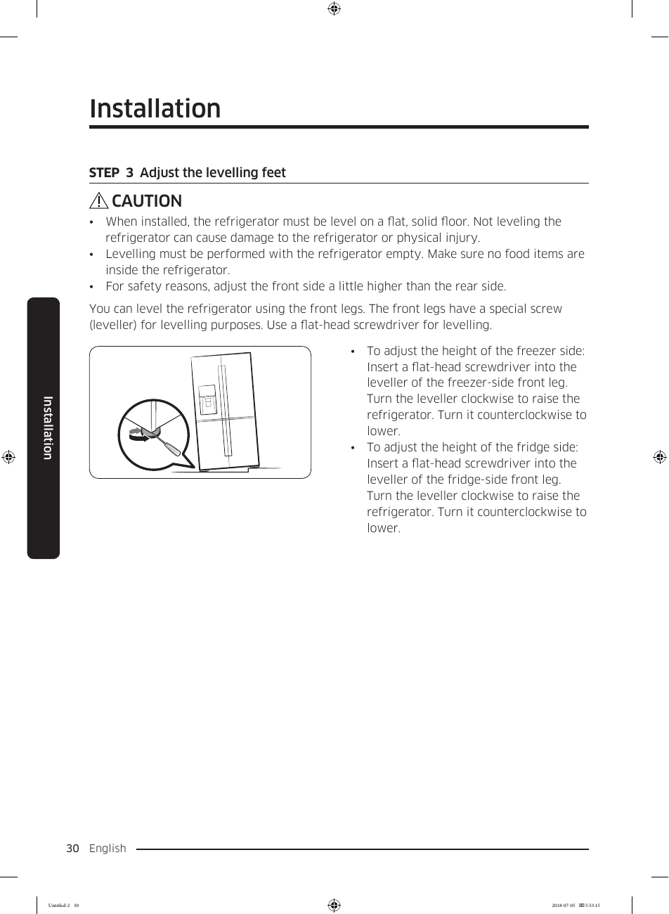

This page provides visual instructions for adjusting the levelling feet of the Samsung RF28K9070SG refrigerator. The diagram illustrates the use of a flat-head screwdriver to turn the leveller, with specific instructions to turn clockwise to raise and counterclockwise to lower the refrigerator. A caution note emphasizes the importance of proper leveling to avoid damage or injury.

<!-- llm-wiki:embedded-images -->
## Embedded Images

### Document

![The image depicts a diagram related to the installation of a refrigerator, specifically focusing on adjusting the leveling feet. It includes a visual representation of a flat-head screwdriver being used on the leveller of the front leg of the refrigerator. The accompanying text provides instructions for adjusting the height of both the freezer side and the fridge side, indicating to turn the leveller clockwise to raise and counterclockwise to lower the refrigerator. The section is labeled "STEP 3 Adjust the levelling feet" and includes a caution note regarding proper leveling to avoid damage or injury.](../media/13-fridge-docsmd--18-samsungrf28k9070sg--6-assets--10-user-guide--7-page030--1skzkcz/001-page_030.png)
<!-- llm-wiki:embedded-images -->
