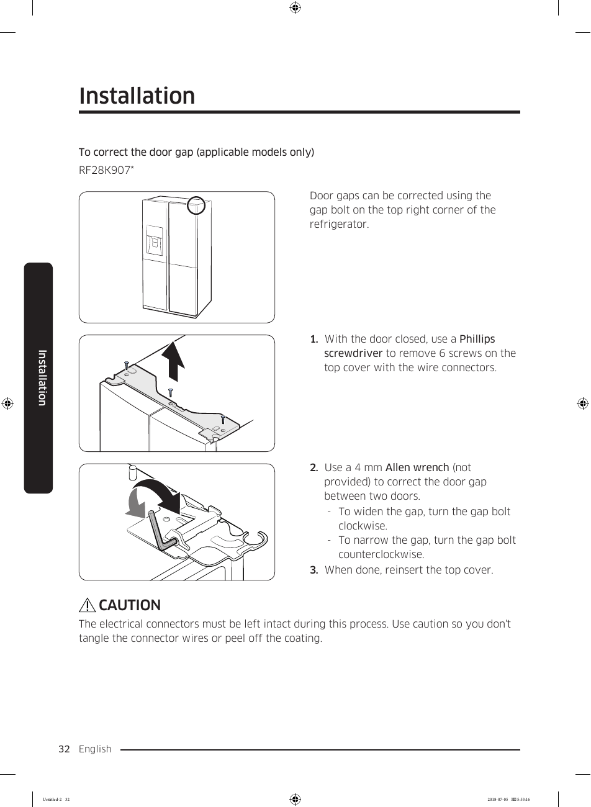

# Samsung RF28K9070SG User Manual - Page 032

This page provides installation instructions for correcting the door gap on the Samsung RF28K9070SG refrigerator. The instructions include a diagram and a step-by-step process to ensure proper sealing and functionality of the refrigerator doors.

## Instructions for Door Gap Adjustment

1. Remove six screws from the top cover using a Phillips screwdriver.
2. Adjust the gap using a 4 mm Allen wrench by turning the bolt clockwise to widen or counterclockwise to narrow the gap.
3. Reinsert the top cover.

**Caution**: Ensure that electrical connectors remain intact during the adjustment process.

<!-- llm-wiki:embedded-images -->
## Embedded Images

### Document

![The image depicts installation instructions for correcting the door gap on a refrigerator model RF28K907. It includes a diagram of the refrigerator with an arrow pointing to the gap bolt located at the top right corner. The instructions are numbered and detail the following steps: 1) Use a Phillips screwdriver to remove six screws from the top cover, 2) Use a 4 mm Allen wrench to adjust the gap by turning the bolt clockwise to widen or counterclockwise to narrow the gap, and 3) Reinsert the top cover. A caution note emphasizes the importance of keeping electrical connectors intact during the process.](../media/13-fridge-docsmd--18-samsungrf28k9070sg--6-assets--10-user-guide--7-page032--guef89/001-page_032.png)
<!-- llm-wiki:embedded-images -->
