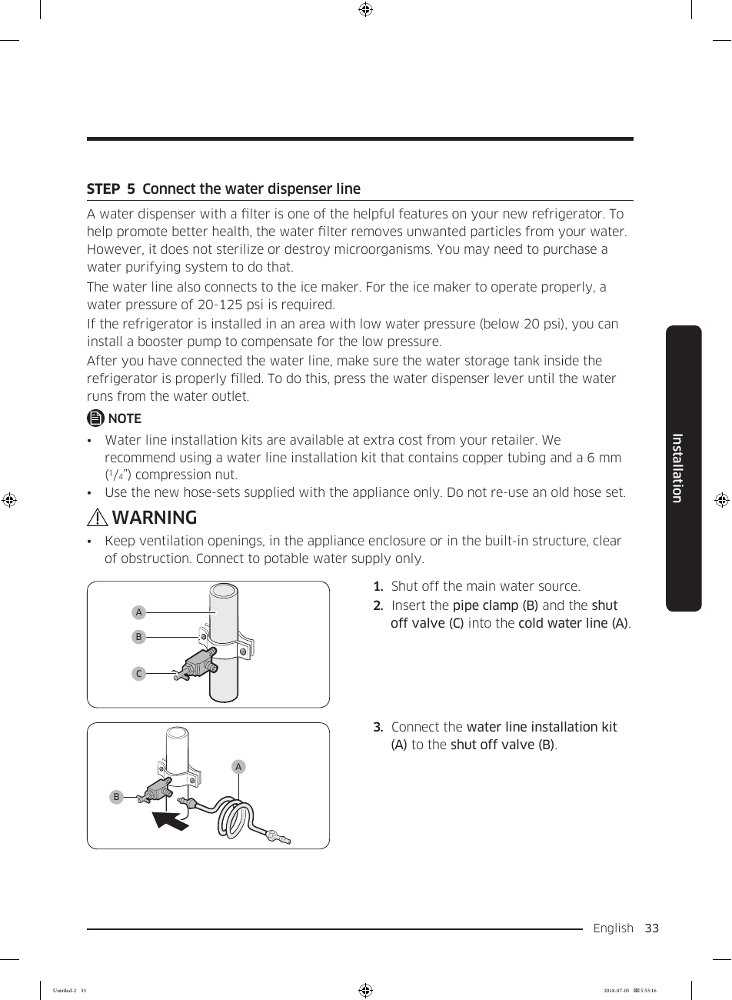

The document provides a diagram for installing the water dispenser line for the Samsung RF28K9070SG refrigerator. It includes labeled components such as the cold water line, pipe clamp, and shut-off valve, and outlines three installation steps:

1. Shut off the main water source.
2. Insert the pipe clamp and shut-off valve into the cold water line.
3. Connect the water line installation kit to the shut-off valve.

Additional notes and warnings regarding water pressure and installation kit recommendations are included. This source strengthens existing knowledge by providing specific installation instructions for the RF28K9070SG model.

<!-- llm-wiki:embedded-images -->
## Embedded Images

### Document

![The image appears to be a diagram illustrating the connection of a water dispenser line for a refrigerator. It includes labeled components: "A" for the cold water line, "B" for the pipe clamp, and "C" for the shut-off valve. The diagram outlines three steps for installation: shutting off the main water source, inserting the pipe clamp and shut-off valve into the cold water line, and connecting the water line installation kit to the shut-off valve. Additionally, there are notes and warnings regarding water pressure and installation kit recommendations.](../media/13-fridge-docsmd--18-samsungrf28k9070sg--6-assets--10-user-guide--7-page033--hm9t3a/001-page_033.png)
<!-- llm-wiki:embedded-images -->
