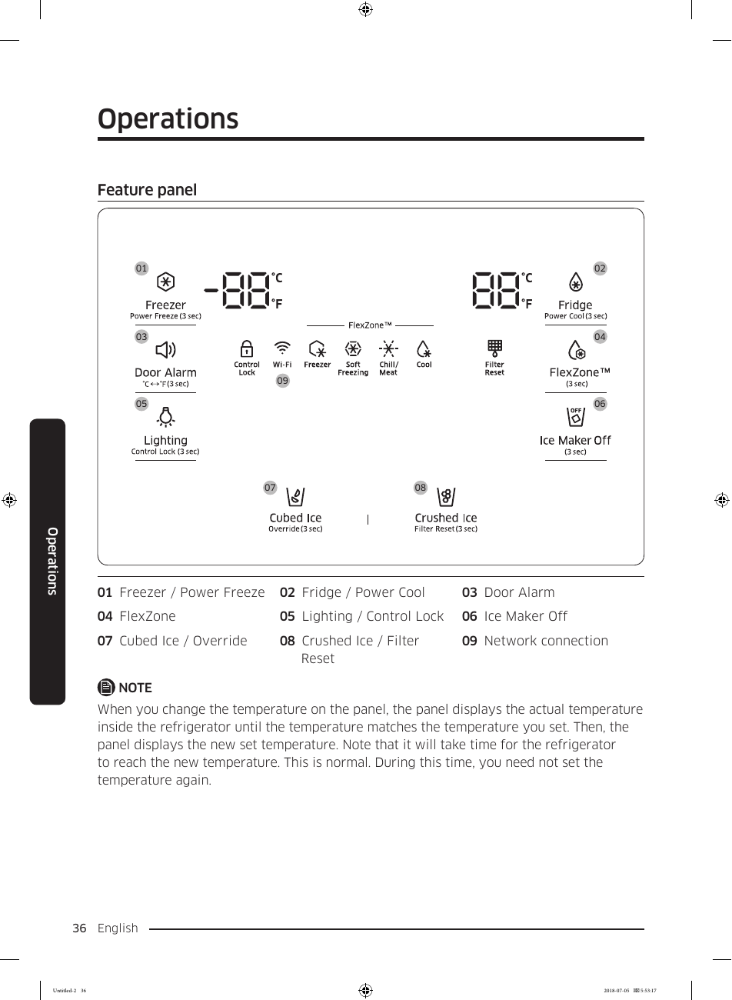

# Samsung RF28K9070SG User Manual - Page 036
This page of the user manual for the Samsung RF28K9070SG refrigerator features the operations panel, which includes various controls and indicators for settings such as temperature for the freezer and fridge, door alarm, lighting, and ice options. The image illustrates key features labeled from 01 to 09, including "Freezer / Power Freeze," "Fridge / Power Cool," "Cubed Ice / Override," and "Crushed Ice / Filter Reset." A note at the bottom explains that changing the temperature on the panel will display the actual temperature until it matches the set temperature.

<!-- llm-wiki:embedded-images -->
## Embedded Images

### Document

![The image displays a feature panel for a refrigerator, labeled "Operations." It includes various controls and indicators for settings such as temperature for the freezer (-80°C) and fridge (80°F), door alarm, lighting, and ice options. Key features are numbered from 01 to 09, with descriptions including "Freezer / Power Freeze," "Fridge / Power Cool," "Cubed Ice / Override," and "Crushed Ice / Filter Reset." A note at the bottom explains that changing the temperature on the panel will display the actual temperature until it matches the set temperature.](../media/13-fridge-docsmd--18-samsungrf28k9070sg--6-assets--10-user-guide--7-page036--1riywkl/001-page_036.png)
<!-- llm-wiki:embedded-images -->
