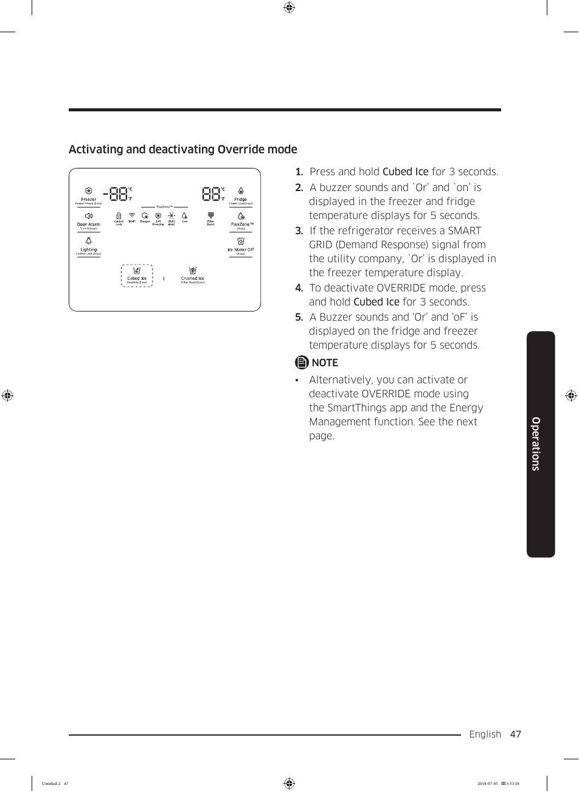

# Samsung RF28K9070SG User Manual - Page 047
This page of the user manual for the Samsung RF28K9070SG refrigerator details the control panel features, including temperature settings for the freezer and fridge, which are set to -8°F and 89°F, respectively. It also includes buttons for "Cubed Ice," "Crushed Ice," "Ice Maker Off," and various indicators such as "Open Alarm" and "Lighting." 

Instructions for activating and deactivating the Override mode are provided, detailing steps such as pressing and holding the "Cubed Ice" button for 3 seconds, with accompanying notes about buzzer sounds and display changes. The option to use the SmartThings app for managing Override mode is also mentioned.

<!-- llm-wiki:embedded-images -->
## Embedded Images

### Document

![The image displays a control panel for a refrigerator, showing temperature settings for the freezer and fridge, which are set to -8°F and 89°F, respectively. It includes buttons for "Cubed Ice," "Crushed Ice," "Ice Maker Off," and various indicators such as "Open Alarm" and "Lighting." The instructions for activating and deactivating Override mode are listed, detailing steps such as pressing and holding the "Cubed Ice" button for 3 seconds, with accompanying notes about buzzer sounds and display changes. The text also mentions the option to use the SmartThings app for managing Override mode.](../media/13-fridge-docsmd--18-samsungrf28k9070sg--6-assets--10-user-guide--7-page047--1qnpdjh/001-page_047.png)
<!-- llm-wiki:embedded-images -->
