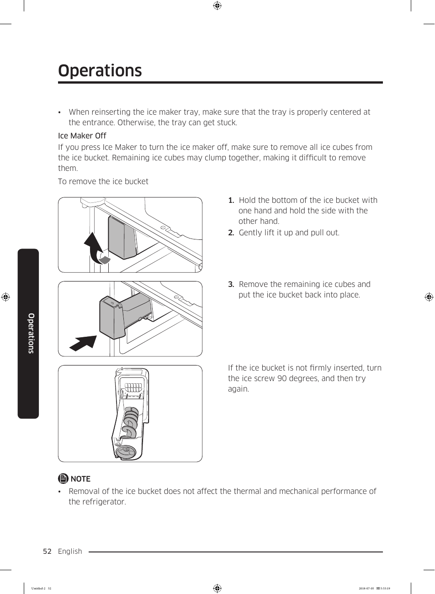

# Samsung RF28K9070SG User Manual - Page 052

This page provides instructions for removing the ice bucket from the Samsung RF28K9070SG refrigerator's ice maker. The process is outlined in three clear steps:

1. Hold the bottom of the ice bucket with one hand and hold the side with the other hand.
2. Gently lift it up and pull out.
3. Remove the remaining ice cubes and put the ice bucket back into place.

Visual elements in the instructions include arrows indicating the direction of movement for the ice bucket. A note states that the removal of the ice bucket does not affect the thermal and mechanical performance of the refrigerator.

<!-- llm-wiki:embedded-images -->
## Embedded Images

### Document

![The image depicts a set of instructions for removing an ice bucket from a refrigerator's ice maker. It includes three numbered steps:  1. "Hold the bottom of the ice bucket with one hand and hold the side with the other hand." 2. "Gently lift it up and pull out." 3. "Remove the remaining ice cubes and put the ice bucket back into place." There are also visual elements showing arrows indicating the direction of movement for the ice bucket. A note states, "Removal of the ice bucket does not affect the thermal and mechanical performance of the refrigerator." The section is titled "Operations" and is part of a larger document.](../media/13-fridge-docsmd--18-samsungrf28k9070sg--6-assets--10-user-guide--7-page052--nbb90r/001-page_052.png)
<!-- llm-wiki:embedded-images -->
