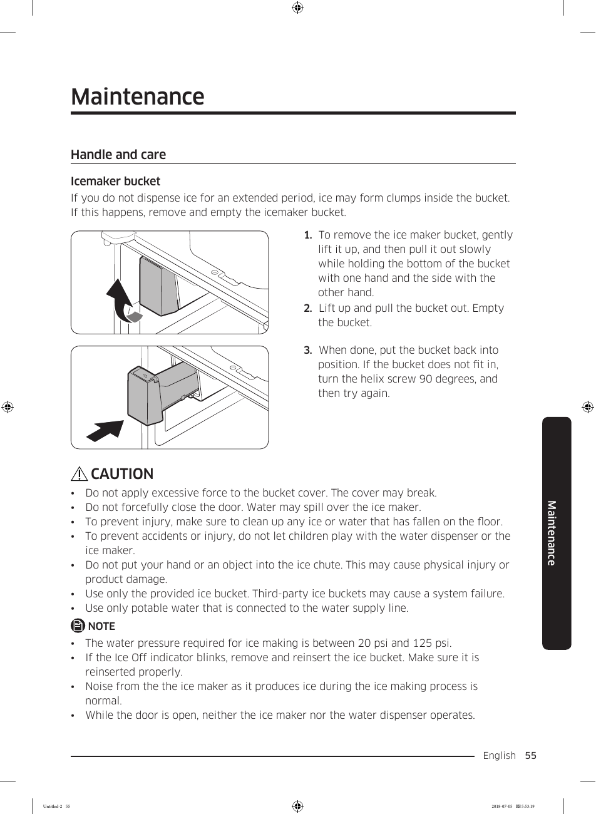

# Samsung RF28K9070SG User Manual - Page 055
This page provides visual instructions for handling the icemaker bucket of the Samsung RF28K9070SG refrigerator. It includes a step-by-step illustration with three numbered steps:

1. Gently lift and pull the bucket out.
2. Empty the bucket.
3. Reposition the bucket and adjust the helix screw if necessary.

Cautionary notes are included to prevent injury or damage during the process.

<!-- llm-wiki:embedded-images -->
## Embedded Images

### Document

![The image depicts instructions for handling and caring for an icemaker bucket. It includes three numbered steps for removing and emptying the bucket, with accompanying illustrations. The first step advises gently lifting and pulling the bucket out, while the second step instructs to empty it. The third step mentions repositioning the bucket and adjusting the helix screw if necessary. Additionally, there are cautionary notes regarding the proper handling of the bucket and safety precautions to prevent injury or damage.](../media/13-fridge-docsmd--18-samsungrf28k9070sg--6-assets--10-user-guide--7-page055--mceuay/001-page_055.png)
<!-- llm-wiki:embedded-images -->
