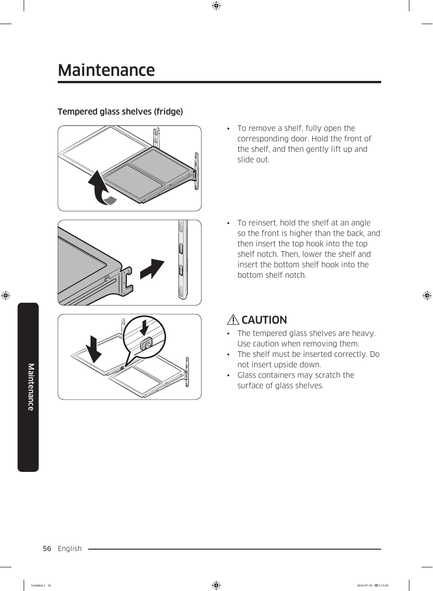

# Samsung RF28K9070SG User Manual - Page 056
This page provides visual instructions for handling tempered glass shelves in the Samsung RF28K9070SG refrigerator. It includes illustrations for both removing and reinstalling the shelves, along with important safety warnings regarding their weight and proper handling.

---

<!-- llm-wiki:embedded-images -->
## Embedded Images

### Document

![The image depicts instructions for handling tempered glass shelves in a refrigerator. It includes two illustrations: the first shows the removal of a shelf by lifting it up and sliding it out, while the second illustrates the reinstallation process, where the shelf is held at an angle to insert the hooks into the notches. A caution section highlights that the tempered glass shelves are heavy, advises caution during removal, and warns against inserting the shelf upside down or using glass containers that may scratch the surface.](../media/13-fridge-docsmd--18-samsungrf28k9070sg--6-assets--10-user-guide--7-page056--1posf6f/001-page_056.png)
<!-- llm-wiki:embedded-images -->
