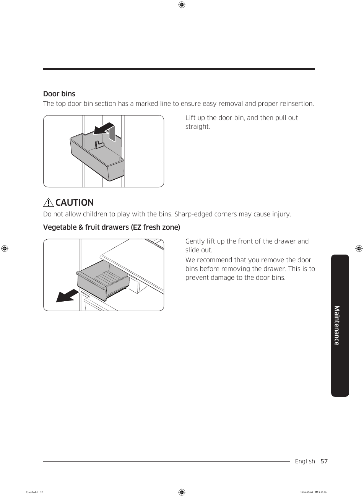

# Samsung RF28K9070SG User Manual - Page 057
This page provides visual instructions for removing door bins and vegetable & fruit drawers from the Samsung RF28K9070SG refrigerator. The instructions emphasize the correct method for removal to prevent damage to the refrigerator components. A cautionary note highlights safety concerns regarding children and sharp edges, reinforcing the importance of careful handling.

## Key Instructions
- **Door Bins**: Lift up the door bin, and then pull out straight.
- **Vegetable & Fruit Drawers**: Gently lift up the front of the drawer and slide out.

**Caution**: Do not allow children to play with the bins. Sharp-edged corners may cause injury. It is important to remove door bins before taking out the drawer to prevent damage.

<!-- llm-wiki:embedded-images -->
## Embedded Images

### Document

![The image depicts instructions for removing door bins and vegetable & fruit drawers from a refrigerator. It includes two illustrations: one showing a door bin with an arrow indicating to "Lift up the door bin, and then pull out straight," and another for the vegetable & fruit drawer with an arrow indicating to "Gently lift up the front of the drawer and slide out." A caution note warns, "Do not allow children to play with the bins. Sharp-edged corners may cause injury." The text emphasizes the importance of removing door bins before taking out the drawer to prevent damage.](../media/13-fridge-docsmd--18-samsungrf28k9070sg--6-assets--10-user-guide--7-page057--1yon684/001-page_057.png)
<!-- llm-wiki:embedded-images -->
