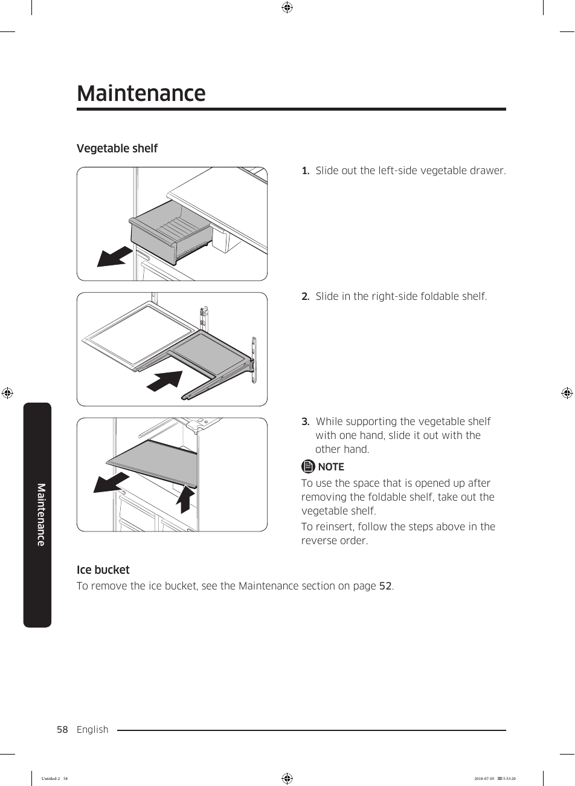

# Samsung RF28K9070SG User Manual - Page 058
This page provides maintenance instructions for the vegetable shelf and ice bucket of the Samsung RF28K9070SG refrigerator. The image outlines three clear steps for handling the vegetable shelf:

1. Slide out the left-side vegetable drawer.
2. Slide in the right-side foldable shelf.
3. While supporting the vegetable shelf with one hand, slide it out with the other hand.

These instructions are essential for users to properly manage the vegetable shelf, ensuring optimal use of space and functionality.

<!-- llm-wiki:embedded-images -->
## Embedded Images

### Document

![The image depicts a maintenance guide for a vegetable shelf and an ice bucket. It includes three steps for handling the vegetable shelf: "1. Slide out the left-side vegetable drawer," "2. Slide in the right-side foldable shelf," and "3. While supporting the vegetable shelf with one hand, slide it out with the other hand." There is a note indicating that to use the space opened up after removing the foldable shelf, the vegetable shelf should be taken out, and instructions for reinserting are provided.](../media/13-fridge-docsmd--18-samsungrf28k9070sg--6-assets--10-user-guide--7-page058--1dd7mih/001-page_058.png)
<!-- llm-wiki:embedded-images -->
