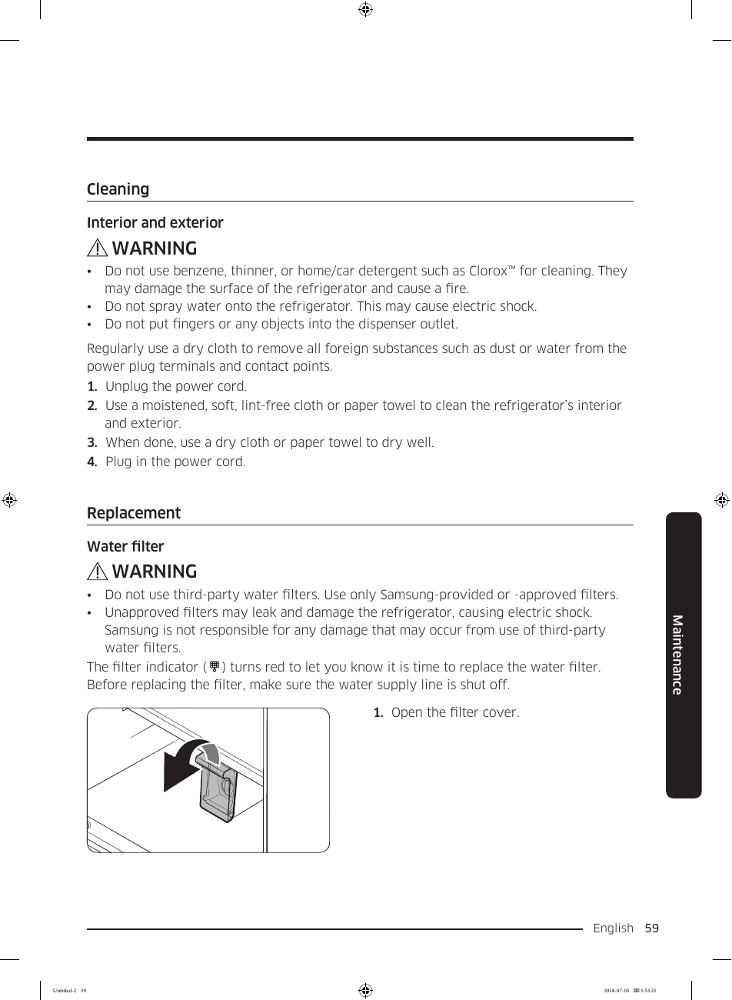

This page provides a visual guide for the water filter replacement process in the Samsung RF28K9070SG refrigerator. It emphasizes the importance of using only Samsung-provided or approved filters to ensure safety and performance. The diagram illustrates the steps involved, making it user-friendly for consumers.

<!-- llm-wiki:embedded-images -->
## Embedded Images

### Document

<!-- llm-wiki:embedded-images -->
