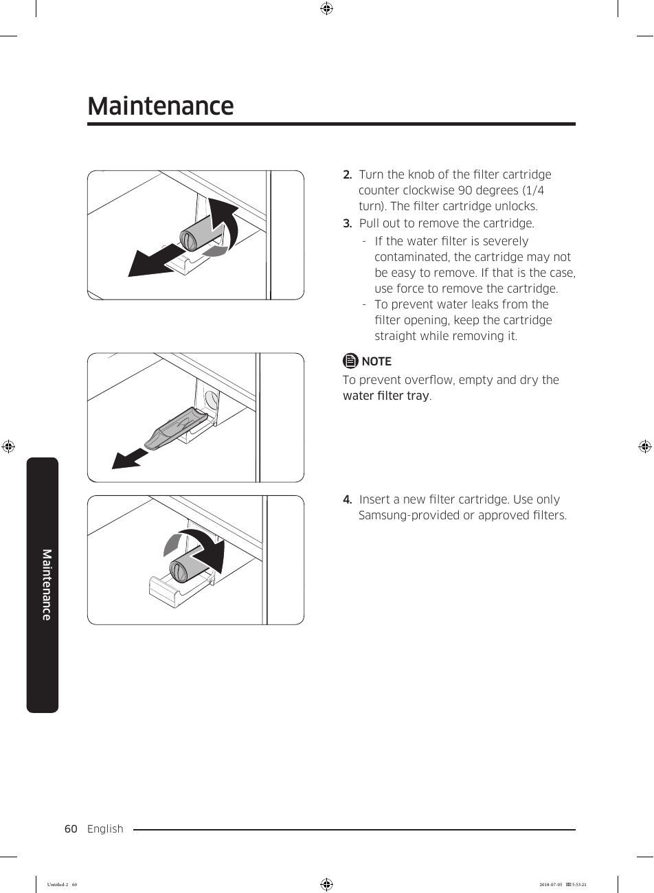

The document provides a maintenance guide for replacing the water filter cartridge in the Samsung RF28K9070SG refrigerator. It includes a step-by-step process with illustrations, detailing how to unlock, remove, and replace the filter cartridge. The guide emphasizes the importance of using only Samsung-approved filters and provides tips for handling contaminated filters to prevent leaks. 

<!-- llm-wiki:embedded-images -->
## Embedded Images

### Document

![The image depicts a maintenance guide for replacing a water filter cartridge. It includes four numbered steps with corresponding illustrations. Step 2 instructs to turn the knob of the filter cartridge counterclockwise 90 degrees to unlock it. Step 3 shows pulling out the cartridge, with notes on handling a severely contaminated filter and preventing leaks. Step 4 advises inserting a new filter cartridge, specifying to use only Samsung-provided or approved filters. The text also includes a note about emptying and drying the water filter tray to prevent overflow.](../media/13-fridge-docsmd--18-samsungrf28k9070sg--6-assets--10-user-guide--7-page060--1339rom/001-page_060.png)
<!-- llm-wiki:embedded-images -->
