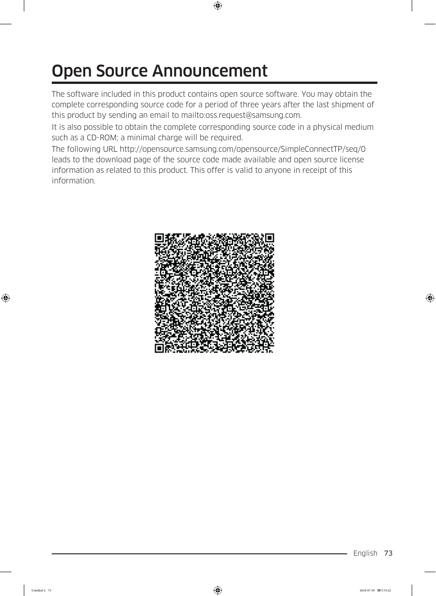

# Samsung RF28K9070SG User Manual - Page 073
This page contains an announcement regarding the inclusion of open-source software in the Samsung RF28K9070SG refrigerator. Users can obtain the complete corresponding source code for three years after the last shipment by contacting Samsung via email at oss.request@samsung.com or visiting the URL [http://opensource.samsung.com/opensource/SimpleConnectTP/seq/0](http://opensource.samsung.com/opensource/SimpleConnectTP/seq/0). A QR code is also present, likely linking to the same information.

<!-- llm-wiki:embedded-images -->
## Embedded Images

### Document

![The image displays an "Open Source Announcement" with visible text stating that the software included in the product contains open source software. It provides instructions on obtaining the complete corresponding source code for three years after the last shipment by emailing oss.request@samsung.com. Additionally, it includes a URL: http://opensource.samsung.com/opensource/SimpleConnectTP/seq/0, which leads to the download page of the source code. A QR code is also present, likely linking to the same information.](../media/13-fridge-docsmd--18-samsungrf28k9070sg--6-assets--10-user-guide--7-page073--io1s6a/001-page_073.png)
<!-- llm-wiki:embedded-images -->
