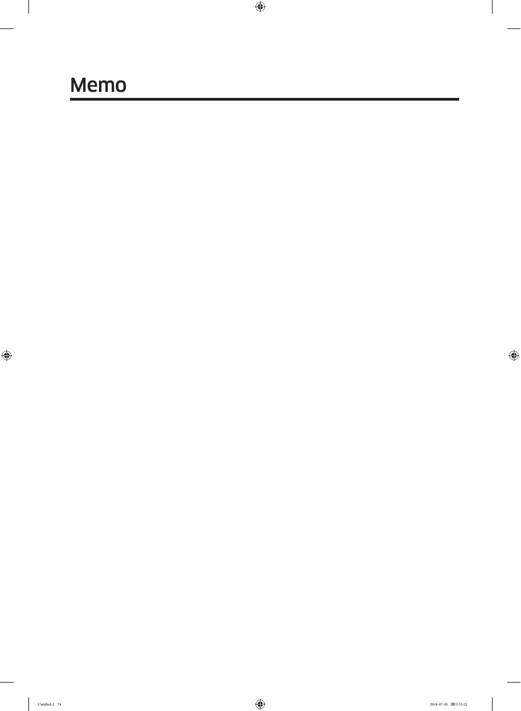

# Samsung RF28K9070SG User Manual - Page 074
This page contains a blank section labeled "Memo," which serves as a placeholder for users to write notes. There are no additional instructions or content provided on this page, indicating it does not contribute directly to the operational understanding of the Samsung RF28K9070SG refrigerator.

<!-- llm-wiki:embedded-images -->
## Embedded Images

### Document

<!-- llm-wiki:embedded-images -->
