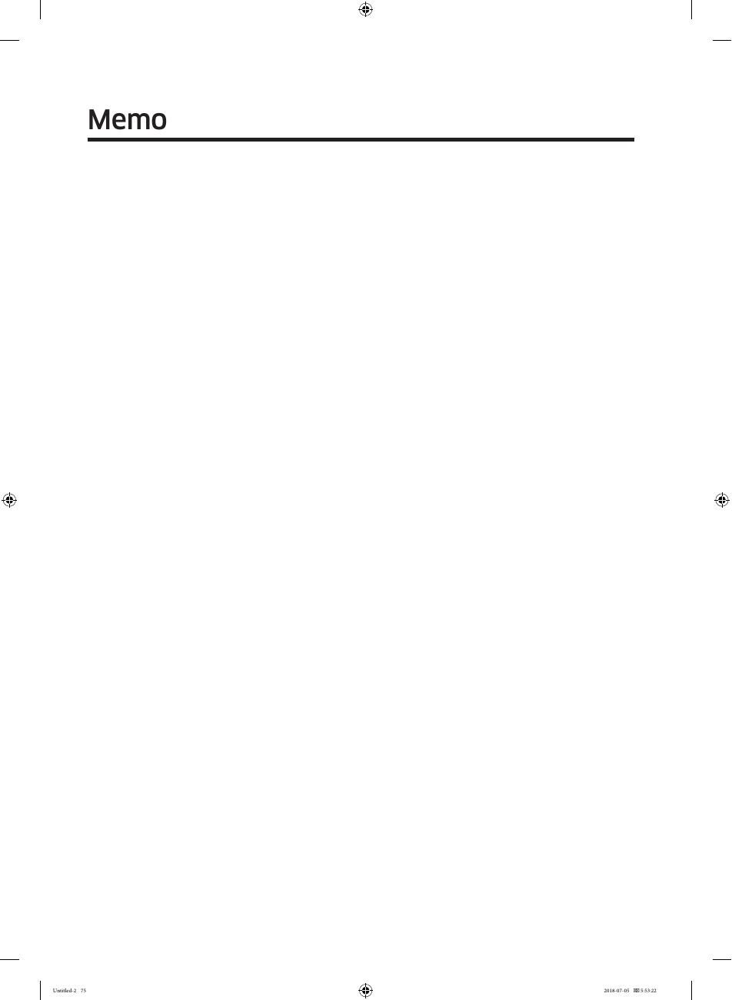

The image on this page is a blank section labeled "Memo," intended for users to write notes or reminders. It does not contain any additional text or instructions, serving a simple purpose within the user guide for the Samsung RF28K9070SG refrigerator. This page emphasizes the importance of user guides in providing comprehensive support for product usage, although it does not add substantive content regarding the refrigerator's features.

<!-- llm-wiki:embedded-images -->
## Embedded Images

### Document

<!-- llm-wiki:embedded-images -->
