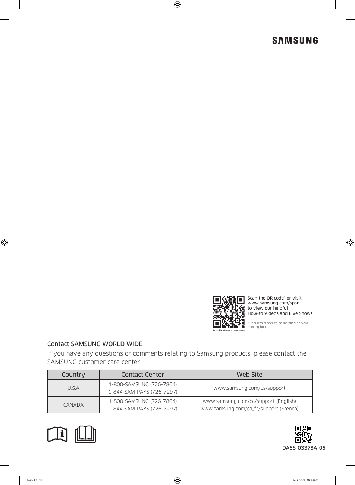

# Samsung RF28K9070SG User Manual - Page 076

This page provides essential contact information for Samsung customer support, including phone numbers and websites for users in the U.S.A and Canada. 

## Contact Information
- **U.S.A:** 1-800-SAMSUNG (726-7864)
- **Canada:** 1-844-SAM-PAYS (726-7297)

## Support Websites
- **U.S.A:** [www.samsung.com/us/support](http://www.samsung.com/us/support)
- **Canada (English):** [www.samsung.com/ca/support](http://www.samsung.com/ca/support)
- **Canada (French):** [www.samsung.com/ca_fr/support](http://www.samsung.com/ca_fr/support)

A QR code is also provided, directing users to Samsung's support resources.

<!-- llm-wiki:embedded-images -->
## Embedded Images

### Document

![The image contains contact information for Samsung customer support. It includes the heading "Contact SAMSUNG WORLD WIDE" and provides phone numbers for the U.S.A and Canada: "1-800-SAMSUNG (726-7864)" and "1-844-SAM-PAYS (726-7297)" for both countries. Additionally, it lists corresponding websites for support: "www.samsung.com/us/support" for the U.S.A and "www.samsung.com/ca/support (English)" and "www.samsung.com/ca_fr/support (French)" for Canada. A QR code is also present, directing users to Samsung's support resources.](../media/13-fridge-docsmd--18-samsungrf28k9070sg--6-assets--10-user-guide--7-page076--1d90urt/001-page_076.png)
<!-- llm-wiki:embedded-images -->
