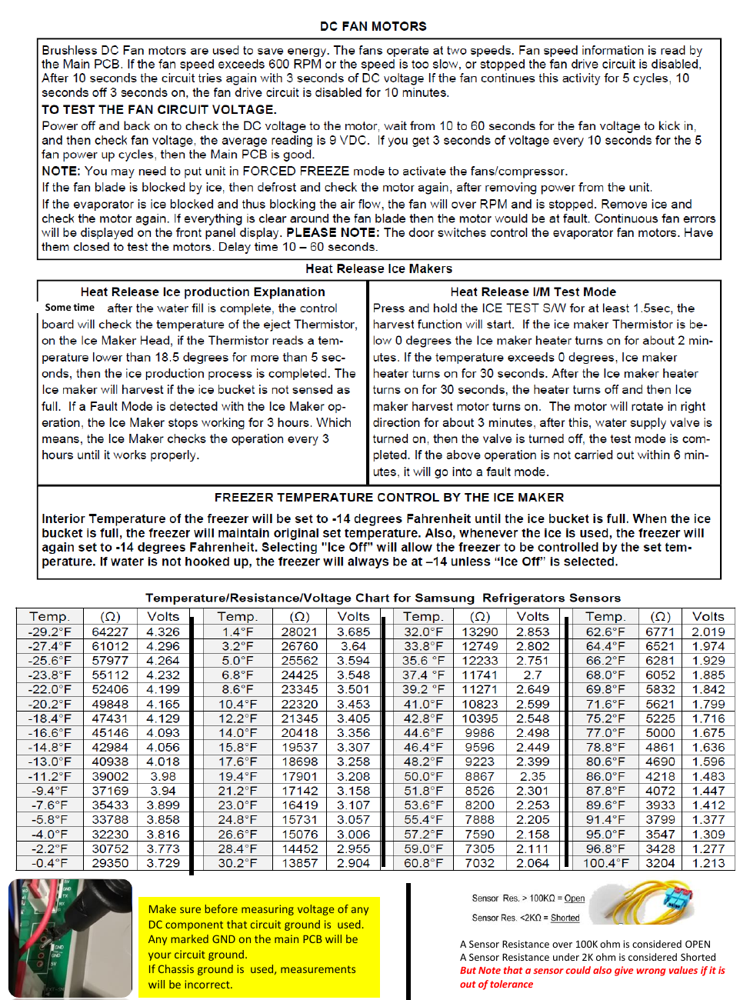

# Samsung RF28K9070SG Repair Guide - Page 002
This page contains detailed technical information regarding the Samsung RF28K9070SG refrigerator, focusing on the DC fan motors, ice maker operation, and a temperature/resistance/voltage chart for diagnostic purposes.

## Key Sections
- **Testing Fan Circuit Voltage**: Instructions for measuring voltage in the fan circuit to ensure proper operation.
- **Ice Maker Operation**: Overview of how the ice maker functions and its operational parameters.
- **Temperature/Resistance/Voltage Chart**: A chart correlating temperature values with resistance and voltage readings for refrigerator sensors, crucial for diagnosing issues.

The chart lists temperature values from -29.2°F to 60.8°F with corresponding resistance and voltage readings, providing essential data for troubleshooting sensor-related issues.

<!-- llm-wiki:embedded-images -->
## Embedded Images

### Document

![The image contains a detailed technical document about DC fan motors and heat release ice makers. It includes instructions for testing fan circuit voltage, operational notes for ice makers, and a temperature/resistance/voltage chart for Samsung refrigerator sensors. Key sections include a note on measuring voltage, a description of the ice maker's operation, and a table listing various temperatures with corresponding resistance (Ω) and voltage (Volts) values. The chart features temperature values ranging from -29.2°F to 60.8°F, with associated resistance and voltage readings for each temperature.](../media/13-fridge-docsmd--18-samsungrf28k9070sg--6-assets--12-repair-guide--7-page002--frasio/001-page_002.png)
<!-- llm-wiki:embedded-images -->
