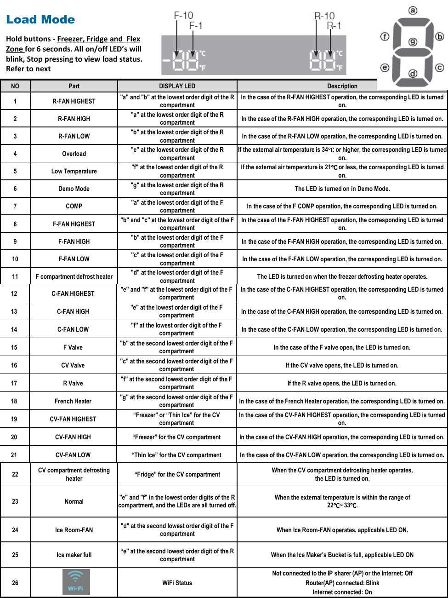

# Samsung RF28K9070SG Repair Guide - Page 003
This page contains a detailed chart titled "Load Mode," which outlines various operational statuses of the Samsung RF28K9070SG refrigerator and their corresponding display indicators. The chart includes 26 entries that describe different parts of the refrigerator and their associated LED display indicators, essential for diagnosing issues. Each entry specifies a part (e.g., R-FAN HIGHEST, Overload, Demo Mode) and describes the LED behavior under specific conditions. Additionally, the chart features a section for WiFi status, indicating connectivity details relevant for modern refrigerators.

<!-- llm-wiki:embedded-images -->
## Embedded Images

### Document

![The image appears to be a detailed chart titled "Load Mode," which outlines various operational statuses and corresponding display indicators for a refrigeration unit. It includes a table with numbered entries (1 to 26) that describe different parts and their associated display LED indicators. Each entry specifies the part (e.g., R-FAN HIGHEST, Overload, Demo Mode) and provides a description of the LED's behavior under specific conditions. The chart also features a section for WiFi status at the bottom, indicating connectivity details.](../media/13-fridge-docsmd--18-samsungrf28k9070sg--6-assets--12-repair-guide--7-page003--7z4itv/001-page_003.png)
<!-- llm-wiki:embedded-images -->
