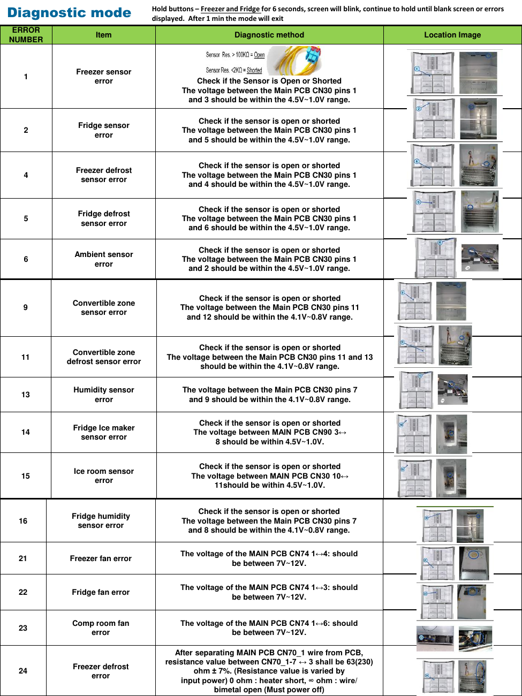

The document provides diagnostic information for the Samsung RF28K9070SG refrigerator, focusing on error codes and troubleshooting methods. It includes a table detailing various error codes, the items affected, and diagnostic procedures involving voltage checks. This information is crucial for effective repairs and understanding the refrigerator's operational issues.

---

<!-- llm-wiki:embedded-images -->
## Embedded Images

### Document

![The image titled "Diagnostic mode" presents a table detailing various error codes related to a refrigeration unit. Each row lists an error number, the corresponding item (e.g., "Freezer sensor error"), and a diagnostic method that includes voltage checks between specific pins on the Main PCB CN30. The table also includes location images for each error, showing the physical components associated with the diagnostics. The visible text includes instructions for checking sensor status and voltage ranges, such as "The voltage between the Main PCB CN30 pins 1 and 3 should be within the 4.5V-1.0V range."](../media/13-fridge-docsmd--18-samsungrf28k9070sg--6-assets--12-repair-guide--7-page004--7s36wi/001-page_004.png)
<!-- llm-wiki:embedded-images -->
