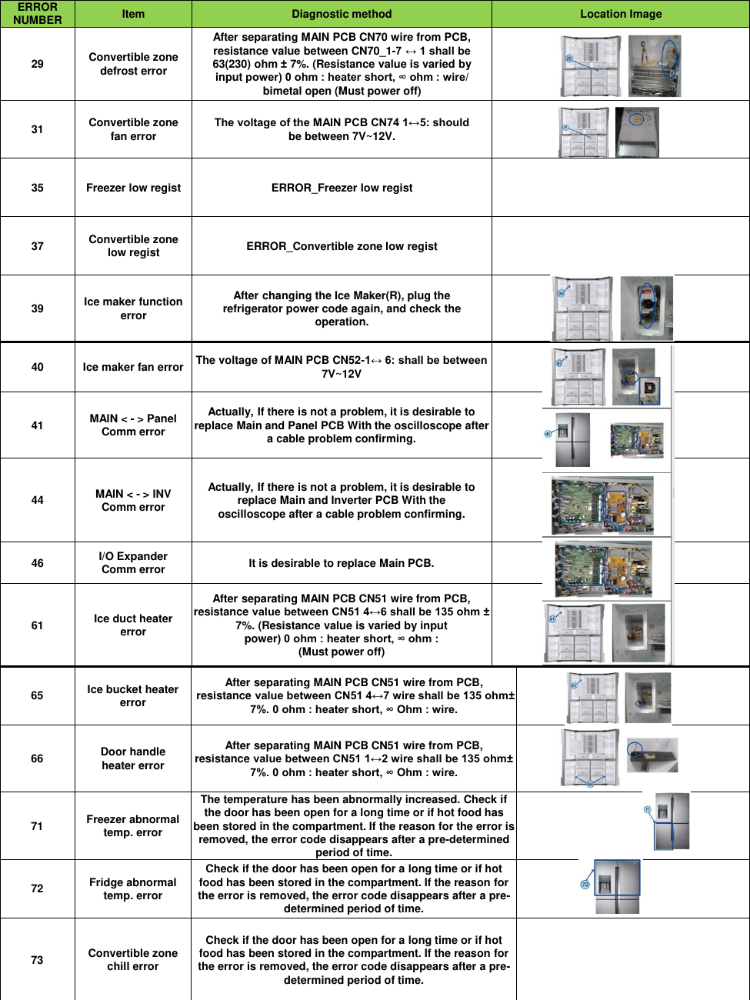

This page provides diagnostic information for the Samsung RF28K9070SG refrigerator, including a table of error codes, diagnostic methods, resistance values, and voltage specifications for various components. The information is crucial for troubleshooting and repairing the appliance effectively.

---

<!-- llm-wiki:embedded-images -->
## Embedded Images

### Document

![The image contains a table listing various error codes related to appliance diagnostics. Each row includes an "ERROR NUMBER," "Item," "Diagnostic method," and "Location Image." Specific entries mention resistance values for different components, such as "resistance value between CN70 1-7 shall be 63(230) ohm ± 7%" for the "Convertible zone defrost error." Other entries detail checks for components like the ice maker and fan errors, with voltage specifications noted, such as "should be between 7V-12V." The table appears to serve as a troubleshooting guide for appliance repair.](../media/13-fridge-docsmd--18-samsungrf28k9070sg--6-assets--12-repair-guide--7-page005--6x3v1h/001-page_005.png)
<!-- llm-wiki:embedded-images -->
