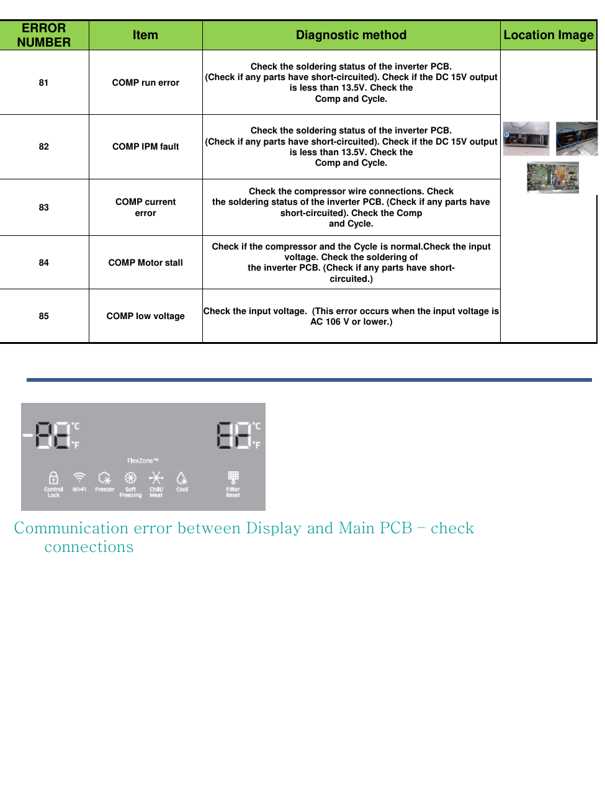

This page provides diagnostic information for the Samsung RF28K9070SG refrigerator, focusing on error codes related to the compressor system. It includes a table detailing error codes 81 to 85, diagnostic methods for each code, and indications of communication errors between the display and the main PCB.

---

<!-- llm-wiki:embedded-images -->
## Embedded Images

### Document

![The image contains a table detailing error codes related to a compressor system, with five entries labeled from 81 to 85. Each entry includes an "Item," "Diagnostic method," and a "Location Image." The diagnostic methods suggest checks for soldering status, wire connections, and input voltage. Below the table, there is a display showing temperatures of -10°C and 81°F, along with icons for various functions such as Control Lock, Wi-Fi, Freezer, Soft Freezing, Chill/Meat, Cool, and Filter Reset. The text below the display indicates a "Communication error between Display and Main PCB – check connections."](../media/13-fridge-docsmd--18-samsungrf28k9070sg--6-assets--12-repair-guide--7-page006--k1uj2k/001-page_006.png)
<!-- llm-wiki:embedded-images -->
