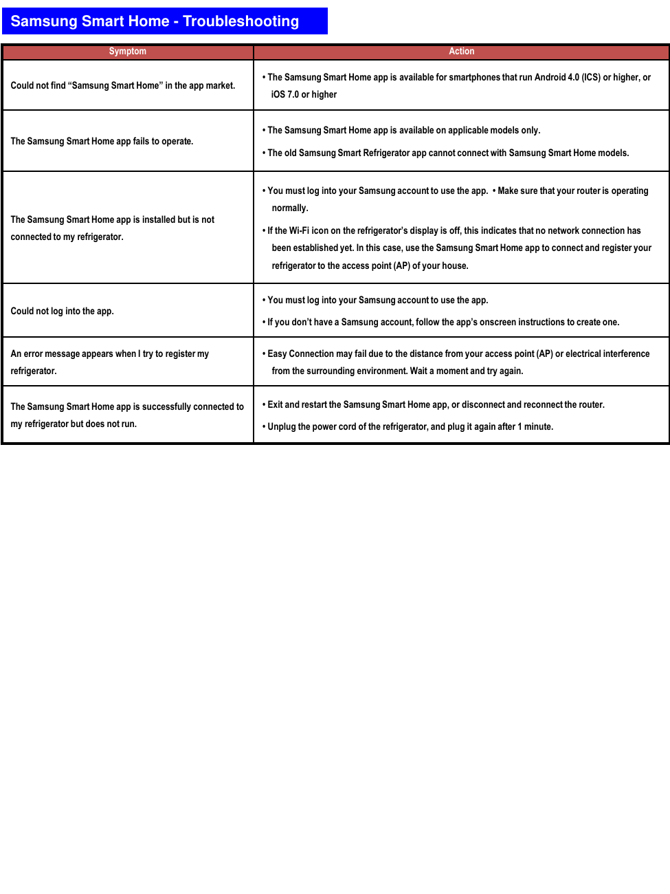

# Samsung RF28K9070SG Repair Guide - Page 008
This page provides troubleshooting information related to the Samsung Smart Home app and its interaction with the Samsung RF28K9070SG refrigerator. It includes a table listing symptoms and corresponding actions to resolve issues.

## Troubleshooting Steps
- **Symptom:** Could not find 'Samsung Smart Home' in the app market  
  **Action:** The Samsung Smart Home app is available for smartphones that run Android 4.0 (ICS) or higher, or iOS 7.0 or higher.

Additional symptoms and actions are detailed in the source image.

<!-- llm-wiki:embedded-images -->
## Embedded Images

### Document

![The image titled "Samsung Smart Home - Troubleshooting" contains a table with two columns: "Symptom" and "Action." Each row lists a specific issue related to the Samsung Smart Home app, such as "Could not find 'Samsung Smart Home' in the app market" and corresponding troubleshooting actions. For example, under the symptom "Could not find 'Samsung Smart Home' in the app market," the action states, "The Samsung Smart Home app is available for smartphones that run Android 4.0 (ICS) or higher, or iOS 7.0 or higher." The table provides various troubleshooting steps for different issues related to the app and refrigerator connectivity.](../media/13-fridge-docsmd--18-samsungrf28k9070sg--6-assets--12-repair-guide--7-page008--1sxy9jy/001-page_008.png)
<!-- llm-wiki:embedded-images -->
