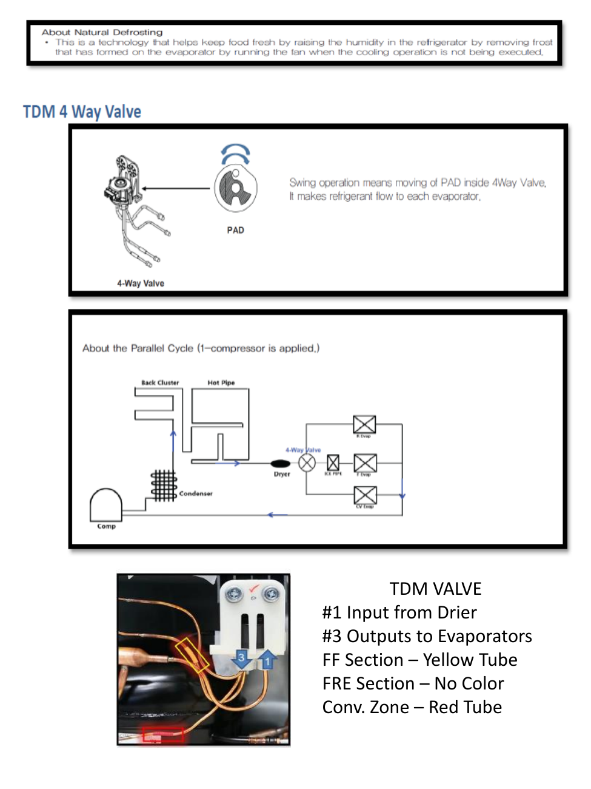

# Samsung RF28K9070SG Repair Guide - Page 010
This page provides detailed information about the TDM 4 Way Valve, including its operation and significance within the Samsung RF28K9070SG refrigerator's cooling system. The accompanying diagram illustrates the valve's components and refrigerant flow, essential for troubleshooting and repairs.

## Key Components
- **TDM 4 Way Valve**: A crucial component that regulates refrigerant flow, allowing for both heating and cooling cycles in the refrigerator.

## Operation Overview
The diagram shows the swing operation of the valve and the movement of the PAD inside it. It also includes a schematic of the parallel cycle with labeled components such as the condenser and dryer, along with arrows indicating refrigerant flow.

---

<!-- llm-wiki:embedded-images -->
## Embedded Images

### Document

![The image titled "TDM 4 Way Valve" includes a diagram and an explanation of the 4-way valve's operation. The top section features a labeled illustration of the valve with arrows indicating the swing operation and the movement of the PAD inside the valve. Below, a schematic shows the parallel cycle with components labeled, including the condenser and dryer, and arrows indicating refrigerant flow. The bottom section displays a photo of the TDM valve with labels indicating input and output connections, specifically "#1 Input from Drier" and "#3 Outputs to Evaporators," along with color-coded sections for the FF, FRE, and Conv. Zone.](../media/13-fridge-docsmd--18-samsungrf28k9070sg--6-assets--12-repair-guide--7-page010--nphh2n/001-page_010.png)
<!-- llm-wiki:embedded-images -->
