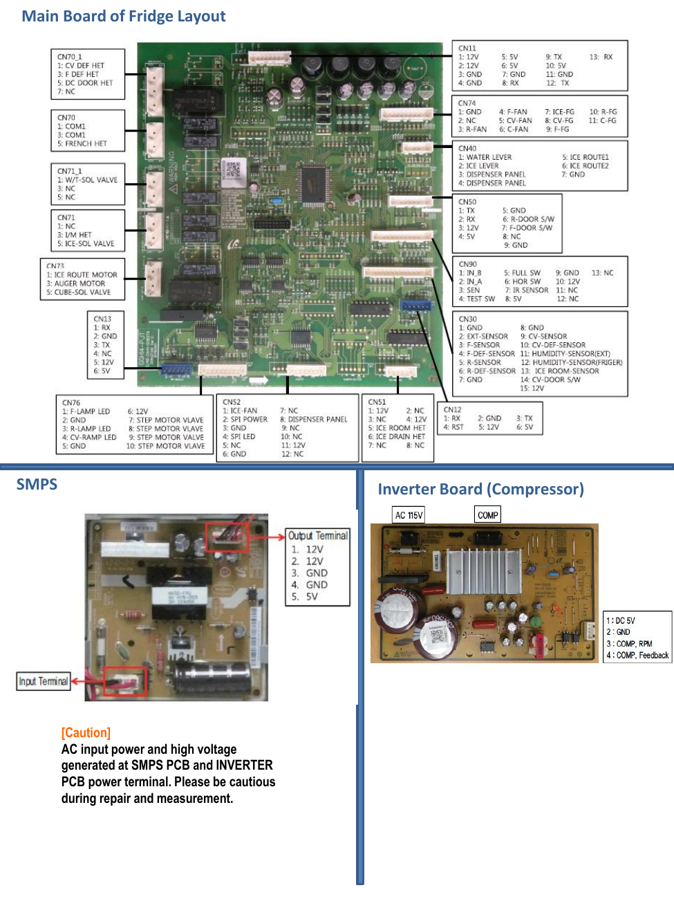

# Samsung RF28K9070SG Repair Guide - Page 011
This page contains a schematic of the main board layout for the Samsung RF28K9070SG refrigerator. It includes detailed information about the main circuit board, connectors (labeled CN70 to CN90), and voltage specifications (e.g., 12V, 5V, GND). A caution note regarding high voltage is also provided, emphasizing the need for careful handling during repairs.

<!-- llm-wiki:embedded-images -->
## Embedded Images

### Document

![The image titled "Main Board of Fridge Layout" displays a detailed schematic of a refrigerator's main circuit board, including various connectors labeled CN70 to CN90, with corresponding pin assignments. The layout includes sections for the SMPS (Switch Mode Power Supply) and the Inverter Board (Compressor), highlighting input and output terminals with specific voltage values (e.g., 12V, 5V, GND). A caution note emphasizes the presence of high voltage at the SMPS and inverter PCB power terminals, advising caution during repair and measurement.](../media/13-fridge-docsmd--18-samsungrf28k9070sg--6-assets--12-repair-guide--7-page011--hk3pi4/001-page_011.png)
<!-- llm-wiki:embedded-images -->
