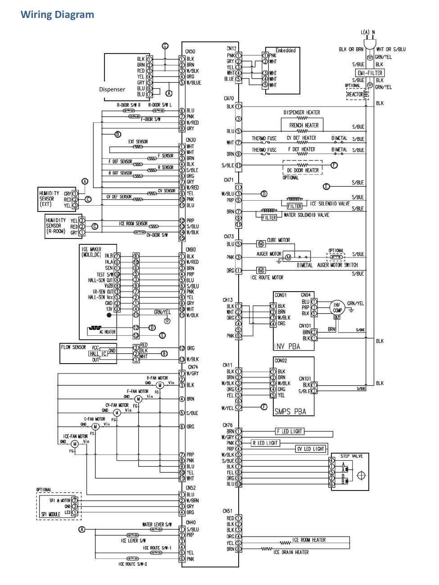

# Samsung RF28K9070SG Repair Guide - Page 012

This page contains the wiring diagram for the Samsung RF28K9070SG refrigerator. The diagram illustrates the electrical connections and components, which are crucial for understanding the operation and troubleshooting of the appliance.

## Key Components
- **Connectors:** CN50, CN70, CN73
- **Sensors:** Humidity sensor, ice maker sensor
- **Motors:** Auger motor, fan motors
- **Other Components:** Dispenser, dispenser heater, ice route motor, F LED light

The wiring diagram serves as a visual reference for the electrical layout and connections within the Samsung RF28K9070SG refrigerator.

<!-- llm-wiki:embedded-images -->
## Embedded Images

### Document

<!-- llm-wiki:embedded-images -->
