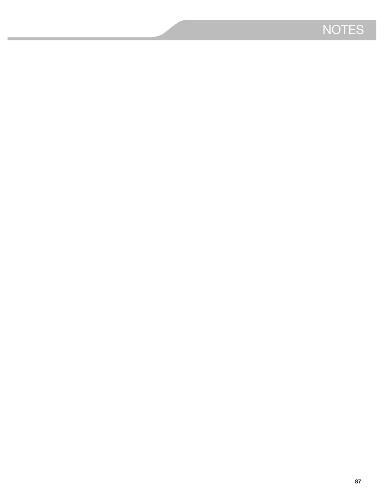

Acest document conține informații despre frigiderul KitchenAid® French Door Bottom Mount, inclusiv instrucțiuni de utilizare, siguranță, părți și caracteristici, precum și cerințe de instalare. Secțiunea recentă detaliază instrucțiunile de curățare și întreținere, inclusiv avertismente legate de utilizarea produselor de curățare. De asemenea, sunt incluse imagini referitoare la componentele frigiderului și instrucțiuni de instalare.

### Entități
- **KitchenAid® French Door Refrigerator**: Frigider cu uși franceze de la KitchenAid.

### Concepute
- Siguranța frigiderului
- Părți și caracteristici ale frigiderului
- Instrucțiuni de instalare
- Cerințe electrice
- Cerințe pentru alimentarea cu apă
- Ajustarea înclinării cabinetului
- Alinierea ușilor
- Stabilizarea frigiderului
- Curățarea frigiderului
- Întreținerea sistemului de filtrare a apei
- Avertismente de siguranță privind curățarea
- Sistem de filtrare a apei
- Funcții de frigider (ex. Max Ice, Water Filter Status)
- Instrucțiuni de instalare pentru uși și compartimente

<!-- llm-wiki:embedded-images -->
## Embedded Images

### Document

![L'image montre des instructions d'installation pour retirer et remplacer le panneau avant du tiroir du congélateur. Le texte visible inclut "INSTALLATION INSTRUCTIONS" en haut et des étapes numérotées pour retirer le tiroir, avec des détails sur les vis et les supports en plastique. Les éléments clés comprennent des flèches indiquant les emplacements des vis et des supports en plastique, ainsi que des avertissements concernant les risques d'électrocution. Les sections "Remove Drawer Front" et "Replace Drawer Front" sont clairement identifiées.](../media/13-fridge-docsmd--20-kitchenaidkrff507hps--10-user-guide--1bdnof4/005-page_011.png)
![L'image présente des instructions d'installation pour connecter une ligne d'eau à un réfrigérateur. Elle inclut des étapes numérotées et des illustrations étiquetées avec des lettres (A, B, C, D) pour identifier les composants tels que le tube en cuivre, le manchon de compression et le robinet d'arrêt. Le texte visible comprend des notes importantes, comme "IMPORTANT: If you turn the refrigerator on before the water is connected, turn the ice maker OFF." et des instructions spécifiques pour éviter les fuites.](../media/13-fridge-docsmd--20-kitchenaidkrff507hps--10-user-guide--1bdnof4/006-page_013.png)

![L'image montre des instructions d'installation pour un réfrigérateur, avec des sections numérotées et des illustrations. La première section, "Style 1", indique comment ajuster l'inclinaison du réfrigérateur à l'aide d'un tournevis hexagonal de 1/4". Les éléments visuels incluent des flèches et des étiquettes pour les pièces, telles que "A. Brake foot" et "B. Front roller". La section "Style 2" présente une autre méthode d'ajustement avec des étiquettes similaires. Les instructions soulignent l'importance de s'assurer que les portes se ferment correctement et que le réfrigérateur est stable.](../media/13-fridge-docsmd--20-kitchenaidkrff507hps--10-user-guide--1bdnof4/008-page_016.png)
![L'image montre un système de filtration d'eau avec des instructions pour installer le filtre à eau. Elle inclut des étapes numérotées, telles que "1. Locate the accessory packet in the refrigerator and remove the water filter" et "5. Turn the filter clockwise 90 degrees (1/4 turn), until it locks into the housing." Des éléments visuels incluent une illustration du filtre avec des étiquettes "A. O-ring cover" et "B. O-rings." Le texte met également en garde contre l'utilisation d'eau non potable et fournit des conseils sur le suivi de l'état du filtre.](../media/13-fridge-docsmd--20-kitchenaidkrff507hps--10-user-guide--1bdnof4/009-page_017.png)
![L'image montre des instructions pour remplacer le filtre à eau et installer un filtre à air dans un réfrigérateur. Le texte visible inclut des étapes numérotées pour l'installation du filtre à air, ainsi que des notes sur l'indicateur de statut du filtre. Les éléments clés comprennent une illustration du filtre à air avec des flèches indiquant son emplacement et des instructions pour activer l'indicateur de statut. Les sections sont clairement étiquetées avec des lettres A, B et C pour identifier les composants.](../media/13-fridge-docsmd--20-kitchenaidkrff507hps--10-user-guide--1bdnof4/010-page_018.png)

![L'image présente des instructions sur l'utilisation d'un réfrigérateur, avec des sections intitulées "Recommended Freezer Temperature" et "Cooling On/Off". Elle inclut des étapes pour ajuster les points de température, indiquant que la plage de réglage pour le réfrigérateur est de 33°F à 45°F (0°C à 7°C) et pour le congélateur de -5°F à 5°F (-21°C à -15°C). Un tableau montre les ajustements de température recommandés selon les conditions, par exemple, "REFRIGERATOR too warm" entraîne un réglage du réfrigérateur d'1° plus bas. Des instructions pour activer le mode "Max Cool" et des avertissements concernant le verrouillage des boutons sont également présents.](../media/13-fridge-docsmd--20-kitchenaidkrff507hps--10-user-guide--1bdnof4/012-page_022.png)
![L'image présente des instructions concernant les fonctionnalités d'un réfrigérateur, notamment "Max Ice", "Water Filter Status", "Vacation Mode", "Power Outage Indicator", "Door Ajar Alarm", "Disabling Sounds" et "Showroom Mode". Elle inclut des éléments visuels tels que des icônes et des boutons pour activer ou désactiver ces fonctions. Le texte visible mentionne des instructions spécifiques, comme "To turn on the Max Ice feature, press the OPTIONS button" et "Press the MEASURED FILL button to confirm". Les sections sont clairement délimitées et organisées pour faciliter la compréhension des fonctionnalités.](../media/13-fridge-docsmd--20-kitchenaidkrff507hps--10-user-guide--1bdnof4/013-page_023.png)

![L'image montre un écran de contrôle pour un distributeur d'eau, avec des options pour ajuster le volume de distribution. Le texte visible indique : "Press ICE MODE, under Back, to manually turn off the Measured Fill feature and return to the home screen." Il y a également une section sur les unités de mesure, avec des valeurs par défaut, minimales et maximales pour les onces, les tasses et les litres. Les unités sont listées comme suit : Ounces (Default: 8, Minimum: 1, Maximum: 128), Cups (Default: 1, Minimum: 1/4, Maximum: 16), Liters (Default: 0.25, Minimum: 0.05, Maximum: 4.00).](../media/13-fridge-docsmd--20-kitchenaidkrff507hps--10-user-guide--1bdnof4/015-page_025.png)
![L'image montre des instructions concernant le fonctionnement de la machine à glaçons et du bac à glaçons dans certains modèles de réfrigérateurs. Le texte visible inclut des points importants sur la production de glace, tels que "IMPORTANT: To avoid low ice production and poor quality ice, flush the water system before turning on the ice maker." et "The ice maker should produce approximately 3 lbs (1.4 kg) of ice per day under normal operation." Il y a également des instructions sur la façon d'activer et de désactiver la machine à glaçons, ainsi que des notes sur le bac à glaçons.](../media/13-fridge-docsmd--20-kitchenaidkrff507hps--10-user-guide--1bdnof4/016-page_027.png)
![L'image montre des instructions sur les étagères du réfrigérateur, avec un accent particulier sur le modèle "Tuck Away Shelf". Le texte visible comprend des étapes pour retirer et remplacer une étagère, ainsi que des instructions pour rétracter et étendre la section avant de l'étagère. Les étapes incluent : "1. Remove the shelf/frame by tilting it up at the front and lifting it out of the shelf supports." et "2. Replace the shelf/frame by guiding the rear shelf hooks into the shelf supports." Des flèches illustrent les mouvements nécessaires pour manipuler l'étagère.](../media/13-fridge-docsmd--20-kitchenaidkrff507hps--10-user-guide--1bdnof4/017-page_028.png)

<!-- llm-wiki:embedded-images -->
