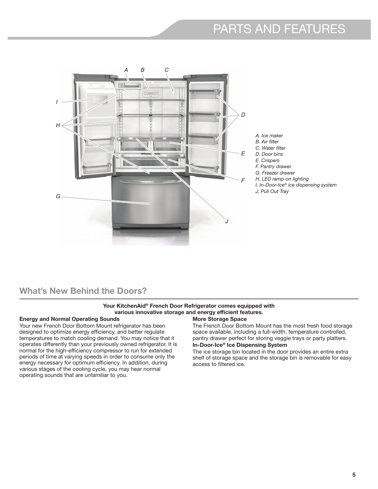

The image provides a visual representation of the KitchenAid® French Door Refrigerator (Model KRFF507HPS) and its various components, highlighting features that enhance usability and storage efficiency. The labeled components include:

- A. Ice maker
- B. Air filter
- C. Water filter
- D. Door bins
- E. Crispers
- F. Pantry drawer
- G. Freezer drawer
- H. LED ramp-on lighting
- I. In-Door-Ice® ice dispensing system
- J. Pull Out Tray

This page serves as a strong visual aid that clearly illustrates the features of the refrigerator, making it easy for users to understand its layout and components.

<!-- llm-wiki:embedded-images -->
## Embedded Images

### Document

<!-- llm-wiki:embedded-images -->
