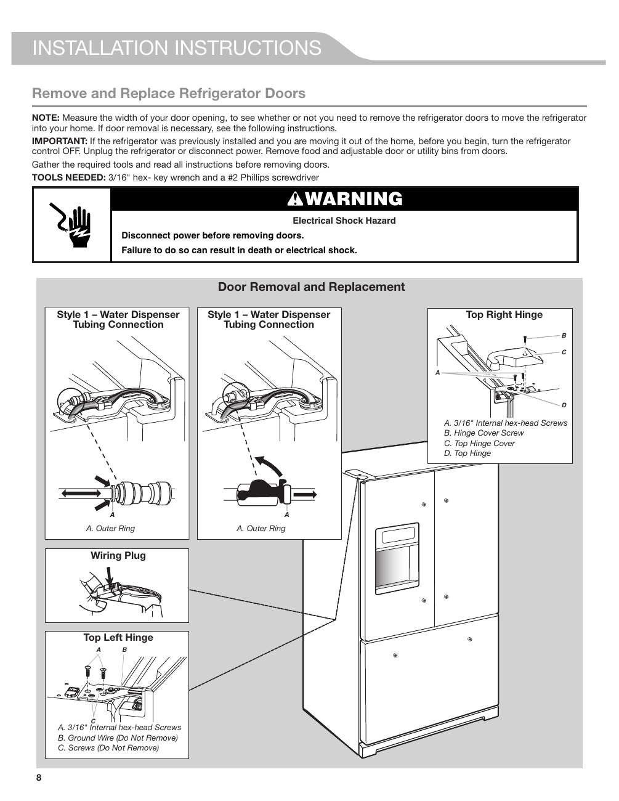

This page contains installation instructions for the KitchenAid® KRFF507HPS refrigerator, specifically focusing on the removal and replacement of the refrigerator doors. The diagram illustrates the necessary steps and components involved, including connections for water dispensers and electrical wiring. It emphasizes safety warnings regarding electrical hazards.

<!-- llm-wiki:embedded-images -->
## Embedded Images

### Document

![The image is a diagram titled "Remove and Replace Refrigerator Doors" from an installation instruction manual. It includes several labeled sections: "Style 1 – Water Dispenser Tubing Connection" with arrows indicating the "Outer Ring," and a "Wiring Plug" section showing where to connect wires. The "Top Left Hinge" section lists components labeled A (3/16" Internal hex-head Screws), B (Ground Wire), and C (Screws Do Not Remove). Additionally, the "Top Right Hinge" section identifies parts A (3/16" Internal hex-head Screws), B (Hinge Cover Screw), C (Top Hinge Cover), and D (Top Hinge). A warning about electrical shock hazards is prominently displayed.](../media/13-fridge-docsmd--20-kitchenaidkrff507hps--6-assets--10-user-guide--7-page008--1ebz7mn/001-page_008.png)
<!-- llm-wiki:embedded-images -->
