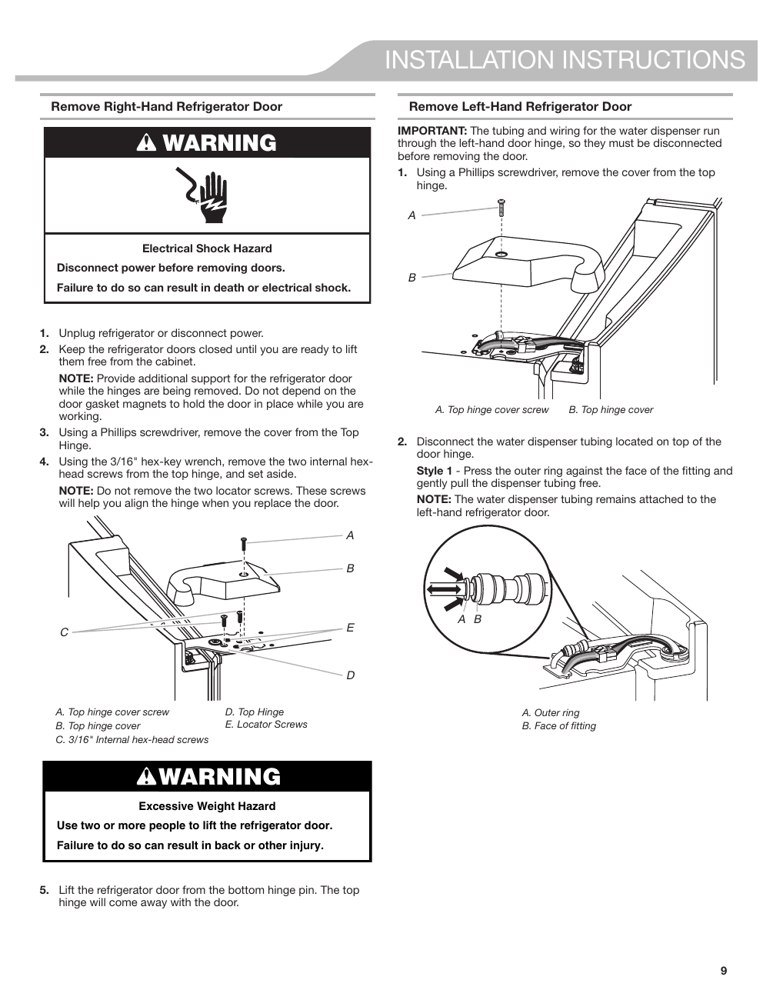

This page provides installation instructions for removing the right-hand and left-hand doors of the KitchenAid KRFF507HPS refrigerator. It includes essential safety warnings regarding electrical shock and excessive weight hazards. The instructions are visually supported by labeled diagrams and step-by-step procedures, emphasizing the need to unplug the refrigerator and the specific screw types required (3/16" internal hex-head screws).

<!-- llm-wiki:embedded-images -->
## Embedded Images

### Document

![The image contains installation instructions for removing the right-hand and left-hand refrigerator doors. It includes a warning about electrical shock hazards and excessive weight hazards. The left section details steps for removing the right-hand door, including unplugging the refrigerator, using a Phillips screwdriver, and specific screw types (3/16" internal hex-head screws). The right section outlines the process for the left-hand door, emphasizing the disconnection of water dispenser tubing and includes labeled diagrams for the top hinge cover and screws.](../media/13-fridge-docsmd--20-kitchenaidkrff507hps--6-assets--10-user-guide--7-page009--1f3ulho/001-page_009.png)
<!-- llm-wiki:embedded-images -->
