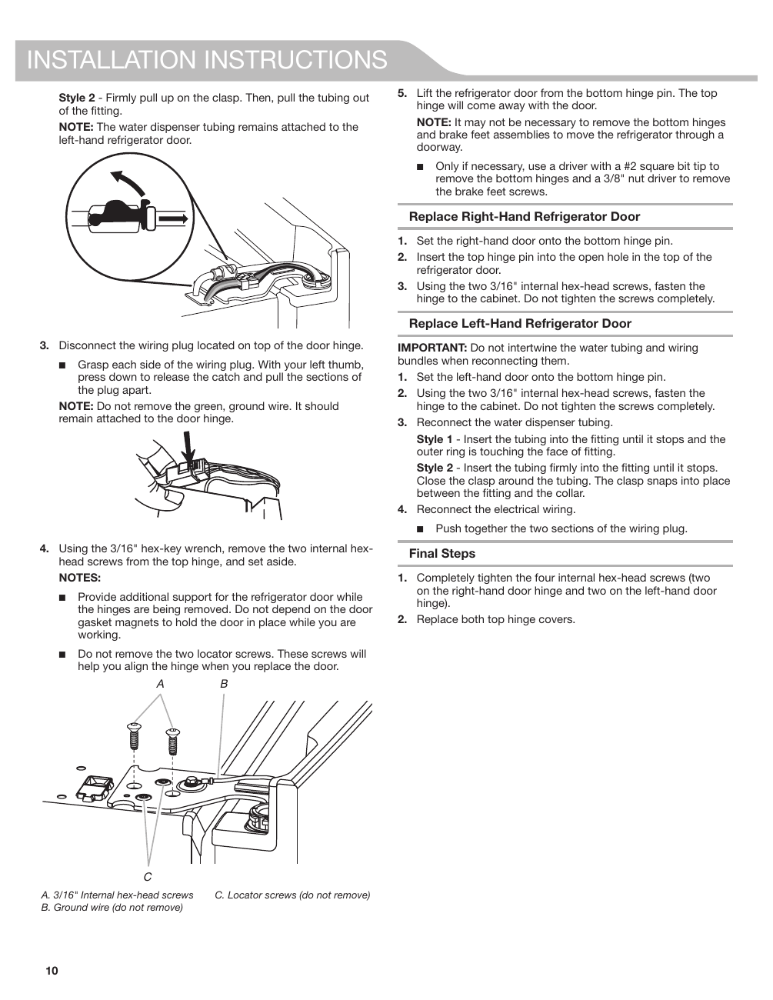

# KitchenAid® KRFF507HPS User Guide - Page 010
This page provides detailed instructions for replacing the refrigerator doors on the KitchenAid KRFF507HPS. It includes a diagram with labeled components such as screws and wires, along with step-by-step textual instructions. Key notes emphasize the importance of not removing certain screws and the need for support during the process.

---

<!-- llm-wiki:embedded-images -->
## Embedded Images

### Document

![The image contains installation instructions for replacing refrigerator doors. It features a diagram showing the internal components, including two 3/16" internal hex-head screws labeled as "A," a green wire labeled as "B," and locator screws labeled as "C." The text provides detailed steps for lifting and replacing the refrigerator doors, reconnecting the water dispenser tubing, and ensuring proper alignment with the locator screws. Key notes emphasize not to remove certain screws and to provide support while working on the hinges.](../media/13-fridge-docsmd--20-kitchenaidkrff507hps--6-assets--10-user-guide--7-page010--1vgwozy/001-page_010.png)
<!-- llm-wiki:embedded-images -->
