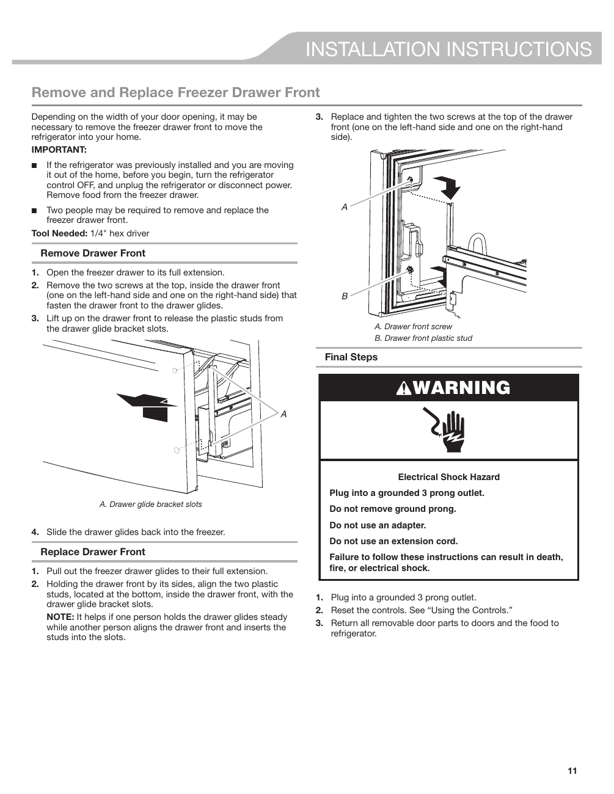

This page provides installation instructions for removing and replacing the freezer drawer front of the KitchenAid KRFF507HPS refrigerator. It includes a warning about electrical shock hazards, specifies the required tool (1/4" hex driver), and outlines key steps with numbered instructions and diagrams. Visual aids enhance the usability of the instructions.

<!-- llm-wiki:embedded-images -->
## Embedded Images

### Document

![The image contains installation instructions for removing and replacing the freezer drawer front of a refrigerator. It includes a warning about electrical shock hazards and specifies the tool needed (1/4" hex driver). Key steps are numbered, detailing how to open the freezer drawer, remove screws, lift the drawer front, and replace it. Visual elements include labeled parts: "A. Drawer front screw" and "B. Drawer front plastic stud," along with diagrams illustrating the process. The final steps emphasize plugging the refrigerator into a grounded outlet and resetting controls.](../media/13-fridge-docsmd--20-kitchenaidkrff507hps--6-assets--10-user-guide--7-page011--1vkctz5/001-page_011.png)
<!-- llm-wiki:embedded-images -->
