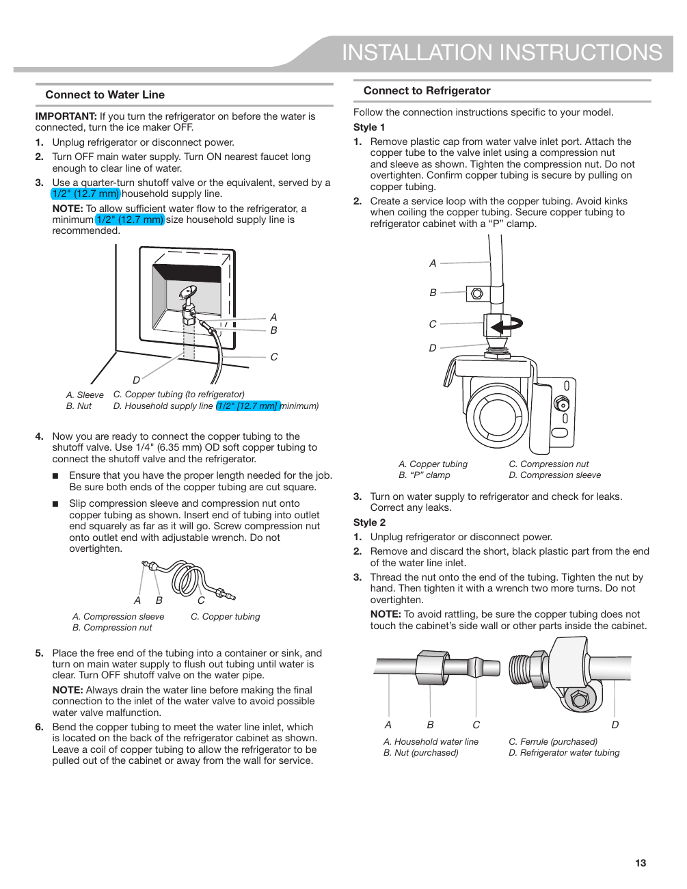

This page provides installation instructions for connecting a water line to the KitchenAid KRFF507HPS refrigerator. It includes detailed steps and diagrams for the connection process, emphasizing the importance of turning off the water supply and specifying the required tubing size (minimum 1/2" or 12.7 mm). The instructions are crucial for enabling features like ice-making and water dispensing.

<!-- llm-wiki:embedded-images -->
## Embedded Images

### Document

![The image contains installation instructions for connecting a water line to a refrigerator. It includes two sections: "Connect to Water Line" and "Connect to Refrigerator," with detailed steps and notes. Key visible elements include diagrams labeled with letters A through D, indicating components such as a copper tubing, compression nut, and household water line. The text emphasizes the importance of turning off the water supply and provides specific measurements for the tubing, such as a minimum size of 1/2" (12.7 mm) for the household supply line.](../media/13-fridge-docsmd--20-kitchenaidkrff507hps--6-assets--10-user-guide--7-page013--8ix2gr/001-page_013.png)
<!-- llm-wiki:embedded-images -->
