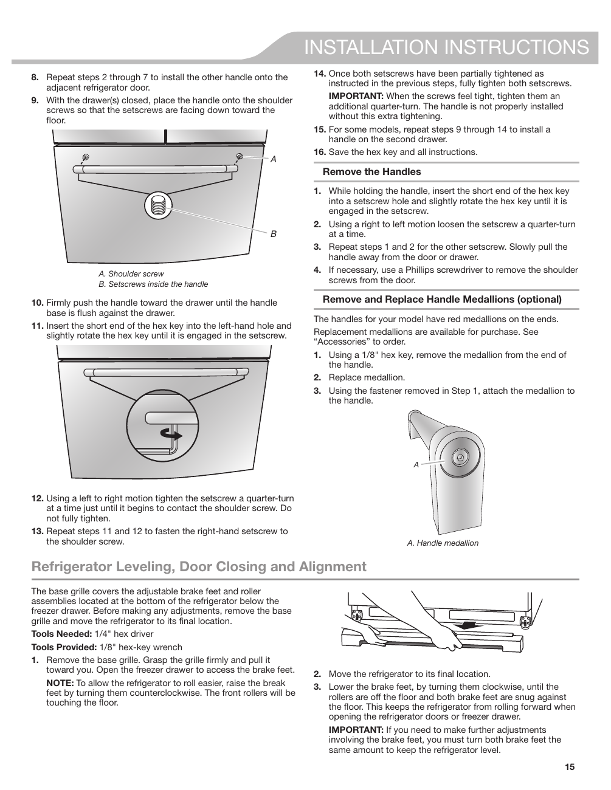

# KitchenAid® KRFF507HPS User Guide - Page 015
This page provides installation instructions for the handle of the KitchenAid KRFF507HPS refrigerator. It includes steps 8 to 15, detailing how to install the handle onto the refrigerator door. Key elements include the mention of "A. Shoulder screw" and "B. Setscrews inside the handle." The instructions emphasize the importance of tightening the setscrews properly and provide guidance on removing and replacing handle medallions. Additionally, there are notes on leveling the refrigerator and adjusting the brake feet.

<!-- llm-wiki:embedded-images -->
## Embedded Images

### Document

<!-- llm-wiki:embedded-images -->
