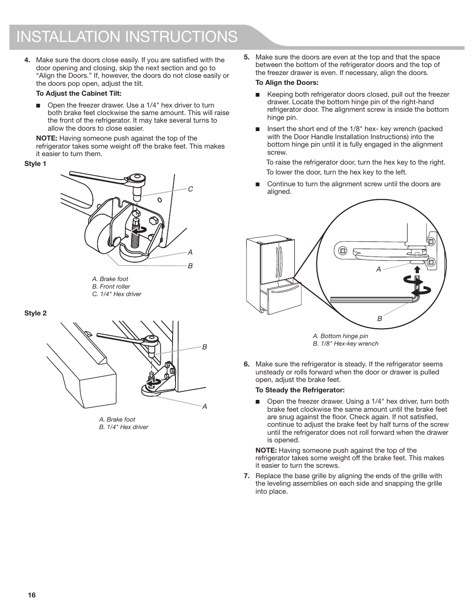

The source provides detailed installation instructions for adjusting the cabinet tilt and aligning the doors of the KitchenAid KRFF507HPS refrigerator. It includes diagrams labeled "Style 1" and "Style 2," illustrating components involved in the adjustment process, such as the brake foot and front roller. The instructions specify the tools required, including a 1/4" hex driver and a 1/8" hex-key wrench, emphasizing the importance of ensuring the doors close easily and that the refrigerator remains steady.

<!-- llm-wiki:embedded-images -->
## Embedded Images

### Document

![The image contains installation instructions for a refrigerator, specifically detailing how to adjust the cabinet tilt and align the doors. It includes two styles of diagrams labeled "Style 1" and "Style 2," showing components such as the brake foot, front roller, and hex drivers. The visible text includes steps for adjusting the brake feet and aligning the refrigerator doors, with specific tools mentioned like a 1/4" hex driver and a 1/8" hex-key wrench. The instructions emphasize the importance of ensuring the doors close easily and that the refrigerator remains steady.](../media/13-fridge-docsmd--20-kitchenaidkrff507hps--6-assets--10-user-guide--7-page016--1d57q8k/001-page_016.png)
<!-- llm-wiki:embedded-images -->
