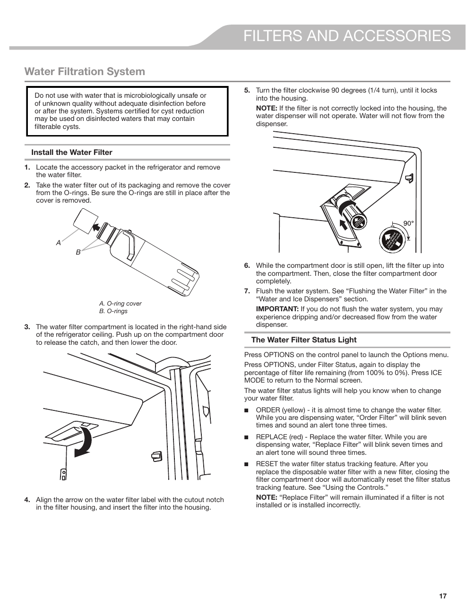

# KitchenAid® KRFF507HPS User Guide - Page 017
This page provides detailed instructions for installing a water filtration system in the KitchenAid KRFF507HPS refrigerator. It emphasizes the importance of using safe water and includes visual aids to assist users in the installation process.

## Key Instructions
- Locate the water filter.
- Remove packaging.
- Align the filter with the housing.
- Turn the filter clockwise 90 degrees to lock it into place.

### Important Notes
- Do not use microbiologically unsafe water.
- Flush the water system after installation.
- Monitor the water filter status light indicators.

<!-- llm-wiki:embedded-images -->
## Embedded Images

### Document

![The image depicts instructions for installing a water filtration system in a refrigerator. It includes a warning not to use microbiologically unsafe water and outlines steps for installation, such as locating the water filter, removing packaging, and aligning the filter with the housing. Key visual elements include labeled parts (A: O-ring cover, B: O-rings) and a diagram showing the filter being turned clockwise 90 degrees to lock it into place. Additional notes emphasize the importance of flushing the water system after installation and provide information about the water filter status light indicators.](../media/13-fridge-docsmd--20-kitchenaidkrff507hps--6-assets--10-user-guide--7-page017--1b62ko7/001-page_017.png)
<!-- llm-wiki:embedded-images -->
