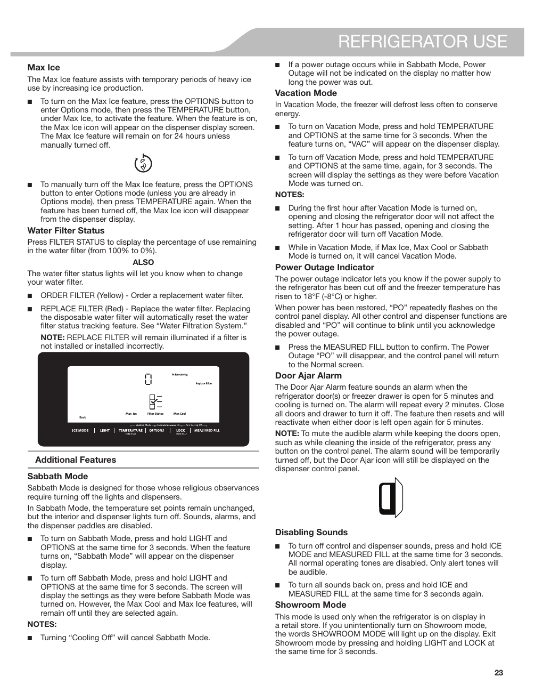

This page from the KitchenAid® KRFF507HPS user guide details several key features of the refrigerator, including the Max Ice feature, Water Filter Status, Sabbath Mode, Power Outage Indicator, and Showroom Mode. It provides visual instructions and descriptions for activating these features, emphasizing their importance for user experience and safety.

<!-- llm-wiki:embedded-images -->
## Embedded Images

### Document

![The image appears to be a page from a user manual for a refrigerator, specifically detailing various features and settings. Key sections include "Max Ice," which explains how to activate the feature for increased ice production, and "Water Filter Status," indicating how to check the percentage of remaining filter life. Additional features mentioned are "Sabbath Mode," which disables lights and dispensers, and "Power Outage Indicator," which alerts users if power is lost. The page also includes instructions for disabling sounds and a "Showroom Mode" for display purposes.](../media/13-fridge-docsmd--20-kitchenaidkrff507hps--6-assets--10-user-guide--7-page023--uo7nr4/001-page_023.png)
<!-- llm-wiki:embedded-images -->
