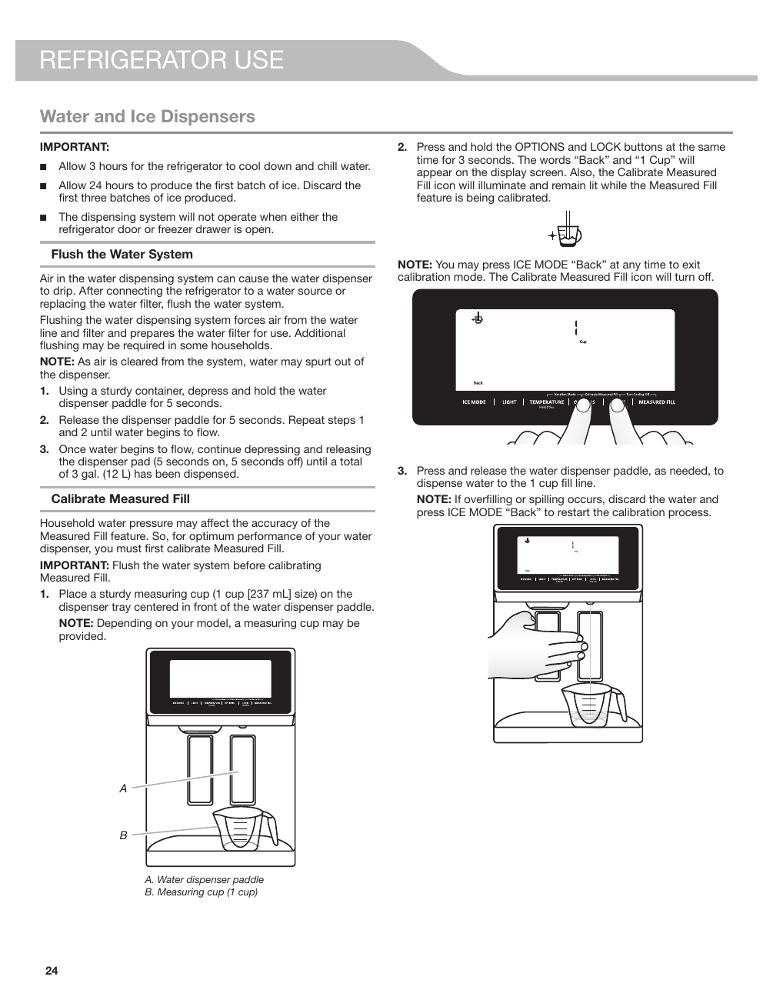

This page provides instructions for calibrating the "Measured Fill" feature of the KitchenAid KRFF507HPS refrigerator's water and ice dispenser. It emphasizes the importance of flushing the water system before calibration and includes step-by-step instructions for accurate water dispensing. The source features a diagram illustrating the calibration process, including the use of a measuring cup.

<!-- llm-wiki:embedded-images -->
## Embedded Images

### Document

![The image depicts instructions for calibrating the "Measured Fill" feature of a refrigerator's water and ice dispenser. It includes a diagram showing a water dispenser paddle (labeled A) and a measuring cup (labeled B) with a capacity of 1 cup (237 mL). The text emphasizes the importance of flushing the water system before calibration and provides step-by-step instructions for the calibration process, including pressing specific buttons and using a measuring cup to ensure accurate water dispensing.](../media/13-fridge-docsmd--20-kitchenaidkrff507hps--6-assets--10-user-guide--7-page024--suqbr9/001-page_024.png)
<!-- llm-wiki:embedded-images -->
