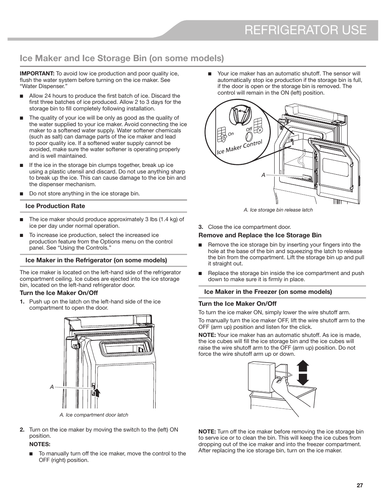

This page from the KitchenAid® KRFF507HPS user guide provides detailed instructions on the operation of the ice maker and the ice storage bin. Key points include the recommendation to allow 24 hours for the first batch of ice production and to discard the first three batches produced. It emphasizes the importance of water quality for optimal ice production and includes operational instructions for turning the ice maker on and off, as well as handling the ice storage bin. Visual aids and labeled sections enhance user understanding of these features.

<!-- llm-wiki:embedded-images -->
## Embedded Images

### Document

![The image appears to be a page from a user manual detailing the operation of an ice maker and ice storage bin in a refrigerator. It includes several important notes about ice production, such as the recommendation to allow 24 hours for the first batch of ice and to discard the first three batches produced. The text also advises on the quality of water used and provides instructions for turning the ice maker on and off, as well as removing and replacing the ice storage bin. Key visual elements include labeled sections for "Ice Production Rate," "Ice Maker in the Refrigerator," and "Ice Maker in the Freezer," along with diagrams indicating the ice compartment door latch and ice storage bin release latch.](../media/13-fridge-docsmd--20-kitchenaidkrff507hps--6-assets--10-user-guide--7-page027--153qrak/001-page_027.png)
<!-- llm-wiki:embedded-images -->
