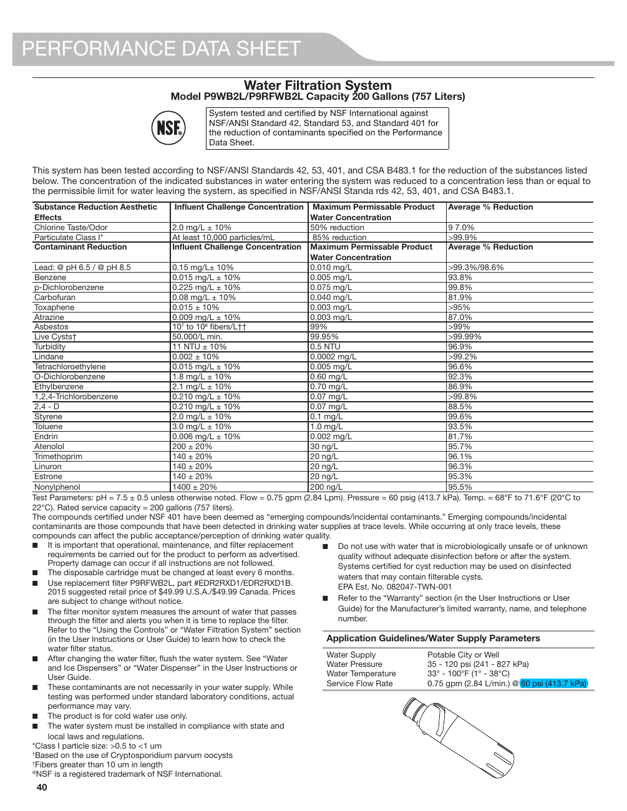

This page contains performance data for the PW9B2L/P9RFWB2L water filtration system used in the KitchenAid KRFF507HPS refrigerator. It includes a table detailing various contaminants, their influent challenge concentrations, maximum permissible product water concentrations, and average percentage reductions. Notable contaminants listed include Lead, Dichlorobenzene, and Asbestos, with average percentage reductions ranging from 7.0% to 99.99%. The data is essential for users concerned about water quality and filtration performance.

<!-- llm-wiki:embedded-images -->
## Embedded Images

### Document

![The image is a performance data sheet for a water filtration system, model PW9B2L/P9RFWB2L, with a capacity of 200 gallons (757 liters). It includes a table detailing various contaminants, their influent challenge concentrations, maximum permissible product water concentrations, and average percentage reductions. Notable contaminants listed include Lead, Dichlorobenzene, and Asbestos, with average percentage reductions ranging from 7.0% to 99.99%. Additional information includes system testing standards and operational guidelines.](../media/13-fridge-docsmd--20-kitchenaidkrff507hps--6-assets--10-user-guide--7-page040--1fy1suz/001-page_040.png)
<!-- llm-wiki:embedded-images -->
