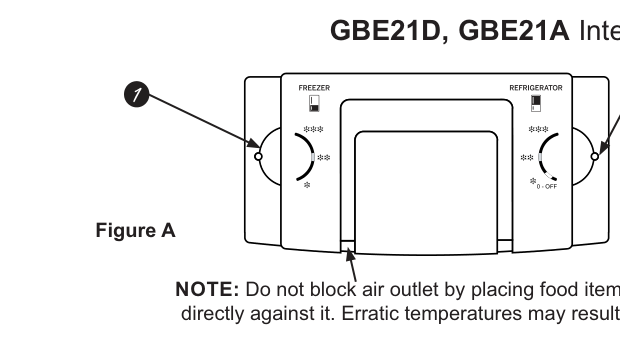
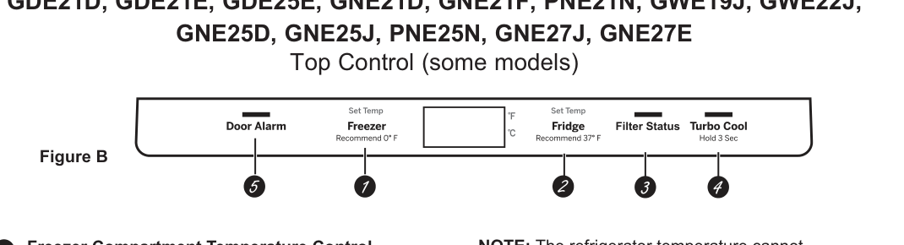
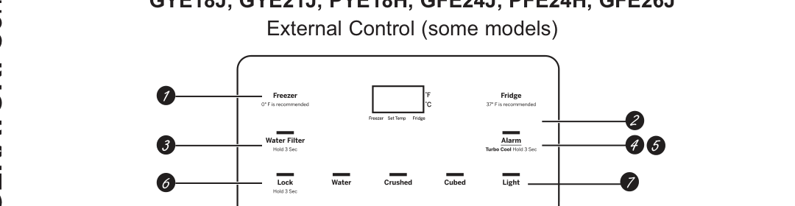
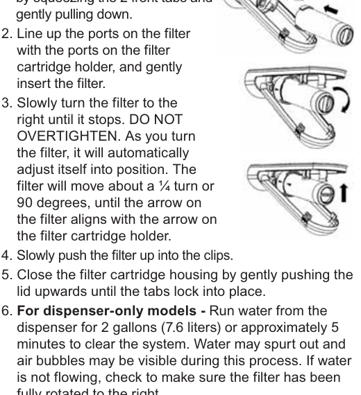
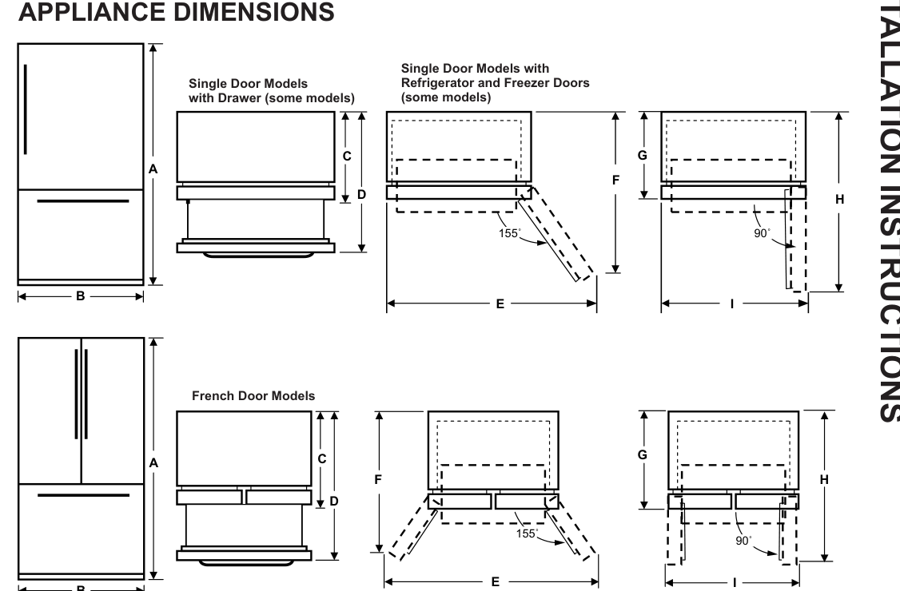

# GE / GE Profile Bottom-Freezer Refrigerators — Technician Support Knowledge Base

> **Evidence level: [DOCUMENTED] unless explicitly [UNKNOWN].** Sole source: *REFRIGERATORS — Bottom Freezer: Owner's Manual & Installation Instructions*, GE / GE Profile, publication **49-1000472 Rev. 9 (04-26)**, English printed pp. 1–52. This is a support-oriented interpretation of that document, not a service manual and not an assertion that all configurations exist on every model.  The folder's name `ge_GNE27JYMFS` identifies the customer's nominal unit; the manual covers **many related models** and does not establish every feature of that full SKU.

## How to answer tickets without making things up

1. Ask for the **complete model number** and the symptom; the label is on the **left side, near the middle of the fresh-food compartment** (p. 1). Check the *actual control panel*, door arrangement, icemaker location, dispenser and filter before giving instructions. The manual often says “on some models.”
2. Check safety first: water leakage, electric shock, damaged cord, flammable refrigerant, moving icemaker parts and restricted service tasks are more important than restoring functionality (pp. 3–5, 20–21).
3. Retrieve by symptom and variant. Give only the steps shown in this manual, preserving required waits, sequence, units and warnings. Say **[UNKNOWN]** when the manual provides neither a procedure nor a confirmed feature mapping.
4. Distinguish a **temperature setting** from measured compartment temperature; a control-panel OFF setting does **not disconnect electrical power** (pp. 8–11).
5. For questions involving sealed refrigeration-system diagnosis, live electrical testing, refrigerant charging, firmware, internal component repair or unlisted error codes, **[UNKNOWN]**: these procedures are not provided. Qualified service is required for repairs (pp. 3, 5, 52).

## Model and option identification (pp. 6–12, 39–40)

| Visible control family | Model prefixes explicitly named on control illustrations | How to recognize it | Initial recommended set point |
|---|---|---|---|
| **Rotary internal / Figure A** | GBE21D; GBE21A | Separate manual cold/colder/coldest knobs inside appliance | **Colder** for both fresh food and freezer |
| **Electronic top / Figure B** | GDE21D, GDE21E, GDE25E, GNE21D, GNE21F, PNE21N, GWE19J, GWE22J, GNE25D, GNE25J, PNE25N, GNE27J, GNE27E | Control across top, with Fridge, Freezer, alarm and filter functions on equipped models | Fresh food **37°F (2.8°C)**; freezer **0°F (-17.8°C)** |
| **Electronic external / Figure C** | GYE18J, GYE21J, PYE18H, GFE24J, PFE24H, GFE26J | Controls beside the external water/ice dispenser | Fresh food **37°F**; freezer **0°F** |

**[UNKNOWN]** These names are model families/prefixes displayed in the manual, not a guarantee that every suffix has every illustrated feature. In particular the manual does not independently specify every feature for suffix `GNE27JYMFS`. For 27-cu-ft French-door families the manual also lists GNE27J and GNE27E (p. 40). Confirm configuration by physical inspection.

### What is inside (pp. 6–7, 16–19)

- **French-door families**: some have a space-saving door-mounted icemaker; LED lights may be at upper center and beside climate-zone pans; lower full-width fresh-food drawer; two produce-storage climate-zone pans; adjustable door bins; XWFE filter on equipped units; and a QuickSpace™ shelf that slides its front portion back for tall items. The QuickSpace rear half is **not adjustable**.
- **Single-door fresh-food families**: may have a movable floating snack pan; top refrigerator and freezer LEDs; full-width shelves; fixed full-width gallon door bins; adjustable other bins; optional XWFE filter; and freezer icemaker or optional **IM4D** kit for icemaker-ready models.
- **Freezer drawer** variants have a top and bottom full-width basket, some with ice bucket or divider; **hinged freezer-door** variants have a fixed wire shelf and a sliding plastic basket. Never fill baskets above their rim: this can jam them.

## Electrical, refrigerant and personal safety (pp. 3–5)

**Shock and installation:** This appliance requires a **grounded three-prong outlet**, **115 V AC, 60 Hz**, a **15- or 20-amp fused supply**, and ideally its own outlet. Do not remove the ground prong, use an adapter or extension cord, operate with a damaged cord or disconnect by pulling on the cord. A qualified electrician should correct a two-prong outlet; damaged power cords require authorized replacement. Unplug before cleaning or repairs; settings do not de-energize the appliance. Replace guards and panels before use. Repairs are performed by qualified professionals.

**Fire, refrigerant and disposal:** Check the unit's *rating label* for refrigerant. **If R600a**: it is flammable isobutane; avoid damaging refrigerant tubing; use only authorized service staff and manufacturer parts; keep ventilation openings clear; remove frost with wood or plastic scraper, never metal points; use no electrical device to defrost or in the food compartment. Keep flammable vapors/liquids and explosive aerosols away. Dispose of refrigerant and foam under local regulations. Before discarding an old fridge, remove doors and leave shelves in place to reduce child entrapment risk.

**Injury, food and water:** Keep children from climbing/playing, protect fingers from door pinch gaps, avoid wet-hand contact with frozen metal/surfaces, do not clean cold glass with warm water, never re-freeze completely thawed food, never touch operating icemaker mechanisms, and never insert hands or objects in the ice-crusher opening. Use a sturdy glass for ice. Water and ice require **potable cold water**, **25–120 psi (172–827 kPa)**; do not use hot water. The XWFE application sheet additionally requires a pressure-limiting valve if household supply exceeds **80 psi (552 kPa)**, and warns not to install the system where pressure exceeds **120 psi** (p. 50).

## Temperature and controls (pp. 8–11)

### Rotary controls — GBE21D / GBE21A

| Position | Refrigerator approximate guide | Freezer approximate guide |
|---|---|---|
| Coldest | 34°F (1.1°C) | -6°F (-21.1°C) |
| **Colder (factory)** | **37°F (2.8°C)** | **0°F (-17.8°C)** |
| Cold | 44°F (6.7°C) | 6°F (-14.4°C) |
| 0 | OFF control position | OFF control position |

Set each knob for its own compartment. Allow **24 hours** after setting for stabilization. **Do not block the air outlet** by placing food directly against it: temperature can become erratic. Even at OFF, electrical power remains connected (p. 8).

### Electronic top panel

Set freezer or refrigerator on the corresponding control; default is **0°F / 37°F**, with **24 hours** to stabilize. On models with a Water Filter reset control, hold it **3 seconds** to reset; models with **Filter Status** let the customer display remaining filter life %. To activate **TurboCool**, hold **Turbo Cool** 3 seconds until `tc` appears: it cools the fresh-food compartment more quickly after large warm-food loads or power loss; the freezer setting is not affected, and the refrigerator setting cannot be changed while active. Door alarm sounds if a door is open for **more than 2 minutes** when enabled; close the door to stop beeping. Hold **Freezer + Fridge** 3 seconds for the *control* OFF state. Hold **Door Alarm + Freezer** together **5 seconds** to switch Fahrenheit/Celsius where that button pairing appears (pp. 8–9).

### External dispenser panel

Defaults and stabilization are the same. Hold **Alarm** 3 seconds to activate TurboCool (display `tc`); a short Alarm press toggles the door alarm. Hold **Lock** 3 seconds to lock the dispenser and controls; hold to unlock. **Light** toggles dispenser LED. Hold **Freezer + Fridge** 3 seconds for control OFF; **Freezer + Alarm** simultaneously for 5 seconds toggles °F/°C. A factory protective film may cover the panel: remove it if it remains after installation. For filter-equipped versions hold the water-filter reset control 3 seconds or check Filter Status % as the actual panel specifies (pp. 10–11).

**Important variant boundary:** The manual shows **different TurboCool and units-change button combinations** for top and external panels. Never give one combination until identifying the actual panel.

### Sabbath mode (p. 12)

On equipped units, this turns off advanced features, such as door alarms, and may keep interior lights off or dim irrespective of door opening; compressor uses timed defrost. **External controls**: hold **Lock + Light** together **5 seconds** to enter/exit. **Top controls**: hold **Alarm + Water Filter** *or* **Alarm + Filter Status**, depending on the control, for **5 seconds**. **Turn the icemaker OFF manually** during Sabbath mode at its physical switch, and ON manually afterward. **[UNKNOWN]** Page 12 does not specify how to activate Sabbath mode on the rotary GBE21D/GBE21A family.

## Water and ice dispensing (p. 13)

**External dispenser:** Press a sturdy glass gently against the cradle. The small spill tray does **not** drain itself: clean it regularly. For first installation with no water, use the paddle for at least **5 minutes** to purge trapped air and fill the system; **discard the first six full glasses**. To remove the tray, pull out; to return, push until firmly seated. Avoid narrow glasses and overfilled ice cups; position the glass near (not touching) the chute. Do not place purchased/tray ice, beverage cans, bottles or food packages in the door ice bucket: they can jam the crusher/auger. Occasionally crushed fragments with selected cubed ice, drips after crushed ice or minor chute frost can be normal. To clear chute blockage, remove the ice bucket and use a **wooden spoon**; never put a hand into the discharge opening.

**Internal water dispenser (some models):** Located on the **left inside fresh-food wall**. Press glass against recess and press button; keep glass under it **2–3 seconds** after release because dispensing may continue. Initial water-line purge **at least 5 minutes**; discard first **six glassfuls**; wipe dispenser with clean cloth or sponge periodically.

**Door-mounted bucket:** Open left fresh-food door; release bucket door latch; lift bucket via handhold off bottom locators; reinstall onto guide brackets and push until seated. If bucket will not seat, rotate bucket fork **¼ turn clockwise** (p. 13). On models whose icemaker continues operating when the bucket is removed, turn the icemaker OFF first (p. 20).

## XWFE cartridge: operation and replacement (pp. 14–15)

**Applicability:** Equipped models only. Holder is upper-right rear of refrigerator compartment. Some variants employ **RFID** for filter status and leak recognition. Red filter warning may blink during dispensing on external controls or while door open on top controls. Without an indicator, change every **six months**, sooner if flow decreases; rating capacity **170 gal (643.5 L)**.

**Removal:** (1) Squeeze the housing's two front tabs and lower cover. (2) Tilt filter down. (3) Carefully turn **counterclockwise about ¼ turn** until released; some water drips are expected. **Caution:** trapped air can eject the filter suddenly.

**Installation:** (1) Open housing. (2) Align filter ports to holder ports and insert gently. (3) Rotate **clockwise/right about 90°** until housing and filter arrows align; **do not overtighten**. (4) Push filter up into clips and close cover until tabs latch. (5) **Dispenser-only**: flush **2 gallons / 7.6 L** or roughly **5 minutes**, anticipating spurts/air; if none flows, verify full clockwise rotation. **Icemaker-only**: discard first ice bin; small discolored droplets/early ice can occur during flush and should clear. (6) Hold **Reset Water Filter** for **3 seconds** where provided; some models reset automatically (p. 14).

**Bypass:** If no cartridge, use the correct **filter bypass plug**; the dispenser/icemaker won't run without *either* filter or plug, and bypass reduces leak risk. Some models lack an included plug. US 833.4BODEWELL; Canada 800.561.3344. Install like cartridge. Use manufacturer-approved cartridge per manual; GE has not qualified other-brand cartridges. Source application limits: flow **0.5 gpm (1.89 L/min)**, potable water, pressure **25–120 psi**, input temperature **33–100°F (0.6–38°C)**; capacity **170 gal** (p. 15). Small parts may present choking hazard for under-3s.

## Storage hardware — remove, clean, reinstall (pp. 16–19)

| Component | Removal | Correct reinstallation / cautions |
|---|---|---|
| Fresh-food adjustable shelf | Empty; tilt front upward; lift at rear; draw out | With front raised, put rear top hook into track slot; lower front until bottom locks |
| QuickSpace shelf | Front half slides under rear; whole shelf may be relocated | Rear half not independently adjustable |
| Door bin, adjustable or full-width gallon | Lift straight up, then out | Seat on molded door supports and push downward to lock |
| Climate-zone produce pan | Pull to stop; lift above stop; pull forward | Wipe excess moisture below/inside drawer |
| Floating snack pan | Pull to stop, lift past stop and out | Can be relocated where useful (equipped models) |
| Full-width pan | Pull to stop, lift front out | Install back first; rotate front down onto slides and push closed |
| Full-width pan divider | Pull pan to stop, slide divider to right to release | Reverse removal |
| Top freezer-drawer basket | Extend to stop and lift free of slides | Put on both side rails **over** bottom-basket slides; fully close |
| Bottom freezer-drawer basket | Extend drawer, remove top basket, lift bottom basket front, pull and release pin from slot | Tilt back into drawer; rotate level; press down, seat pin in slot and rest on bracket tabs |
| Freezer-door sliding basket | Pull full extension; lift front, pull straight out | Slide into lower liner rails and push back |
| Fixed freezer wire shelf | Push sideways, lift opposite end out | Fit one side support and push across until other side fits; **not a sliding shelf** |

These configurations are alternatives, not simultaneous features on every appliance. Never overfill freezer baskets above rim (pp. 18–19).

## Icemaker operation (pp. 20–21)

- Door-type icemaker described on p. 20 makes **7 cubes/cycle** and approximately **100–130 cubes/day**; freezer-compartment unit on p. 21 makes **10 cubes/cycle**, also ~100–130/day. Both depend on temperatures, use and door openings. First ice can take **12–24 hours** after initial installation; p. 20 says the icemaker fills when cooled to about **15°F (-10°C)**.
- Switch **OFF** if water has not yet been connected, then **ON** after connection. Leaving an icemaker on without water can harm the valve (p. 45). Buzzing while filling and occasional joined ice cubes can be normal; the feeler arm stops filling when the bin is full. Ensure the arm moves unobstructed. Discard the first few batches on initial use. Old ice can become stale/cloudy/shrunken.
- Some freezers have an installed maker or are **IM4D-ready**; see p. 21 for bin located left of upper freezer basket and switch variants. Do not treat readiness as installed hardware.
- Don't touch moving ejector mechanism or heater while connected to power; potable cold water **25–120 psi** only.

## Cleaning, moving, vacation and lights (pp. 22–23)

- Unplug first where practical. Clean interior with **1 tablespoon (15 mL) baking soda per quart (1 L) warm water**; rinse and dry. Avoid washing cold glass with warm water. For fingerprint-resistant stainless, black stainless, slate, painted surfaces use **soft/microfiber cloth + mild detergent/warm water**, then dry; **do not apply stainless cleaner to these finishes**.
- For ordinary stainless outside surfaces approved stainless products may be used; oxalic-acid soft cleanser for surface rust/tarnish is permitted **on stainless only**. Prevent stainless cleaners contacting plastic trim; if they do, wash plastic with mild detergent and warm water. Avoid abrasive/scouring products, ammonia/bleach, citrus oil, vinegar/acidic and oven cleaners as specified in the material-specific charts (p. 22).
- Refrigerator LEDs: upper/side positions vary; **authorized technician must replace LED assemblies**, not a consumer bulb swap. US 833.4BODEWELL; Canada 800.561.3344.
- Moving: tape shelves/drawers, use hand truck on a **side**, keep refrigerator upright, don't push sideways across vulnerable flooring, raise leveling legs to move and lower afterward; protect water tubing and cord.
- Long vacation: remove food, unplug, clean interior and leave doors open. Empty ice bin, shut off water, turn icemaker off. If below freezing possible, have **qualified technician drain water system**. On return replace filter and dispense **2 gallons or about 5 minutes** to flush (p. 23).

## Installation: prerequisite and environment (pp. 24–26)

- Installer reads all instructions and observes codes. Manufacturer estimates refrigerator installation **20 min**, water line **30 min**, but these are stated estimates, not guaranteed service times. Basic mechanical skills required; improper installation excluded from warranty. Consider two-person moving and padded hand truck against a side.
- Temperature site **60–100°F (16–37°C)**; avoid direct rain and sunlight; floor must support fully loaded weight. Required clearances: **1/8 in (3 mm) sides**, **1 in (25 mm) top**, **2 in (50 mm) rear**. Use cabinet opening and dimension diagram for actual unit instead of assuming cubic-foot size determines all dimensions.
- Passageways must be at least **36 in (91.4 cm)** to keep the doors attached; narrower passages may require model-appropriate door/drawer removal. Check the size with and without handles (p. 26).

### Dimension groups (p. 25)

The source's dimensional illustration defines **A–I** and several configurations; the table must be read together with those arrows, because some rows refer to door swing rather than the closed cabinet. Critical *cabinet body widths (B)* printed in the table are: **33 in** for 18/19 French-door; **30 in** for 21 single-door and 21 French-door; **36 in** for 21/22 French-door group; **33 in** for 25 single-door and 24/25 French-door; **36 in** for 26/27 French-door. The source lists **A = 69-7/8 in (177.5 cm)** for the tabulated configurations.
**Exact A–I dimension values (inches), by family**. These letters are defined by the cropped dimensional schematic below. `A*` is height to the top of the refrigerator door; `C**`, `D**` and `I**` include the handle as marked in the manufacturer's table. Blank or dash values are genuinely absent in that family, not zero.

| Manual dimension group | A* | B | C** | D** | E | F | G | H | I** |
|---|---|---|---|---|---|---|---|---|---|
| 18/19 cu ft, French doors | 69-7/8" | 33" | 30-7/8" | 41-3/32" | 48-3/8" | 39-17/32" | 28-7/8" | 41-15/16" | 40-1/2" |
| 21 cu ft, single door | 69-7/8" | 30" | 36-1/8" | - | 55" | 45-5/8" | 33-7/8" | 61" | 33-1/2" |
| 21 cu ft, French doors | 69-7/8" | 30" | 36-3/8" | 54" | 54-7/8" | 37" | 34-3/8" | 45-7/8" | 37-5/8" |
| 21/22 cu ft, French doors | 69-7/8" | 36" | 31" | 42-3/4" | 54-13/16" | 38-13/32" | 26-3/4" | 43-3/8" | 43-3/8" |
| 25 cu ft, single door | 69-7/8" | 33" | 37-3/8" | 54-3/4" | 60-1/2" | 48" | 34-7/8" | 65" | 36" |
| 24/25 cu ft, French doors | 69-7/8" | 33" | 37-1/8" | 54-3/4" | 60-1/2" | 38-3/4" | 35-3/8" | 48-3/8" | 40-1/2" |
| 26/27 cu ft, French doors | 69-7/8" | 36" | 36-5/16" | 50-3/16" [127.5 cm] | 54-13/16" | 43-23/32" | 33-13/16" | 48-3/4" | 43-3/8" |

## Installation: doors, handles, drawers and plumbing (pp. 26–43)

**Handle styles** (pp. 26–27): freezer handle may be slide-on (align endcap slots and slide right to stop, then gently tap with padded rubber mallet) or set-screw (use supplied **1/8-in hex key**, hand-tighten, press handle flush with no endcap gap; don't use powered tools). Handle detachment creates fall risk. Match installation to **fastener type**, not to an assumed model suffix.

**French-door removal/reinstallation** (pp. 28–31): Unplug first. Tape doors, stage a non-scratch work surface and obtain lifting help. Right door: remove top hinge cover screw, unbolt top hinge with **5/16-in socket**, separate from center hinge and lift to protected surface. Left door on ice/water configurations: carefully disconnect the back water line, remove tape, hinge cover, and relevant **three electrical connectors**, protecting the line; unbolt and lift. Center hinges/brackets can be detached with **1/4-in Allen** and **5/16-in socket**. Reinstall in reverse order, center hinges first, then right and left with correct wire/water reconnection and cover hardware. **Do not omit or overtighten fasteners**: falling doors are a serious hazard. Follow the illustrated routing details for the particular configuration; professional installation if unsure.

**Freezer-drawer front** (pp. 32–33): Empty/remove internal baskets before front removal; release drawer-front attachment in the documented sequence while supporting its weight. Rehang on both attachment brackets, seat/secure fasteners and then reinstall the baskets; test full closure. The source diagrams show the hook and screw engagement; use that figure rather than inventing a generic drawer removal method.

**Single-door hinge reversal and hinged freezer door** (pp. 34–37): This is a distinct procedure from French-door handling. Source directs removal of both relevant doors, transfer of hinge parts and door stop positions, proper rerouting/fasteners, replacement of handles/mounting fasteners and model-appropriate logo badge application. Unplug before beginning, use help lifting, retain separate hardware groups, and follow illustrated hinge orientations closely. Reversal can lead to doors falling if parts omitted or overtightened. **[UNKNOWN]** No basis for swapping arbitrary GE variants' hinges or handles.

**House water connection** (pp. 38, 41–43): Use potable **cold water 25–120 psi**. The manual specifies approved copper or **GE Universal Water Line 1/4-in outside diameter tubing**; kits **WX08X10006 (6 ft / 1.8 m)**, **WX08X10015 (15 ft / 4.6 m)**, **WX08X10025 (25 ft / 7.6 m)**; copper kits WX8X2/WX8X3/WX8X4. Leave slack to move refrigerator. With RO feeding the fridge and the fridge also equipped with a filter, use its filter **bypass plug**; manufacturer notes using both filters may cause hollow cubes. No hot-water connection; no freezing tubing route; rectify water hammer via plumber beforehand. Do not use unapproved plastic line or cut molded plastic fitting end.

**Water shutoff valve (source sequence, pp. 42–43):** Turn off main supply; open faucet to clear line. Choose accessible vertical pipe location or top/side of horizontal line, not bottom where sediment may collect. Drill **1/4-in hole** and deburr; clamp shutoff valve without crushing pipe; route tubing; connect copper compression fittings or the approved molded plastic end; avoid overtightening. Flush supply tubing **~1 quart (1 L) or 2 minutes** until clear. In Massachusetts, saddle valves are illegal under **248 CMR**. After appliance hookup, open supply and check all connections for leaks, secure tubing and level appliance.

**Leveling** (p. 39): Adjust **front legs clockwise to raise, counterclockwise to lower**, so cabinet rests firmly and doors close when opened halfway. For uneven French doors, with cabinet level, turn **1/4-in Allen adjustable hinge pin** to raise lower door. Check routing of power cable and water line before pushing cabinet back.

## Normal sounds, operating behaviors and troubleshooting (pp. 44–47)

**[DOCUMENTED] normal sounds:** newer high-efficiency appliances may make different sounds. The manual identifies fan whirring, humming/whistling, clicks/pops/snaps from control and thermal expansion, water gurgling, and occasional sizzling/hissing during defrost. Page 44 distinguishes normal mechanical sounds from service problems. Warm divider surfaces, hot airflow underneath, long motor periods after loading/startup, isolated surface moisture in humid conditions and dispensing drips may also be normal when the stated conditions apply.

### First-response troubleshooting matrix

| Customer complaint / aliases | Documented checks or explanation | Page |
|---|---|---|
| No power / refrigerator won't run | During defrost wait ~**30 min**; check controls OFF, plug, fuse/breaker; showroom mode: unplug/replug | 45 |
| Motor runs often / never stops | First 24 h, warm food, high ambient, door use and coldest setting lengthen operation; if temperatures normal and adaptive defrost involved, manual says may cycle off after **2 hours closed** | 45–46 |
| Freezer or fridge warm | Adjust one step colder when appropriate, avoid frequent opening, check package obstructing door, allow 24 h after first install/outage | 45–46 |
| Fresh-food freezing | Move food away from back air outlet; change fridge setting one warmer increment | 47 |
| Rattling / vibration | Level front legs; slight vibration is normal | 45 |
| Frost on frozen food | Inspect for door held open; frequent openings can cause frost; frost inside frozen-food wrapper is described as normal | 45 |
| Warm divider or bottom air | Energy-saving piping and normal condenser/motor heat | 45–46 |
| Door left open / beeping | Close door; alarm usually sounds after >2 min when enabled | 8–11, 46 |
| Door doesn't close / freezer pops open | Level; if freezer door briefly pops then self-closes, manual calls seal behavior normal | 47 |
| Doors unequal heights / handle loose | Level then adjust hinge pin; refit correct handle fasteners | 39, 47 |
| Basket jams | Remove items above rim and reposition load before reopening/closing | 18–19, 47 |
| Ice maker produces no ice | Check on/off, water connected/on, freezer cooled 24 h, piled ice/feeler arm, stuck cubes; turn off before clearing | 45 |
| Ice tastes/smells bad | Clean bucket, discard old ice, wrap odorous foods and clean compartment | 45 |
| Hollow/small ice | Replace blocked filter or use correct bypass; RO + fridge filter issue on p. 41 | 45, 41 |
| Slow ice freezing | Check door held open and freezer setting | 45 |
| Buzzing without water | Switch icemaker OFF before water connection to avoid valve damage | 45 |
| No dispenser water | Check supply, filter/bypass, trapped air (hold dispenser ≥**2 min**), or external-panel Lock (hold **3 sec** to unlock) | 46 |
| First glass warm / stale taste | Normal after installation or nonuse; dispense to replenish; allow 24 h to cool, several hours after water drained | 46 |
| Water spurts after filter | New filter purge: troubleshooting page calls for **~3 min / 1.5 gal**; filter-install instruction says **2 gal / ~5 min** (pp. 14, 46). Preserve both contexts; use filter-install purge for replacement setup | 14, 46 |
| Water no longer dispenses though ice maker works | Manual identifies possible frozen reservoir—**call service**—or too-cold setting: change warmer | 46 |
| No water AND no ice | Clogged shutoff/supply valve—**call plumber**; blocked or badly installed filter also listed | 46 |
| Water drips after dispense | Keep glass beneath outlet **2–3 sec**; purge trapped air ≥2 min | 47 |
| Moisture / fog | Humidity and door openings can make temporary condensation; wipe dry; inspect door closure | 46 |
| Refrigerator smell | Wrap strong-smelling foods, clean interior, open baking-soda box changed every 3 months | 46 |
| LED or interior light dark | Check power; LED replacement by qualified service | 23, 46 |
| `tc` shown | TurboCool active, not an error code | 8–11, 47 |
| Filter red indicator | Check remaining life with Filter Status; replace when 0%; some versions reset automatically (LED flashes three times) | 14, 47 |
| Filter stays red after changing | Confirm **XWFE not XWF**; inspect printed filter label for scratches/damage; seat properly; reset Water Filter pad **3 sec** where required | 47 |
| `LEAK` / scrolling leak, flashing red and buzzer / water disabled | Filter leak detection: replace cartridge and wipe wet filter/surrounding area after change | 47 |
| `Err` / red flash + buzzer, no water | Filter not detected/communication fault: correct **XWFE**, intact filter label, replace if damaged | 47 |
| Dispenser beeps instead of running | Manual identifies filter improperly installed or filter water leak; inspect and reseat/replace filter | 47 |

**Safety of response:** Do not recommend disassembling live machinery, checking electrical values, bypassing electrical safeties or opening the refrigerant circuit. These are **[UNKNOWN]** without service information (pp. 3–5, 52).

## Warranties and support (pp. 48–49, 52)

**United States/Canada, as provided in this edition**: refrigerator parts defective due to workmanship/materials: **one year from original purchase** including specified repair labor; included water filter cartridge: **30 days** replacement for defect; GE Profile and GE Café **sealed system** listed as **five years**, including relevant labor/service. Document identifies sealed system as compressor, condenser, evaporator and connecting tubing. Proper purchase documentation matters; coverage conditions/consumer rights are jurisdiction-dependent. Source exclusions include misuse, commercial/non-intended use, improper install/maintenance, spoilage, house fuse/breaker, after-delivery damage, inaccessible appliance, act of God, incidental damage, unauthorized/non-GE filter-caused damage, some finish issues and running icemaker without water. Do not promise a claim will be accepted without checking purchaser, location and warranty terms.

**Separate XWFE filter warranty (p. 49):** defective materials/workmanship within **30 days**; customer rights vary; instructions include Iowa sale-signature requirement. Does not provide a general six-month defect warranty despite filter replacement cadence.

**Support in this edition**: US website **GEAppliances.com**; registration `/register`; service `/service`, **833.4BODEWELL**; parts **GEApplianceparts.com** and **877.959.8688**. Canada **GEAppliances.ca**, service **800.561.3344**, parts **800.661.1616**. These are printed contacts, not a guarantee of current reachability. For lighting, leak/repair and unauthorized service boundaries use qualified service. On-board diagnostics may share appliance data with GE; customer can tell technician not to submit it (p. 48).

## Connectivity and regulatory details (pp. 14, 50–51)

Some models offer **GE WiFi Connect** using optional **ConnectPlus** module plugged into **RJ45 port on rear of top refrigerator control cover**. The module enables remote monitoring/control/notification with compatible app; source help **GEAppliances.com/connect**, telephone **1-800-220-6899**. Option applies to select models/regions; **[UNKNOWN]** whether the named full SKU has a working connectivity module preinstalled. Regulatory section covers FCC Part 15 / Industry Canada conditions and Class B interference mitigation; ConnectPlus transmitter requires **≥20 cm** separation from body during mobile use. Some XWFE filters employ RFID with published FCC/IC identifiers (p. 14). Do not misidentify the RJ45 communications connection as wired Ethernet support without an explicit statement.

## XWFE performance certification / contaminant lookup (p. 50)

XWFE filtration performance reported in the manual is tested against **NSF/ANSI 42, 53, 401 and P473** via IAPMO R&T. These are **manufacturer-published reduction test results**, not proof of removal of every contaminant or identical water quality in every home. Example exact table values: chlorine taste and odor **>99%**, chloramine **>99%**, class-I particulates **91.4%**, cysts **>99.99%**, lead **98.85%**, mercury **96.95%**, asbestos **>99%**. The remaining measured chemicals and pharmaceuticals are retained in the lookup table below, with the original manual p. 50 as the authoritative numerical source.

| Contaminant / class | Influent challenge | Maximum treated concentration | Average reduction (%) |
|---|---|---|---|
| Chlorine Taste and Odor | 2.0 mg/L +/- 10% | N/A | > 99 |
| Chloramine Taste and Odor | 3.0 mg/L +/- 10% | 0.5 | > 99 |
| Particulate, Class I | At least 10,000/mL | N/A | 91.4 |
| Cysts | 50,000/L | N/A | > 99.99 |
| Lead | 0.15 | 0.01 | 98.85 |
| Mercury | 0.006 | 0.002 | 96.95 |
| Asbestos | 10⁷ to 10⁸ fibers/L | N/A | > 99 |
| Toxaphene | 0.015 +/- 10% | 0.003 | 86.95 |
| VOC (Chloroform surrogate chemical) | 0.300 | 0.015 | > 99 |
| Alachlor | 0.050 | 0.001 | > 98 |
| Atrazine | 0.100 | 0.003 | > 97 |
| Benzene | 0.081 | 0.001 | > 99 |
| Carbofuran | 0.190 | 0.001 | > 99 |
| carbon tetrachloride | 0.078 | 0.0018 | 98 |
| chlorobenzene | 0.077 | 0.001 | > 99 |
| chloropicrin | 0.015 | 0.0002 | 99 |
| 2,4-D | 0.110 | 0.0017 | 98 |
| dibromochloropropane (DBCP) | 0.052 | 0.00002 | > 99 |
| o-Dichlorobenzene | 0.08 | 0.001 | > 99 |
| p-Dichlorobenzene | 0.040 | 0.001 | > 98 |
| 1,2-dichloroethane | 0.088 | 0.0048 | 95 |
| 1,1-dichloroethylene | 0.083 | 0.001 | > 99 |
| cis-1,2-dichloroethylene | 0.170 | 0.0005 | > 99 |
| trans-1,2-dichloroethylene | 0.086 | 0.001 | > 99 |
| 1,2-dichloropropane | 0.080 | 0.001 | > 99 |
| cis-1,3-dichloropropylene | 0.079 | 0.001 | > 99 |
| dinoseb | 0.170 | 0.0002 | 99 |
| Endrin | 0.053 | 0.00059 | 99 |
| Ethylbenzene | 0.088 | 0.001 | > 99 |
| ethylene dibromide (EDB) | 0.044 | 0.00002 | > 99 |
| bromochloroacetonitrile | 0.022 | 0.0005 | 98 |
| dibromoacetonitrile | 0.024 | 0.0006 | 98 |
| dichloroacetonitrile | 0.0096 | 0.0002 | 98 |
| trichloroacetonitrile | 0.015 | 0.0003 | 98 |
| 1,1-dichloro-2-propanone | 0.0072 | 0.0001 | 99 |
| 1,1,1-trichloro-2-propanone | 0.0082 | 0.0003 | 96 |
| heptachlor (H-34, Heptox) | 0.025 | 0.00001 | > 99 |
| heptachlor epoxide | 0.0107 | 0.0002 | 98 |
| hexachlorobutadiene | 0.044 | 0.001 | > 98 |
| hexachlorocyclopentadiene | 0.060 | 0.000002 | > 99 |
| Lindane | 0.055 | 0.00001 | > 99 |
| methoxychlor | 0.050 | 0.0001 | > 99 |
| pentachlorophenol | 0.096 | 0.001 | > 99 |
| Simazine | 0.120 | 0.004 | > 97 |
| Styrene | 0.150 | 0.0005 | > 99 |
| 1,1,2,2-tetrachloroethane | 0.081 | 0.001 | > 99 |
| Tetrachloroethylene | 0.081 | 0.001 | > 99 |
| Toluene | 0.078 | 0.001 | > 99 |
| 2,4,5-TP (silvex) | 0.270 | 0.0016 | 99 |
| tribromoacetic acid | 0.042 | 0.001 | > 98 |
| 1,2,4-Trichlorobenzene | 0.160 | 0.0005 | > 99 |
| 1,1,1-trichloroethane | 0.084 | 0.0046 | 95 |
| 1,1,2-trichloroethane | 0.150 | 0.0005 | > 99 |
| trichloroethylene | 0.180 | 0.0010 | > 99 |
| bromoform | 0.300 | 0.015 | 95 |
| bromodichloromethane | 0.300 | 0.015 | 95 |
| chlorodibromomethane | 0.300 | 0.015 | 95 |
| xylenes | 0.070 | 0.001 | > 99 |
| Meprobamate | 400 +/- 20% | 60 | > 99 |
| Atenolol | 200 +/- 20% | 30 | > 99 |
| Carbamazepine | 1400 +/- 20% | 200 | > 99 |
| DEET | 1400 +/- 20% | 200 | > 99 |
| Metolachlor | 1400 +/- 20% | 200 | > 99 |
| Trimethoprim | 140 +/- 20% | 20 | > 99 |
| Linuron | 140 +/- 20% | 20 | > 99 |
| TCEP | 5000 +/- 20% | 700 | > 99 |
| TCPP | 5000 +/- 20% | 700 | > 99 |
| Phenytoin | 200 +/- 20% | 30 | > 99 |
| Ibuprofen | 400 +/- 20% | 60 | > 99 |
| Naproxen | 140 +/- 20% | 20 | > 99 |
| Estrone | 140 +/- 20% | 20 | > 99 |
| Bisphenol A | 2000 +/- 20% | 300 | > 99 |
| Nonyl phenol | 1400 +/- 20% | 200 | > 99 |
| PFOA/PFOS | 1.5 mg/L +/- 10% | 0.07 | 99.25 |

## UNKNOWN and escalation map

| Incoming request | What is unknown from this manual | Documented alternative |
|---|---|---|
| “What are compressor resistance or board test voltages?” | Internal diagnostic limits, schematic or electrical test procedure | Refer qualified service (pp. 3, 5, 52) |
| “How do I charge refrigerant / repair an R600a leak?” | Charge mass, leak location, sealed-system repair | Authorized service only; avoid puncture/ignition (p. 5) |
| “Does exact SKU GNE27JYMFS include every listed optional feature?” | Full suffix option decoding absent | Inspect actual control, filter, icemaker and doors (pp. 6–12, 40) |
| “Can I pair my phone without the ConnectPlus module?” | No documented module-free setup | GE ConnectPlus optional instructions (p. 51) |
| “Can I activate Sabbath mode on rotary knobs?” | Activation unprovided for Figure A family | Only top/external procedures established (p. 12) |
| “What is the precise cause of a persistent cooling fault?” | Appliance-level electrical and refrigeration diagnosis | Perform p. 45 checks, then service if unresolved |
| “How can I force-reset a firmware or filter RFID error?” | Internal reset and service commands | Check XWFE label/seating; contact service (p. 47) |

## Audit of source coverage

| Printed pages | Scope accounted for |
|---|---|
| 1–2 | Identification, source, registration |
| 3–5 | Safety, electrical, disposal, R600a |
| 6–7 | French/single-door equipment and LED layout |
| 8–11 | Figure A/B/C temperature and advanced controls |
| 12–15 | Sabbath; dispensers; XWFE cartridge and water specs |
| 16–19 | Shelves, pans, freezer drawer and door storage |
| 20–23 | Two icemaker families; finish-specific care; moving/vacations/LED |
| 24–26 | Installation planning, tools, site limits and dimensions |
| 27–31 | Handles and French-door removal/reinstallation |
| 32–37 | Freezer-drawer front and single-door hinge reversal |
| 38–43 | Water line hookup, leveling, recommended shelf layouts and shutoff plumbing |
| 44–47 | Normal sounds and complete multi-symptom troubleshooting |
| 48–49 | Refrigerator and cartridge warranties |
| 50–52 | Filter performance, optional communication, regulatory and contact support |

*Scope limitation*: Some installation and performance details are diagram dependent; the selected diagrams preserve the original callouts. This document is not a component service manual. Every numeric instruction above must be interpreted for the variant named with it.
