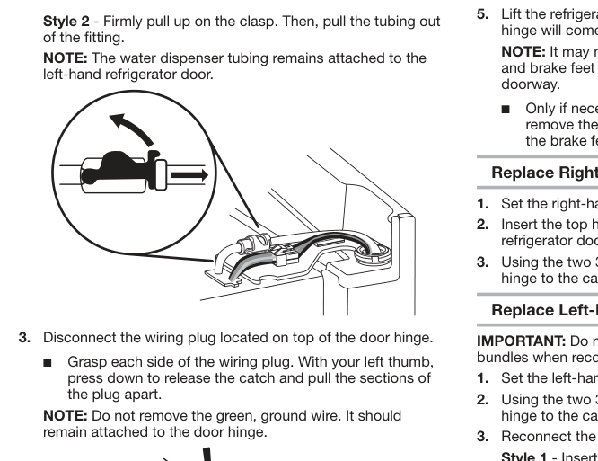
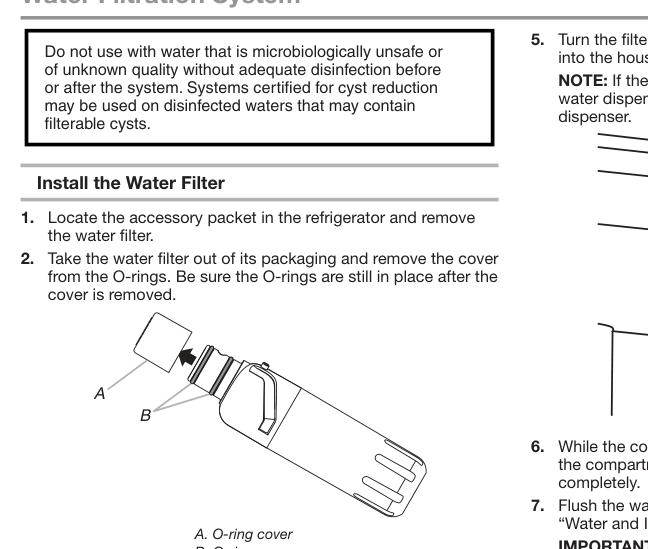
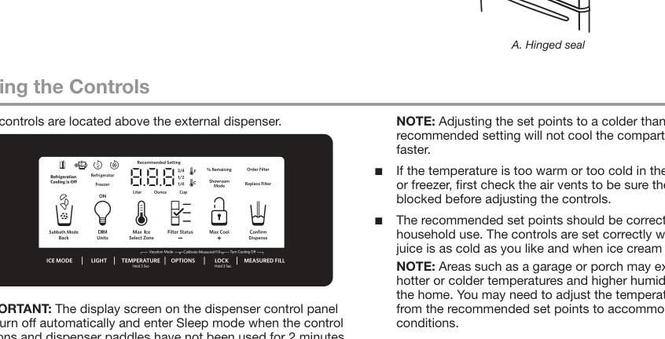

# KitchenAid French Door Bottom Mount Refrigerator — Technician Support Knowledge Base

> **[DOCUMENTED] default evidence level.** Only technical source: *FRENCH DOOR BOTTOM MOUNT REFRIGERATOR — USE & CARE GUIDE*, document **W11218735B**, 43 printed pages. Folder identification `kitchenaid_KRFF507HPS` is the requested model, but the manual is written for a **family of French-door bottom-mount designs**. Features explicitly described as “some models” cannot be assigned confidently to every full SKU. No external appliance knowledge or assumptions have been added.

## Technician's operating policy and identification (pp. 1–6)

When a customer calls, obtain full model/serial, their physical layout (door icemaker vs freezer icemaker, air filter, produce preserver, separate pantry controls), the exact on-screen message and when the symptom began. Check for safety hazards before standard troubleshooting. Ask whether cooling is ON and whether a dispenser control is locked. Never recommend sealed refrigeration-system repair, live circuit testing, undocumented reset codes or bypassing protective components: **[UNKNOWN]** from this user manual.

**Major feature vocabulary:** French doors = two upper fresh-food doors meeting at a center seal; bottom mount = freezer drawer below; *In-Door-Ice®* stores ice on the door; *pantry drawer* is the full-width temperature-controlled fresh-food drawer; *crispers* store produce; *Measured Fill* dispenses a selected quantity of water. Some models have dual evaporators (distinct refrigerator and freezer climates), under-shelf LEDs, pull-out tray, produce-preserver packet and air filter. The source explains the purpose of these features, not a universal presence guarantee (pp. 5–6).

**Expected efficient operation:** Compressor/fans can operate longer at varying speeds to match demand. This is not automatically evidence of malfunction (pp. 5, 33–35). Separated evaporator compartments where fitted can reduce odor transfer and frost. The air filter helps reduce odors; produce-preserver pouches absorb ethylene gas (p. 6).

## Fundamental safety and installation prerequisites (pp. 3–4, 7, 12)

- Obey all labeled **DANGER / WARNING** messages. Disconnect power before installation, service and cleaning; keep children from entrapment. On disposal remove refrigerator/freezer doors and leave shelves so children cannot enter easily (p. 4). Do not store flammable materials nearby; use nonflammable cleaner.
- Electrical: **115 V, 60 Hz AC**, **15- or 20-amp fused** grounded **three-prong** supply. A dedicated unswitched outlet is recommended. **No adapter, ground-prong removal or extension cord**. Before cleaning or installation, turn Cooling OFF **and disconnect power**; Cooling OFF by itself is not unplugging (p. 12).
- Water: potable **cold water 35–120 psi (241–827 kPa)** for ice/dispenser. Do not use microbially unsafe water without adequate disinfection. Ice water supply is sensitive to reverse-osmosis pressure; RO output to refrigerator must still be 35–120 psi; RO system feed minimum quoted as 40–60 psi (276–414 kPa). Check clogged RO sediment filter or depleted RO holding tank if low pressure. Faucet-mounted RO not recommended (p. 12).
- Check and preserve model-specific door swing, leveling, airflow clearance and full width/height before positioning cabinet. Install above freezing and observe local codes. Keep ventilation clear and handle glass shelves carefully.

## Installation sequence — door removal, water, handles and leveling (pp. 7–16)

1. **Unpack**: remove packaging and adhesives with a nonabrasive method; protect floors and cabinet surfaces when moving. Refrigerator is heavy. Confirm clearance and wiring/water routes before beginning (p. 7).
2. **Removing doors to fit through an entrance** (pp. 8–10): Measure entrance and appliance first. Unplug, keep doors closed until ready, remove upper hinge covers/bolts and release hinge components. The left-door ice/water variant has a **water connection and electrical wiring at its hinge**, which must be disconnected in the documented order before lifting. Rest doors on a soft, protected surface; reinstall hinges, water lines and connectors with their original routed positions. Risk of falling door or pinched connection if incomplete. Use the appropriate **Style 1** versus **Style 2** water-tube connector illustrated on p. 10, rather than forcing an unfamiliar connector.
3. **Freezer drawer front removal** (p. 11): Confirm clearance, remove drawer front via the manufacturer-described bracket/slide mechanism with assistance. Match left and right bracket positions when replacing; check slides before restoring freezer storage. This is a large heavy moving component, not a casual consumer troubleshooting step.
4. **House water line** (pp. 12–14): Supply through adequate household pipe (**1/2-in / 12.7-mm suggested**). Use **1/4-in / 6.35-mm OD** soft copper or listed PEX. Source PEX suggestions: **W10505928RP 7 ft**, **8212547RP 5 ft**, **W10267701RP 25 ft**. Do not use a piercing-type or **3/16-in saddle valve**. Shut water off, open nearest tap, connect shutoff using proper compression fittings, flush into container until clear, coil enough slack to move fridge, then connect to appliance using the **correct Style 1 or Style 2** instructions. Check for leaks with valve open; don't kink tube or overtighten fittings. Keep tubing above freezing. If running refrigerator before water is connected, **turn icemaker OFF**.
5. **Handles** (pp. 14–15): Follow each handle's fastener drawings and mounting sequence. Seat handle endcaps fully, use specified key/tools, and verify securely mounted before use. A drawer handle and door handles may have different mounting positions; don't force misaligned parts.
6. **Cabinet stabilizing/door alignment** (pp. 15–16): Set leveling and **brake feet firmly against floor** to prevent fridge rolling as doors open, then align door heights/gaps following adjusting illustration. Don't use equal door gaps as proof cabinet is physically level without checking feet. The customer-facing door-closing checks on p. 39 are the first troubleshooting step for uneven doors.

## Filters — water, air, and produce preservation (pp. 17–20)

### Water filtration system and replacement

The cartridge is inside the appliance in the described filter compartment. Open the filter access door, remove shipping/old cartridge as directed, orient and lock replacement into the housing, and close it; follow p. 17 diagram for exact keyway/rotation. **Replace disposable water filter when indicated** by **REPLACE FILTER (red)** on the control or after the manual's replacement period (generally **six months**); reduced flow can indicate blockage. **[UNKNOWN]** The provided owner-guide pages do not establish a general customer procedure for dispensing water without the cartridge; do not promise bypass operation without manufacturer-approved instructions. Filter status tracking **automatically resets** after a correctly installed new cartridge; persistent red can indicate missing or incorrectly installed cartridge (p. 23). After installation/replacement **flush the system per the Water and Ice Dispensers instructions** (p. 24), rather than skipping the flush.

### Air filter / produce preserver

Optional air filter goes in its dedicated housing, with replacement/status indicator depending on the unit. Air filter reduces food odors; don't confuse it with drinking-water filter. Optional produce-preserver pouch retards ethylene-driven ripening; follow housing directions and attach its status indicator **when installing the pouches**. The guide has specific indicator activation and placement steps on pp. 18–20. Read location diagram before detaching anything.

## Doors, controls and display (pp. 21–23)

**Hinged vertical seal:** The left fresh-food door seal folds inward when that door opens and forms the central seal when the doors close. Both doors may open independently. Don't pry the folding seal into a different shape; check correct closure/clearance (p. 21).

**Display wakes from sleep:** After **2 minutes of no buttons or paddles**, screen may turn off; press a button to reactivate. This alone is not a power fault.

**Factory targets:** Refrigerator **37°F (3°C)**; freezer **0°F (-18°C)**. Let cool **24 hours before loading food**; setting unusually cold does not speed initial cooldown. After changes, wait **at least 24 hours** before changing again, and check vents before adjusting. Allowed ranges: fridge **33–45°F (0–7°C)**, freezer **-5–5°F (-21 to -15°C)** (pp. 21–22).

### Change compartment temperature

1. Hold **TEMPERATURE 3 seconds** to enter temperature mode.
2. Press TEMPERATURE to switch refrigerator/freezer view; **LIGHT** under Units toggles °C/°F during temperature mode.
3. Press **LOCK (+)** to make the set point *warmer* (higher number), or **OPTIONS (-)** to make it *colder* (lower number).
4. Press TEMPERATURE for the other compartment and adjust separately if needed.
5. Press **MEASURED FILL (Confirm)** to save. **ICE MODE (Back)** cancels; after roughly **60 seconds idle** the control returns without saving changes (p. 22).

| Customer observation | Documented response (p. 22) |
|---|---|
| Fresh-food too cold | Raise its temperature set point **1 degree** |
| Fresh-food too warm | Lower fresh-food set point **1 degree** |
| Freezer too cold | Raise freezer set point **1 degree** |
| Freezer too warm / too little ice | Lower freezer set point **1 degree** |

### Cooling and specialty modes

| Control or feature | Exact action | What it does / caveat |
|---|---|---|
| Cooling OFF / ON | Hold **LOCK + MEASURED FILL** simultaneously **3 seconds**, repeat to restore | Stops cooling both compartments; does **not** disconnect electrical supply |
| Max Cool | OPTIONS → **LOCK** under Max Cool | Temporary extra cooling, **24 hours** unless manually stopped |
| Max Ice | OPTIONS → **TEMPERATURE** under Max Ice | Temporary increased ice output, **24 hours** unless manually stopped |
| Water filter status | FILTER STATUS / relevant options control | Remaining percentage 100→0; Yellow ORDER FILTER, red REPLACE FILTER; a correctly installed replacement resets automatically |
| Sabbath mode | Hold **LIGHT + OPTIONS** **3 seconds** | Disables lights, audible alerts and dispenser paddles while keeping set points; press again to exit; cooling OFF cancels it |
| Vacation mode | Hold **TEMPERATURE + OPTIONS** **3 seconds** | Reduces defrost frequency; display `VAC`; after first hour, opening/closing fridge door exits; Max Ice/Cool/Sabbath also cancel |
| Power outage message `PO` | Press **MEASURED FILL** to acknowledge | Flashes when power loss and freezer warmed to **18°F (-8°C) or higher**; normal controls disabled pending acknowledgement |
| Door Ajar alarm | Close all affected doors/drawer | Sounds after **5 minutes** ajar with cooling on; repeats every **2 minutes**; pressing button temporarily mutes |

**Sabbath nuance:** If power outage happens *during* Sabbath mode, the power-outage message isn't shown later, no matter how long power was lost (p. 23).

## Water and ice dispensing — flush, calibrate, measured fill, lock (pp. 24–27)

### First use / after replacing filter

**Flush the dispenser water system** as directed on p. 24 before using it for drinking or ice and after replacing the filter. Using a sturdy container, **hold the dispenser paddle for 5 seconds and release it for 5 seconds**, repeating those alternating periods until the specified volume has been collected and discarded, to remove air/particles. Initial spit/sputter can be normal; if water fails to appear check supply, installed filter and line pressure. Don't operate ice making until flush complete. The manual says dispense **3 gallons (12 L)** in multiple cycles after installation (p. 24). Never dispense into fragile glass for ice.

### Measured Fill calibration (pp. 24–25)

If amount dispensed differs from requested amount, the feature provides a calibration procedure using a **1-cup / 237 mL measuring cup**: start calibration from its on-panel procedure; dispense into the measuring cup; use displayed adjustment choices until the collected volume is exactly one cup; press **MEASURED FILL** under Confirm. Do not guess scale based on glass size.

### Measured Fill operation (p. 25)

Press **MEASURED FILL** → choose unit using **LIGHT (Units)** → adjust desired volume with **LOCK (+)** and **OPTIONS (-)** → dispense by pressing sturdy container against water lever **or** press MEASURED FILL with container under spout. Countdown shows amount remaining, auto-stops on target. Press/hold lever release or press Measured Fill again to stop early; mode times out after **1 minute** idle; **ICE MODE (Back)** cancels. An empty vessel with adequate volume is essential.

| Unit | Default | Minimum | Maximum |
|---|---:|---:|---:|
| Ounces | 8 | 1 | 128 |
| Cups | 1 | ¼ | 16 |
| Liters | 0.25 | 0.05 | 4.00 |

Dispense at least **1 quart / 1 L weekly** for fresh water; small flow check from p. 25: dispensing **1 cup / 237 mL in 8 seconds or less with the water filter removed** indicates minimum pressure to the refrigerator is met; longer indicates pressure below recommendation. This is the manual's test, not an inferred flow standard.

### Ice, tray, light and lock (p. 26)

Use **ICE MODE** to choose cubed (default) or crushed. Hold sturdy glass near dispenser and gently activate paddle; ice can continue moving briefly after release, and some crushed fragments when switching to cubed are expected. Every **two weeks** if little ice is used, remove clumps and clean chute/bin underside with **plastic utensil**, warm damp cloth and dry; never use sharp objects. Drip-tray insert tilts out when rear edge is pressed. **LIGHT** cycles **OFF / ON (100% brightness) / DIM (50%)**. Hold **LOCK 3 seconds** to lock/unlock dispenser and controls; lock **does not switch off refrigerator/ice maker/light power**.

### Ice production and ON/OFF switch variants (p. 27)

New installation: allow **24 hours** for first ice, **2–3 days** to fill the bin; discard **first three batches**. Typical **~3 lb / 1.4 kg per day**; Max Ice can raise output. Fridge-compartment icemaker on equipped models sits at left ceiling with bin on left door: slide physical switch **left = ON, right = OFF**; opening ice compartment latch gives access. Its sensor stops making ice when bin is full, door open or bin removed. Freezer-compartment icemaker on other models uses **wire shutoff arm down = ON, up = OFF**, with automatic stop on full bin—don't force the arm. Turn OFF before lifting a bin for serving/cleaning, and restore ON after replacement. Avoid softened water if possible; maintain softener if unavoidable. Avoid sharp utensils in ice bin.

## Physical storage and food organization (pp. 28–30)

- **Refrigerator shelves**: adjustable glass panels must be removed/reinserted using rear support hooks; first empty shelf, lift as the illustrated mechanism requires, and ensure both supports fully seat. Some models have **under-shelf LED connections**, making full seating important (p. 28, 34).
- **Crispers**: the guide states humidity is **automatically regulated**, so there is no crisper humidity adjustment; glass cover insert is separated from frame by lifting gently at center, then replacing by lowering into frame (p. 29).
- **Temperature-controlled pantry drawer**: affects **only drawer**, not refrigerator/freezer cooling. Settings **Coldest — Fish/Meat; Colder — Deli/Cheese; Cold — Wine**. Avoid leafy greens in this cooler drawer. Drawer divider lifts out after fully opening; align underside locating features on reinstallation (pp. 29–30).
- **Meat storage durations quoted** (p. 30): fresh fish/shellfish same purchase day; chicken/ground beef/organ meats **1–2 days**; cold cuts/steaks/roasts **3–5 days**; cured meats **7–10 days**. Freeze if storing longer. Store leftovers covered.
- **Door bins** lift up/out, reinstall above supports and slide down until stopped. **Freezer pizza-pocket divider** can slide sideways a few inches but is **not removable** (p. 30).

## Cleaning, condenser, LEDs, vacation and moving (pp. 31–32)

Clean inside freezer/fridge about **monthly** (automatic defrost does not eliminate cleaning). For **smooth painted doors**, use soft clean cloth and warm mild soapy water—avoid paper towels/newspaper and abrasive, ammoniacal, vinegar, acidic, oven or flammable cleaners. For **stainless steel**, use cloth/mild soap; approved appliance stainless cleaner only on steel, **never plastic**. Wipe spills promptly (p. 31).

No routine condenser cleaning needed under normal conditions. In particularly greasy/dusty/pet-heavy environments, clean every **2–3 months**: unplug, remove base grille, vacuum with soft brush in open grille/condenser areas, reinstall grille and reconnect (p. 32). Refrigerator/freezer LEDs aren't user-replaceable; if power exists but lights fail, contact service.

**Vacation with refrigerator running:** use/freeze perishables, shut off ice-maker water, switch ice-maker OFF and empty bin. **Turning off for vacation:** empty food, turn off ice water at least a day ahead, turn ice maker off after final ice, turn temperature cooling off, clean and dry, prop doors open using taped wood/rubber blocks to avoid odors/mold. **Move**: shut water a day ahead, disconnect rear line, pack food/frozen food appropriately, remove/secure loose components, turn cooling off and unplug, clean/dry, raise legs to roll safely, tape doors and cord. Reconnect water at new location per installation section (p. 32).

## Customer troubleshooting — documented symptom routing (pp. 33–39)

| Symptom / searchable wording | Manual-based triage and response | Page |
|---|---|---|
| Not running, no cooling | Verify grounded power, outlet, fuse/breaker; confirm cooling ON; allow 24h after installation; check whether **Showroom** mode is displayed | 33 |
| Runs constantly or unusually long | Efficient compressor can run longer; check hot room, recent warm food, frequent/ajar doors, very cold setting, poor/dirty door gasket | 34 |
| Lights off | LED not user replaceable; check dispenser light setting and doors open >10 minutes (close/reopen to reset); contact service | 34 |
| Under-shelf LEDs off | Seat rear shelf hooks fully in brackets, check shelf support screws and doors open >10 min | 34 |
| Pantry drawer control unresponsive | Exit Cooling Off. If control initialization failed, manual says unplug **5 sec**, reconnect and wait **30 sec** before opening doors or touching panel | 34 |
| Whirring, pulsating, popping, hissing, sizzling, gurgling, buzzing, clicks, ice clatter | Consult sound list: most linked to fans/compressor, normal expansion, valve, defrost or ice production. Buzzing/clicking when no water line connected → **turn icemaker OFF** | 34–35 |
| Rattling/vibrating | Level brake/feet, secure water tubing against cabinet, remove stored objects touching cabinet | 35 |
| Fridge/freezer too warm | Verify 24h first cooling, Cooling ON, unblocked air vents, door seals/closure, recent load, then adjust colder **1 degree** and wait 24h | 35 |
| Fresh-food/crisper freezing | Clear vent in upper-left rear, change set point warmer; check ice bucket seating | 36 |
| Pantry drawer too cold | Use correct cold/colder/coldest for actual foods | 36 |
| Moisture, frost or ice buildup | Reduce openings, close doors, remove shelf/bin blocking closure, cover liquid containers, clean/check seals, verify controls | 36 |
| No or little ice | Fully open cold water shutoff, straighten kink, switch icemaker ON, wait 24h/3 days, clear jam gently with plastic, seat/replace filter, consider RO pressure | 36 |
| Hollow/small cubes | Low water pressure warning: check valve open, water tubing, filter and RO; consult licensed plumber for pressure | 37 |
| Taste, odor, gray ice/water | Flush newly installed water system, change expired filter, discard old ice, clean bin; review source water quality | 37 |
| Water dispenser doesn't work/slow | Water connected/on, line unkinked, correct filter installed, dispenser unlocked, water system purged, door fully closed, pressure checked | 37–38 |
| Dispenses water unintentionally or drips | Check remaining air after filter exchange; flush again; clean spout and inspect dispenser hardware per manual | 38 |
| Water leaking from back | Recheck/re-tighten correct water-line connectors, especially after doors removed | 38 |
| Water tastes warm | Source water is chilled to approx **50°F (10°C)**; allow 24h after installation, **3h** after dispensing a lot, discard first glass after inactivity, confirm cold-water pipe | 39 |
| Door won't close | Remove food or packaging obstruction; seat drawer, shelf, bins | 39 |
| Door difficult to open | Clean sticky gasket and contact surfaces with mild soap/warm water and dry | 39 |
| Doors uneven / cabinet rolling | Align doors; turn **both brake feet clockwise** evenly until snug with floor | 39 |

**Do not jump to compressor, board, sensor or refrigerant failure** from these symptoms. Those component-level diagnoses are **[UNKNOWN]** in this owner guide.

## Water-filter performance data and warranty (pp. 40–43)

**Performance sheet (p. 40):** Water filtration model **P9WB2L/P9RFWB2L**, capacity **200 gal (757 L)**. The source specifies replacement cartridge **P9RFWB2L**, part **EDR2RXD1 / EDR2RXD1B**, change **at least every six months**, potable city/well water **35–120 psi**, incoming water **33–100°F (1–38°C)**, service flow **0.75 gpm (2.84 L/min) at 60 psi (413.7 kPa)**. The system was tested against **NSF/ANSI 42, 53, 401, CSA B483.1**. Reported reductions include chlorine taste/odor **97.0%**, Class I particulate **>99.9%**, lead at pH 6.5/8.5 **>99.3% / 98.6%**, and various listed organic compounds and pharmaceuticals. Use the full table below when answering precise contaminant questions; never suggest it proves removal of substances absent from the table. **[DOCUMENTED / notation caution]** The source table literally prints some emerging-contaminant influent challenges as `200 ± 20%`, `140 ± 20%` or similar **without a concentration unit in that column**; those unqualified values are retained as printed, not converted into an inferred unit.

| Substance | Test challenge | Maximum treated level / benchmark | Average reduction |
|---|---|---|---|
| Chlorine Taste/Odor | 2.0 mg/L ± 10% | 50% reduction | 97.0% |
| Particulate Class I* | At least 10,000 particles/mL | 85% reduction | >99.9% |
| Lead: @ pH 6.5 / @ pH 8.5 | 0.15 mg/L± 10% | 0.010 mg/L | >99.3%/98.6% |
| Benzene | 0.015 mg/L ± 10% | 0.005 mg/L | 93.8% |
| p-Dichlorobenzene | 0.225 mg/L ± 10% | 0.075 mg/L | 99.8% |
| Carbofuran | 0.08 mg/L ± 10% | 0.040 mg/L | 81.9% |
| Toxaphene | 0.015 ± 10% | 0.003 mg/L | >95% |
| Atrazine | 0.009 mg/L ± 10% | 0.003 mg/L | 87.0% |
| Asbestos | 10⁷ to 10⁸ fibers/L†† | 99% | >99% |
| Live Cysts† | 50,000/L min. | 99.95% | >99.99% |
| Turbidity | 11 NTU ± 10% | 0.5 NTU | 96.9% |
| Lindane | 0.002 ± 10% | 0.0002 mg/L | >99.2% |
| Tetrachloroethylene | 0.015 mg/L ± 10% | 0.005 mg/L | 96.6% |
| O-Dichlorobenzene | 1.8 mg/L ± 10% | 0.60 mg/L | 92.3% |
| Ethylbenzene | 2.1 mg/L ± 10% | 0.70 mg/L | 86.9% |
| 1,2,4-Trichlorobenzene | 0.210 mg/L ± 10% | 0.07 mg/L | >99.8% |
| 2,4 - D | 0.210 mg/L ± 10% | 0.07 mg/L | 88.5% |
| Styrene | 2.0 mg/L ± 10% | 0.1 mg/L | 99.6% |
| Toluene | 3.0 mg/L ± 10% | 1.0 mg/L | 93.5% |
| Endrin | 0.006 mg/L ± 10% | 0.002 mg/L | 81.7% |
| Atenolol | 200 ± 20% | 30 ng/L | 95.7% |
| Trimethoprim | 140 ± 20% | 20 ng/L | 96.1% |
| Linuron | 140 ± 20% | 20 ng/L | 96.3% |
| Estrone | 140 ± 20% | 20 ng/L | 95.3% |
| Nonylphenol | 1400 ± 20% | 200 ng/L | 95.5% |

**KitchenAid ten-year limited warranty (p. 41):** **year 1** parts and labor for covered manufacturing defects; **years 2–5** parts and labor for certain refrigerator/freezer *cavity liner cracks* and sealed system (compressor, evaporator, condenser, dryer, connecting tubing); **years 6–10** **sealed-system parts ONLY**, labor excluded. Conditions include installation/operation/maintenance per instructions, and applicable USA/Canada domestic use. Proof of original purchase needed. Warranty exclusions include improper installation, unauthorized work, commercial/nonresidential uses, consumables including filters, cosmetic/surface corrosion exclusions, food/medicine loss, inaccessible appliance and remote transport/service restrictions. Check complete printed warranty terms before promising coverage. Page 42 is blank notes, not an additional technical procedure.

**Support (pp. 41, 43):** US **1-800-422-1230**, **www.kitchenaid.com**; Canada **1-800-807-6777**, **www.kitchenaid.ca**. Also listed: US KitchenAid, 553 Benson Road, Benton Harbor MI 49022-2692; Canada 200–6750 Century Ave., Mississauga ON L5N 0B7. Printed numbers are archival, not independently confirmed as currently active.

## Explicit UNKNOWN boundaries and escalation

| Question | What source does NOT establish | Valid source-based answer |
|---|---|---|
| “Which compressor, relay or PCB is bad?” | Technician-only component diagnosis | Use symptom checks pp. 33–39, then manufacturer service |
| “What voltages, resistance or refrigerant pressure should I measure?” | No internal test points or service schematics in this guide | Qualified technician/service; don't invent values |
| “How do I force defrost / enter engineering mode?” | No such diagnostic procedure documented | Describe supported cooling/modes, escalate |
| “Which filter fits my full suffix beyond the printed family?” | No universal SKU-to-filter compatibility crosswalk | Use document's explicitly named P9WB2L/P9RFWB2L system, verify installed item |
| “Does this exact SKU have optional dual evaporators, under-shelf LEDs, produce preserver?” | Explicitly some-model features | Identify feature physically; don't assume |
| “Can you promise repair under warranty?” | Individual purchaser terms, eligibility and exclusion specifics | Review purchase record and p. 41 terms |

## Content coverage audit

| Source printed pages | Reconstructed topics |
|---|---|
| 1–4 | Identification, safety and proper disposal |
| 5–6 | Layout, storage and efficiency features; options |
| 7–11 | Unpack, refrigerator door and freezer drawer disassembly/reassembly |
| 12–16 | Electricity, water supply, handles, leveling and door adjustment |
| 17–20 | Water filter, air filter, produce preserver |
| 21–23 | Hinged seal, temperature controls, cooling, modes, alarms |
| 24–27 | Dispenser/Measured Fill, ice variants and storage bin |
| 28–30 | Shelves, bins, temperature-controlled pantry, freezer divider |
| 31–32 | Finishes, condenser, lighting, moving/vacation |
| 33–39 | All manufacturer troubleshooting categories: operation, sounds, temp, moisture, ice, water, doors |
| 40 | Filtration performance table |
| 41 | Terms of ten-year limited warranty |
| 42 | Blank notes sheet—no substantive technical claims |
| 43 | Manufacturer support contacts |

*This is a documented-source customer-support knowledge base, not a replacement for an authorized service manual. Selective diagrams retain needed visual callouts while the main operational knowledge is readable as text.*
