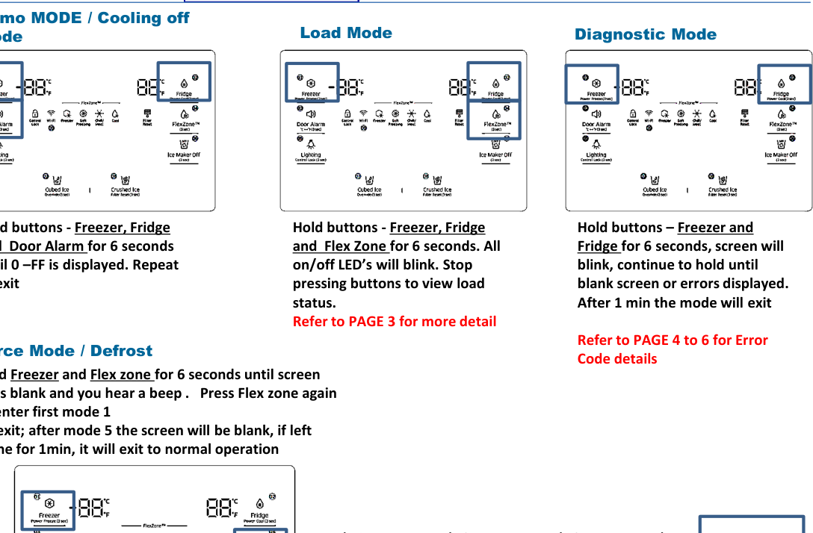
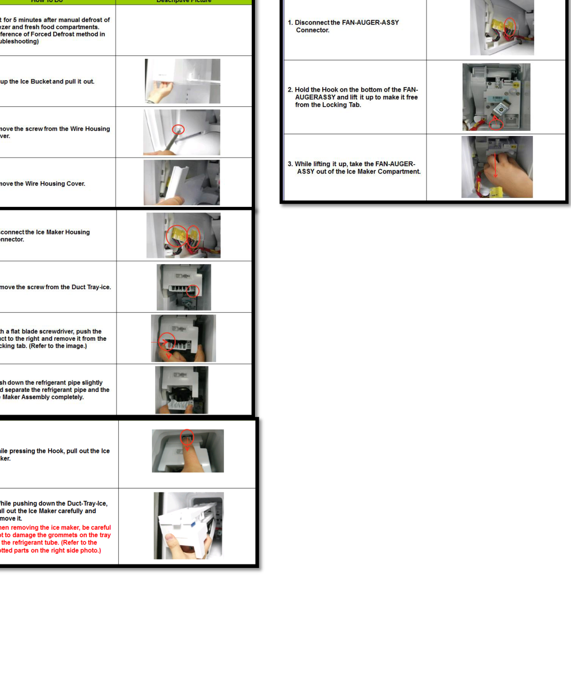
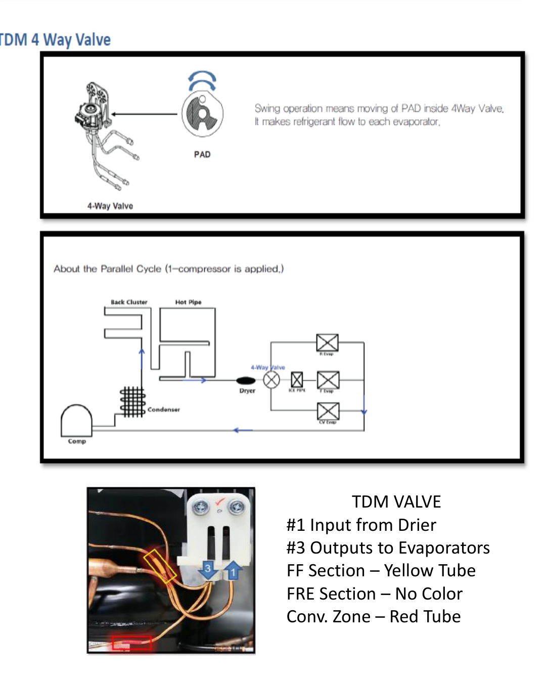
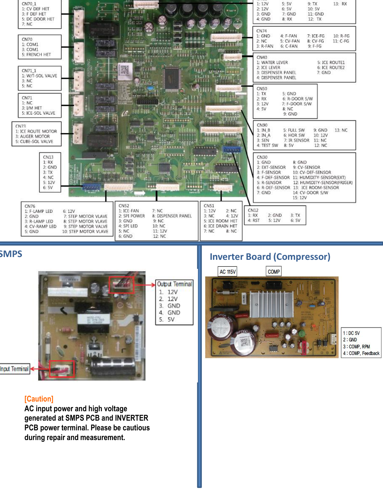
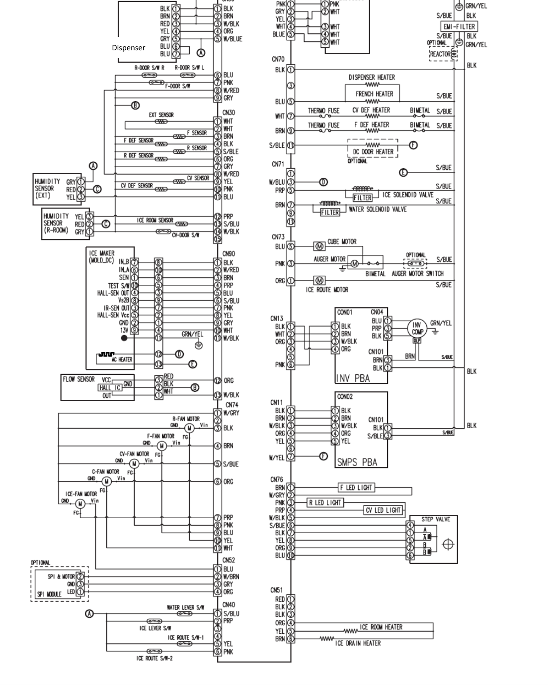

# Samsung Fast Track Troubleshooting — Technician-Only Knowledge Base

> **SOURCE ISOLATION:** This handbook is reconstructed **only** from the supplied 12-page PDF titled *Fast Track Troubleshooting*, models **RF28K9070, RF22K9381, RF28K9380**, production reference **DRRF28K9070-060616** (p. 1). No information from any Samsung owner guide, another manufacturer, outside service manual or prior generated knowledge is used. Folder designation `RF28K9070SG` is a requested product suffix; this sheet lists **RF28K9070** as its model family. Document status **[DOCUMENTED]** unless marked **[UNKNOWN]**.

## Non-negotiable reader and work restrictions (pp. 1, 2, 11)

**IMPORTANT — FOR QUALIFIED SERVICE TECHNICIANS ONLY.** The source expressly requires acceptable electrical/electronic/mechanical repair expertise and warns that major-appliance repair can cause injury and property damage. **Do not give a high-school graduate, untrained end user, or customer live-wire measurements, PCB manipulation, forced-heater instructions or removal of energized parts as DIY guidance.** Instead, use symptom records to explain what a qualified technician will investigate and arrange trained service.

- Page 11 explicitly warns of **AC input power and high voltages** generated at **SMPS and INVERTER PCB power terminals**. Work on energized PCBs entails shock/electrical damage risk.
- Page 2 directs technicians to use circuit **GND on the main PCB for DC component voltage measurements**; using chassis ground can produce wrong readings. This is a measurement-reference instruction for trained technicians, not an invitation to probe circuits without proper isolation/qualification.
- Electrical disconnection is specifically required by the source for the resistance tests marked **“Must power off”** (pp. 4–5). Do not treat their values as live-circuit measurements.
- Sensor triage note (p. 2): **resistance >100 kΩ considered open**, **<2 kΩ considered shorted**; the sheet also warns out-of-tolerance sensors can return a plausible but incorrect value. These are broad sensor thresholds, **not** a complete temperature-versus-resistance calibration table.
- **[UNKNOWN]** The PDF is not a full authorized service manual; it does not specify all protective isolation steps, full test instrumentation, all refrigerant charge/service procedures, repair certifications, or a complete environmental/electrical test plan. No method should be invented to bridge that gap.

## Mode/navigation quick reference (p. 1)

| Mode | Source button sequence | Result, exit and caution |
|---|---|---|
| **Force mode / defrost** | Hold **Freezer + Flex Zone 6 sec** until display blanks/beeps; press **Flex Zone again** to enter first forced mode | Source offers **5 positions**; screen blank after mode 5, inactivity **1 min** returns normal |
| **Demo / Cooling Off** | Hold **Freezer + Fridge + Door Alarm 6 sec** until `0-FF` shown; repeat to exit | Technician sheet's specific timing. Do **not** assume the timing equals a separate user manual |
| **Load mode** | Hold **Freezer + Fridge + Flex Zone 6 sec**; all on/off LEDs blink, then release | Read display segment pattern using page-3 load table; no automatic component-failure verdict |
| **Diagnostic/error mode** | Hold **Freezer + Fridge 6 sec**; screen blinks; continue holding until blank or error display | Errors shown, returns after ~**1 min**, consult pp. 4–6; do not confuse with load mode |

### Force-mode labels and scope

The table on p. 1 associates displayed forced modes with **`FF`, `FF r`, `FF F`, `FF C`, `FD`**. The first modes select continuous/high-output operating combinations and evaporator valve states, with **24-hour** time stated for forced cooling rows. **`FD`** indicates **defrost with all heaters on**: potentially hazardous and reserved for technicians. This is a forced diagnostic state, **not a recommended way to speed normal freezing**. Specific valve and fan engagement is model dependent; preserve original table and ask trained operator to consult the labelled modes figure before executing.

## Load-mode display: how to interpret segments (p. 3)

Load mode exposes actual operating status through labeled display LED segments; these indicators are **not interchangeable with service error codes**. Press **Freezer + Fridge + Flex Zone 6 sec**, release on blink, then interpret each location per the table.

| Load indicator | Display mark / segment described by source | Meaning when lit |
|---|---|---|
| Refrigerator fan highest | `a` + `b` at lowest-order R digit | R-FAN highest active |
| Refrigerator fan high | `a` at lowest R digit | R-FAN high |
| Refrigerator fan low | `b` at lowest R digit | R-FAN low |
| Overload ambient | `e` at lowest R digit | Ambient **≥34°C** |
| Low ambient | `f` at lowest R digit | Ambient **≤21°C** |
| Demo mode | `g` at lowest R digit | Demo mode active |
| Compressor | `a` at lowest F digit | Compressor operating |
| Freezer fan highest | `b`+`c` at lowest F digit | F-FAN highest |
| Freezer fan high | `b` at lowest F digit | F-FAN high |
| Freezer fan low | `c` at lowest F digit | F-FAN low |
| Freezer defrost heater | `d` at lowest F digit | Heater energized |
| Convertible fan highest | `e`+`f` at lowest F digit | C-FAN highest |
| Convertible fan high | `e` at lowest F digit | C-FAN high |
| Convertible fan low | `f` at lowest F digit | C-FAN low |
| F evaporator valve | `b` at second-lowest F digit | Freezer valve open |
| Convertible valve | `c` at second-lowest F digit | Convertible-zone valve open |
| Refrigerator valve | `f` at second-lowest F digit | Fridge valve open |
| French heater | `g` at second-lowest F digit | Heater operation |
| CV fan highest | `Freezer` and `Thin Ice` CV indicators | Highest CV fan |
| CV fan high | `Freezer` CV indicator | High CV fan |
| CV fan low | `Thin Ice` CV indicator | Low CV fan |
| CV defrost heater | `Fridge` CV indicator | CV heater operating |
| Normal ambient | `e` and `f` R digits OFF | Ambient **22–33°C** |
| Ice room fan | `d` at second-lowest F digit | Ice room fan runs |
| Ice maker full | `e` at second-lowest R digit | Bucket full |
| Wi-Fi status | Wi-Fi LED OFF / blink / ON | No AP or internet / router connected / internet connected |

Segment positions require the source's appliance display diagram, not guessing from ordinary typography. They are useful when investigating a condition that may be the correct normal operating state.

## Diagnostic/error-mode symptom index (pp. 4–6)

**Technician-only interpretation:** The listed connector, pin, voltage and resistance ranges are the source's **test references**, not a customer-safe procedure. Only the authorized trained person should handle a main PCB. Sensor 'open'/'short' is the source's detection framing. Values may depend on board configuration and supply; **do not substitute guessed reference points**.

### Sensors and environmental input (p. 4)

| Diagnostic no. | System monitored | Source-reported expected voltage / location |
|---:|---|---|
| 1 | Freezer sensor | **CN30 1–3: 4.5–1.0 V** |
| 2 | Refrigerator sensor | **CN30 1–5: 4.5–1.0 V** |
| 4 | Freezer defrost sensor | **CN30 1–4: 4.5–1.0 V** |
| 5 | Refrigerator defrost sensor | **CN30 1–6: 4.5–1.0 V** |
| 6 | Ambient sensor | **CN30 1–2: 4.5–1.0 V** |
| 9 | Convertible-zone sensor | **CN30 11–12: 4.1–0.8 V** |
| 11 | Convertible-zone defrost sensor | **CN30 11–13: 4.1–0.8 V** |
| 13 | Humidity sensor | **CN30 7–9: 4.1–0.8 V** |
| 14 | Fridge ice-maker sensor | **CN90 3–8: 4.5–1.0 V** |
| 15 | Ice-room sensor | **CN30 10–11: 4.5–1.0 V** |
| 16 | Fridge humidity sensor | **CN30 7–8: 4.1–0.8 V** |

**Interpretation limit:** These are pin-to-pin levels and allowable bands *as printed*. They are not sensor output-versus-temperature calibration curves. Wrong circuit-ground selection can invalidate a test (p. 2).

### Fans, defrost, heater and wiring (pp. 4–5)

| Code | Named subsystem | Technician reference in the source |
|---:|---|---|
| 21 | Freezer fan | **CN74 1–4, 7–12 V** |
| 22 | Fridge fan | **CN74 1–3, 7–12 V** |
| 23 | Compressor-room fan | **CN74 1–6, 7–12 V** |
| 24 | Freezer defrost heater | Power **OFF**; separated **CN70_1**, measure `CN70_1 7 ↔ 3`, printed nominal **63(230) Ω ±7%**; 0Ω short, ∞ open wire/bimetal |
| 29 | Convertible defrost heater | Power **OFF**; separated **CN70**, `CN70_1 7 ↔ 1`, printed **63(230) Ω ±7%**; 0Ω short, ∞ open wire/bimetal |
| 31 | Convertible fan | **CN74 1–5, 7–12 V** |
| 35 | Freezer low regist | Sheet only says `ERROR_Freezer low regist`; further diagnosis **[UNKNOWN]** |
| 37 | Convertible low regist | Sheet only says `ERROR_Convertible zone low regist`; further diagnosis **[UNKNOWN]** |
| 39 | Ice maker function | Source says after replacement of ice maker `(R)`, restore power and check operation; no broader logic established |
| 40 | Ice maker fan | **CN52-1 ↔ 6, 7–12 V** |
| 41 | Main ↔ panel communication | Check cabling and communication; sheet discusses main/panel PCB and oscilloscope-based evaluation; exact waveform **[UNKNOWN]** |
| 44 | Main ↔ inverter communication | Check cabling/communication; sheet discusses main/inverter PCB and oscilloscope; no numeric expected waveform |
| 46 | I/O expander communication | Manufacturer sheet proposes main PCB replacement; prerequisite checks unspecified |
| 61 | Ice duct heater | Power **OFF**; isolate CN51, `CN51 4 ↔ 6`, **135 Ω ±7%**; zero short, ∞ open as given |
| 65 | Ice bucket heater | Power **OFF**; isolate CN51, `CN51 4 ↔ 7`, **135 Ω ±7%** |
| 66 | Door-handle heater | Power **OFF**; isolate CN51, `CN51 1 ↔ 2`, **135 Ω ±7%** |

**Ambiguity retained:** The source literally prints **`63(230) ohm ±7%`** for codes 24 and 29 and says value varies by input power. It does not fully explain which nominal corresponds to which supply in the tabular text; **do not assert a single universal resistance** without checking applicable appliance voltage and approved technician documentation. In the original manual code 61 has a truncated description of infinity/open: avoid filling it with invented specifics.

### Temperatures, compressor and inverter faults (pp. 5–6)

| Code | Description | Documented interpretation |
|---:|---|---|
| 71 | Freezer unusually high temperature | Check whether door left open a long time or hot food was stored; code clears after time once condition corrected |
| 72 | Refrigerator unusually high temperature | Same initial usage checks and timed clearing condition |
| 73 | Convertible-zone chill temperature | Same door-open / recently warm-food checks |
| 81 | Compressor run error | Sheet points to inverter PCB solder/short, **15-V DC output below 13.5 V**, compressor/cycle checks by technician |
| 82 | Compressor IPM fault | Similar inverter, short/low-15-V-output and compressor-cycle checks |
| 83 | Compressor current error | Check wiring between compressor and inverter, solder/short, compressor/cycle |
| 84 | Compressor motor stall | Check compressor/cycle, input supply and inverter solder/short |
| 85 | Compressor low voltage | Occurs at **AC input 106 V or lower**, per p. 6 |

A note on p. 6 also flags display-to-main communication error and connectors; the diagnostic page does not assign it another clear numeric code in the text. Do not invent one.

## User-visible symptom routing included in technician sheet (pp. 7–8)

These are the **safer, preliminary checks** that can be communicated to a customer without entering technician modes:

| Complaint | Manufacturer's checks |
|---|---|
| Warm front/sides / condensation | Front heat-proof piping; warm ambient or humid air can cause moisture; verify full door closure |
| Not making ice | If bucket exhausted, wait **12h**; check Ice Maker Off status, freezer setting, water supply/tank, bucket clumps |
| Water dispenser nonfunctional | Check water tank not frozen (increase fridge setting if it is), water available, tank correctly installed, filter properly installed |
| Bubbling noise | Flow of refrigerant is documented as a normal possible cause |
| Bad smell | Discard spoiled foods, regular cleaning, tightly wrap strong-smelling foods |
| Frost on walls | Check vents unblocked, even food arrangement, doors closed |
| Moisture around vegetables | Cover moisture-rich foods, avoid prolonged door openings |
| “Samsung Smart Home” app can't be found | This older sheet states Android **4.0+** or iOS **7.0+**; this is archival compatibility, not current app-store verification |
| App installed but not paired | Samsung login, router and Wi-Fi indicator, register device to AP |
| App registration fails | Try again after a moment; AP distance/interference mentioned |
| App paired but not functioning | Exit/restart app or router; sheet says unplug fridge and restore **after 1 min** as a user-facing reset step |

**Important:** Do not extrapolate these troubleshooting statements to guarantee an app currently exists or a replacement part is compatible. This sheet is dated and thin on modern app ecosystem specifics.

## Mechanical, refrigeration and electrical diagrams (pp. 9–12)

### Ice bucket, icemaker, auger assembly — p. 9

The photographic flow chart gives a **multi-step removal** of ice bucket/ice maker and a separate auger motor assembly. Read each numbered photo caption in order. It requires disconnection and handling of wire housings/connectors, retaining screws, blade screwdriver hooks and controlled extraction. The sheet includes warning about a possible dropped part if assembly isn't handled carefully. This is **qualified technician service**, not an instruction to tug the ice bucket mechanism apart at home.

### TDM four-way valve — p. 10

The figure describes refrigerant routing via **TDM 4-way valve** and its swing/PAD mechanism, with an input from **drier tube #1** and evaporator outputs **#3**. The source identifies **FF section = yellow tube**, **freezer section = no color**, **convertible zone = red tube**. A parallel-cycle illustration maps compressor, condenser, drier, dryer/valve and evaporators. This is for interpreting the sealed-system schematic, **not** permission to cut/recharge refrigerant piping without a full service procedure.

### Main board and power electronics — p. 11

The printed photographic overview identifies **main PCB** with multiple labeled **CN** connectors, an **SMPS**, and an **inverter (compressor) board**. The photo includes source pin names and typical terminal signals. These labels are only reliably usable at high image resolution; don't invent unreadable pin names. The page expressly warns about **AC/high voltages** at SMPS/inverter power points.

### Dispenser wiring — p. 12

The printed wiring diagram is an electrical schematic with wire-color labels, connectors, switches and dispenser components. It is retained as a **selected technical figure** rather than inaccurately re-described from an illegible small image. Any specific continuity, voltage or pin claim beyond the table above remains **[UNKNOWN]** unless directly legible in the original schematic.

## Knowledge gaps that must not be filled by speculation

- **[UNKNOWN]** Whether every service code listed applies to all three prefixes and the requested full suffix `RF28K9070SG`; the source lists the families together without a per-suffix applicability matrix.
- **[UNKNOWN]** Detailed full sensor resistance-temperature tables, exact serial-patch revisions and component-level replacement procedure for every connector.
- **[UNKNOWN]** Full safety isolation/refrigerant-handling instruction, PCB signal waveforms and compressor charging/pressure specs.
- **[UNKNOWN]** Unambiguous mapping of printed `63(230) Ω` nominal pair to every supply variation.
- **[UNKNOWN]** Current availability of old Samsung Smart Home app and historical technician portal links.

## Source coverage checklist

| PDF pages | Knowledge coverage |
|---|---|
| 1 | Force/Demo/Load/Diagnostic modes, modes table, service contacts, restrictions |
| 2 | Circuit-ground and sensor-resistance caution |
| 3 | All 26 load-mode status definitions |
| 4–6 | 35 numbered diagnostic/error records and documented values/limitations |
| 7–8 | General operating symptoms and original Samsung Smart Home troubleshooting |
| 9 | Ice maker/auger removal photographs |
| 10 | TDM four-way valve and parallel-cycle diagrams |
| 11 | Main board, SMPS, inverter and high-voltage warning |
| 12 | Dispenser wiring schematic |

*This is a faithful source-limited technician briefing; it must not be presented as a customer DIY service guide.*
