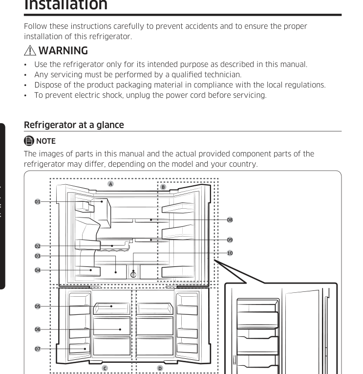
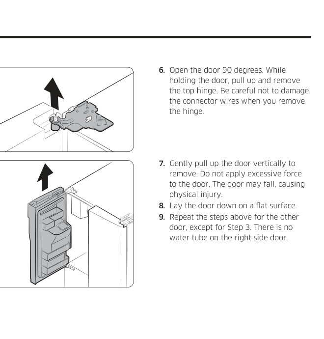
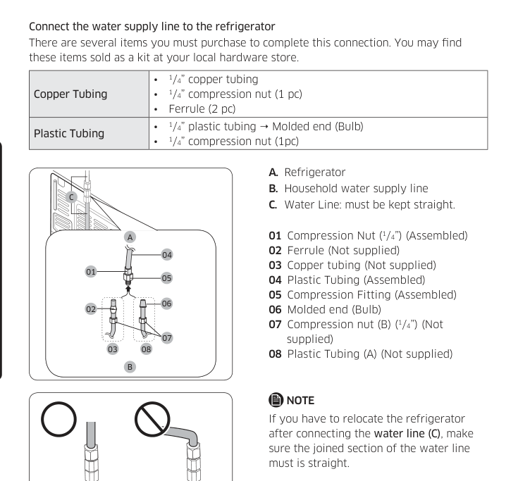
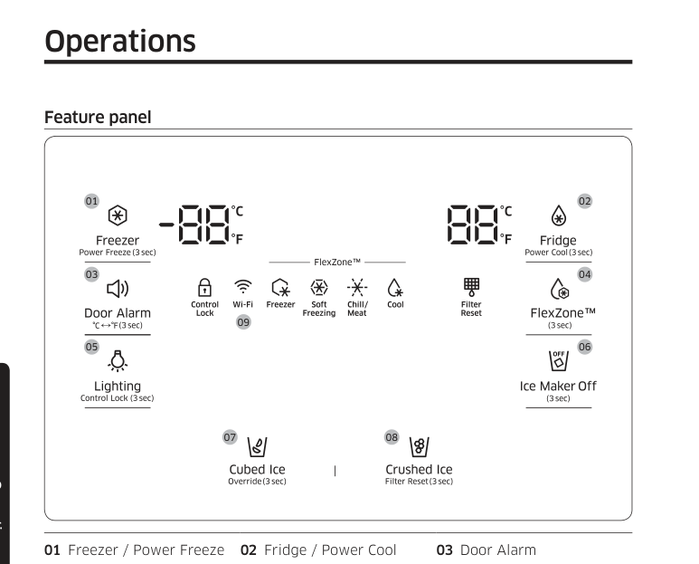
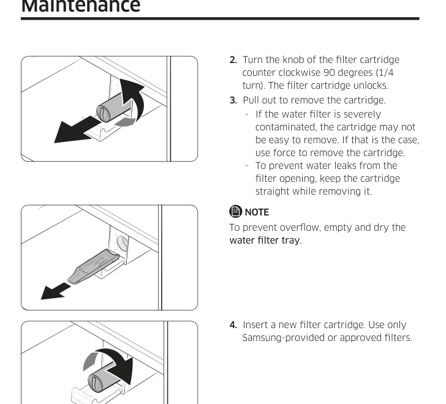

# Samsung Refrigerator — Customer-Support Technician Knowledge Base (User Manual)

> **Source and confidence:** Every refrigerator-specific fact here comes only from *Refrigerator — User manual, Free Standing Appliance*, English printed pages **1–76** of the supplied Samsung PDF, revision/layout dated 2018-07-05. **[DOCUMENTED]** is the default; **[UNKNOWN]** marks missing information. Folder model `samsung_RF28K9070SG` indicates the requested variant, but the illustrated manual also identifies features as *applicable models only*. Do not infer optional equipment from the folder name alone. **This document has been authored without using the separate repair PDF.**

## Support intake and safety boundary

Identify the precise full model, serial, door/showcase arrangement, whether the **bottom-right compartment is FlexZone**, physical water/ice layout, temperature display and the exact symptom/message. First establish whether the unit is in **Cooling Off (`OFF`)**, has a locked control panel or is receiving Smart Grid (`L3`/`L4`) commands before suspecting failed refrigeration. Consult the manufacturer-listed normal behaviors before attributing a component failure. Internal electrical/refrigerant testing, board service and non-user repairs are **[UNKNOWN]** and require qualified technicians, as stated in the supplied user manual (p. 16).

## Safety essentials — do not abbreviate in customer advice (pp. 4–15)

- Carefully follow the guide's WARNING and CAUTION messages. Improper installation, unsuitable power wiring, crushed plugs, wet-hand electrical contact and use of water near energized appliance can cause shock or fire. Use a correctly grounded wall connection, no unsafe shared supply arrangements, and disconnect power before servicing. Do not pull the cable itself to unplug.
- **Do not block ventilation openings**, install near major heat sources, subject to rain/wetness or expose to direct sun. Install on firm, level flooring. Do not allow children to climb on doors, enter cabinet, play with drawers/dispensers or contact moving icemaker components.
- The manual identifies refrigerant as **R-600a or R-134a**, depending on the rating/compressor label; when **R-600a**, it is flammable and requires appropriate disposal. These refrigerant/flammability warnings and safe-disposal cautions apply according to the refrigerator label; do not puncture cooling circuits or attempt heating/drilling defrost shortcuts. Do not use spray/aerosol chemicals near exposed electrical equipment or clean with benzene/thinner/Clorox-type household/car detergents as prohibited by the guide.
- Do not refreeze food that has completely thawed. Keep food clean and safely stored; do not block interior vents with food. Water filtration **does not sterilize drinking water or remove all microbes** (p. 33).
- Remove doors before discarding refrigerator to prevent child entrapment; dispose of foam/refrigerant and packaging according to applicable local regulations.
- For heavy doors, tempered-glass shelves and high door cabinets, follow the lifting and repositioning cautions on the relevant pages. LEDs are **not user-serviceable** (pp. 17, 62).
- Keep the plug accessible after installation; do not leave portable power strips behind the refrigerator. Do not use pipes as substitute electrical earth connections or continue operating with a damaged power cord. Disconnect by firmly gripping the plug, not pulling its cord (pp. 4–8).
- **Do not accelerate defrost** with a hair dryer, heat, ice pick or electrical device; do not put glass bottles or carbonated beverages in a freezer compartment. Do not store temperature-critical pharmaceuticals or laboratory/scientific materials in the refrigerator, which the source does not approve for them (pp. 6–12).
- Do not spray cleaning water into the cabinet or use harsh cleaners. Avoid staring directly into a UV LED where fitted, and avoid trapping fingers at moving door interfaces. If the appliance emits unusual gas/smoke, the guide warns against ignition sources and electrical switching; stop normal troubleshooting and seek appropriate assistance (pp. 5–14).
- Vegetable oils stored in door bins can damage/soften those plastic bins as described in the guide; the shelf/door fittings must not be forced or installed backwards (pp. 10–12).

## Component map, options and physical differences (pp. 16–18)

Parts illustrated: **auto icemaker**, optional wine rack, **EZ Fresh** produce drawers, fresh-food door guards, Easy Slide shelf, dry-food/meat storage drawers, freezer door bins, fixed shelf, QuickSpace shelf, and water filter. Zones: **A Fridge** (upper), **B Showcase Door** (optional), **C Freezer** (bottom-left), **D FlexZone** (bottom-right) (p. 17). Keep shelves/drawers in specified locations for the manual's energy-efficient arrangement. Opening an internal case and showcase in interfering combinations can damage hinges. When closing, ensure vertically hinged section returns to correct orientation; a click may indicate showcase closure. A forcibly shut door can cause another door to open. Icemaker auger interlock automatically stops when door opens.

## Physical installation, removal, clearance and leveling (pp. 19–35)

**Source-specific site requirements** (p. 27): firm **level surface without carpet obstructing ventilation**, protected from direct sun/heat; enough space for opening and servicing; ambient **50–110°F (10–43°C)**. Cabinet dimensions printed: depth A **34¼ in (871 mm)**; width B **35¾ in (908 mm)**; height C **70¾ in (1797 mm)**; overall height D **71⅞ in (1825 mm)**. The **diagram on p. 28** gives swing clearances and 125° door opening; values must be associated with arrows, not interpreted as universal side clearances. Illustrated clearance includes **2 in (50 mm)** at indicated location. Measurements may vary by method. Protect floors with cardboard under legs during positioning (p. 29).

### Refrigerator and freezer door removal to fit through an entrance (pp. 19–26)

**Prerequisites and hazards:** This is a heavy-door installation procedure, not a routine reset. Disconnect appliance power; have a second person available to support the doors. The PDF specifies a **Phillips screwdriver, flat-head screwdriver, 10-mm socket wrench, pliers, 4-mm Allen wrench and 5-mm Allen wrench** (p. 19). **Remove only one refrigerator door at a time**, because a falling door can injure the installer. Keep disconnecting wires and water tubes in their described order; connector positions can vary by configuration (pp. 20–21).

**Detach the refrigerator doors first** (pp. 19–21):
1. With door closed, remove **three top-cover screws** using a Phillips screwdriver, then lift away the top cover without straining its wiring (p. 19).
2. On the **left door**, disconnect both wire connectors. Disconnect its water tube at the coupler (p. 20).
3. Gently draw the **upper-hinge clamp upward in stages**, then remove the clamp. Do not pull suddenly or place fingers where the clamp could pinch (p. 20).
4. Open the door about **90°**. Support it while lifting/removing the **upper hinge**; prevent connector-wire damage. Lift the door **vertically** without excessive force and lay on a flat, protected surface (p. 21).
5. Repeat for the **right** refrigerator door, but **omit the water-tube step**: there is no tube at the right door in this illustrated configuration (p. 21).

**Detach the two lower freezer/FlexZone doors** (pp. 22–23):
1. The guide explicitly requires removing the refrigerator doors **before** removing either lower door. With lower door open, remove the screw and **adjustable-leg cover** using a Phillips screwdriver.
2. Disconnect the bottom wire connectors. Support the door with one hand, then press the hinge shaft **down** with a flat-head screwdriver or wrench to disengage it.
3. Tilt the door slightly **forward** to clear the middle hinge, lift it away, and repeat on the other lower door. Do not leave an unsupported door while releasing its shaft.

**Reinstall lower doors BEFORE refrigerator doors** (pp. 23–24):
1. Insert each lower door into the bottom hinge, taking care not to step on or pinch wiring.
2. With hinge shaft held down, align it below the center-hinge shaft hole. Release the shaft so it enters the hole.
3. With door open, reconnect its bottom connectors, reinstall the leveling-foot cover, and repeat for the other lower door. Check both connector routing and physical attachment.

**Reinstall the upper refrigerator doors** (pp. 25–26):
1. While supporting an upper door opened **more than 90°**, put the middle-hinge shaft into the corresponding hole under the door.
2. Position upper hinge and insert its shaft into the upper door hole, **passing the door wires through the hinge-shaft hole**. Insert and push back the hinge clamp as shown.
3. Reconnect electrical connectors fully; otherwise the display may not operate. For the **left door**, reconnect the water tube and ensure the **red retaining clips secure the coupler**, or a leak may follow. **Keep small clips away from children.**
4. Repeat right door without water-tube connection. Reinstall top cover **front end first**, press back into position and secure its **three screws**.

The source's close-up hinge figure is a useful aid for connector and clamp orientation; the written steps above preserve the stated removal and reinstallation order.

**Level before adjusting gaps** (pp. 30–32): With cabinet **empty**, use flat screwdriver in each front leveler; **clockwise raises**, **counterclockwise lowers**. Front should stand slightly above rear. Door-height mismatch can be adjusted by inserting **one supplied snap ring** (sizes **1, 1.5, 2, 2.5 mm**) on the lower door's hinge while supported. Never stack multiple rings or raise door into top cover. For **RF28K907*** models with gap adjuster, remove top cover's **six screws** while keeping wire connectors intact; turn **4-mm Allen gap bolt clockwise to widen**, counterclockwise to narrow; refit cover (p. 32).

**Water-line setup** (pp. 33–35): Ice maker/dispenser require potable **cold water, 20–125 psi**. Connect new supplied hose sets, not old. Use manufacturer's described **¼-in copper tubing + ferrules/nut** or correct **¼-in plastic with molded bulb end**; do not use plastic without bulb. Keep water line straight, route clamps and fitting exactly as illustrated; avoid over-tightening. Turn on supply and inspect all junctions for water drops; shut off main again if leak appears. After connection, flush **1 gallon (~6 minutes)** before drinking; discard first **one or two ice buckets** produced during the first **1–2 days**. The filter doesn't disinfect. Low-pressure installation below 20 psi may require qualified water-pump/plumbing solution as manual mentions; do not invent pump settings.

## Feature panel — exact button sequences (pp. 36–41)

| Function | Button gesture | Manufacturer-described result |
|---|---|---|
| **Freezer** | Press Freezer repeatedly | Choose freezer **5°F to -8°F (-15°C to -23°C)** |
| **Power Freeze** | Hold **Freezer 3 sec**, hold again to stop | Runs freezing at high output temporarily, restores prior setting; for large loads enable ≥**20 h before** placing food |
| **Fridge** | Press Fridge repeatedly | Choose fresh-food **34–44°F (1–7°C)** |
| **Power Cool** | Hold **Fridge 3 sec**, hold again to stop | Faster cooling after warm food/door opened; additional energy while active |
| **Door Alarm** | Press Door Alarm | Toggle; enabled by factory default; sounds/flashes when door open **>2 min** |
| **°C / °F** | Hold **Door Alarm 3 sec** | Toggle units |
| **FlexZone** | Hold **FlexZone 3 sec**, then press repeatedly | Select bottom-right temperature mode (see below) |
| **Lighting** | Press Lighting | Toggle dispenser light continuous vs use-only |
| **Control Lock** | Hold **Lighting/Control Lock 3 sec** | Disable/enable controls **and dispensing** |
| **Device authentication** | Hold **Control Lock 5 sec** during pairing workflow | Panel shows `on` 5 seconds for authentication; separate from ordinary 3-sec lock |
| **Ice Maker Off** | Hold **Ice Maker Off 3 sec** | Turn ice production off/on |
| **Cubed / Crushed Ice** | Press corresponding selection | Select ice output type |
| **Smart Grid Override** | Hold **Cubed Ice 3 sec** | Toggle `Or on` / `Or oF` energy-management override |
| **Filter Reset** | Hold **Crushed Ice 3 sec** after replacement | Clears red filter reminder |
| **Cooling Off / Shop mode** | Hold **Fridge + Freezer + Door Alarm 5 sec** | Toggles `OFF`: lights/fans may run **but compressor cooling OFF** |

### FlexZone is a separate bottom-right compartment (p. 39)

| Mode | Specified setting | Intended use in the manual |
|---|---|---|
| **Freezer** | Same as left freezer | Frozen food |
| **Soft Freezing** | **23°F (-5°C)** | Meat and fish stored for extended time |
| **Chill/Meat** | **30°F (-1°C)** | Deli items, meat, cold cuts, bacon, cheeses |
| **Cool** | **41°F (5°C)** | Drinks and short-term chilled beverages |

Hold FlexZone 3 seconds and cycle to desired mode. If unresponsive, unlock first (Control Lock longer than 3 sec). **Do not store meat or food that requires colder temperatures in `Cool` mode**; manual warns spoilage risk. Moisture may be released when changing modes. Don't advise ordinary frozen storage in the `Cool` zone.

## Samsung SmartThings and Wi-Fi (pp. 40–44)

Manual's platform context: SmartThings app on Android **6.0+**, iOS **10+**, iPhone **6+** as printed in this 2018 manual—not a guarantee of modern OS support. Register Samsung account, open app, use **ADD NOW** for a detected appliance, else **+ → choose Refrigerator/model**, and follow pairing prompts. This refrigerator supports **2.4-GHz IEEE 802.11 b/g/n** and Soft-AP; recommended Wi-Fi protections include **WPA/TKIP or WPA2/AES**, not newer nonstandard protocols as documented. If pairing fails, check router internet/AP reachability, MAC filtering and firewall/ISP restrictions, and phone connection. The app provides fridge/freezer settings, Power Cool/Freeze, FlexZone and icemaker functions subject to feature availability; remote controls can differ by model. Status/notifications can be viewed through refrigerator device card. Information describes the original published app context, not verified current app functions.

## Smart Grid, Demand Response, Override, MAC and open APIs (pp. 45–49)

**Smart Grid** requires participation with compatible utility energy-management service. Utility can signal **L3 / DAL** (moderate deferral of costly tasks; up to **4.5 hours**) or **L4 / TALR** (aggressive reduction; maximum **15 min**), which can change compressor, ice and defrost behavior. These display codes can represent utility load management rather than a refrigerator fault. Door opening/dispensing can terminate L4 early. Hold **Cubed Ice 3 sec** to switch **Override**; panel gives `Or/on` or `Or/oF` temporarily (p. 47). The user can see status or manage override through app's energy section where available.

**MAC display:** Hold **Freezer + Fridge 6 sec** until blink, then press **Freezer**; MAC address appears in two-digit groups for **one minute**; `--/--` indicates unknown MAC/no link (p. 46). SmartThings Energy Management provides energy reporting (updated **every 10 min**) and **Delay Defrost** scheduling; printed defaults **6–10 AM Nov–Apr**, **3–7 PM May–Oct** when not set by user (p. 48). The documentation contains example network interfaces to retrieve icemaker state, door alarm, demand-response status and delay-defrost schedules. These are published interface paths, **not** instructions to bypass appliance security.

| Published open access example | Endpoint/method (p. 49) |
|---|---|
| Ice maker status | `GET /external/icestatus?icegetstatus=opt` |
| Door alert | `GET /devices/0/Door?type=opt` |
| Demand-response status | `GET /external/drlc?drgetstatus=opt` |
| Defrost schedule add | `POST /devices/0/defrost/addSchedule` |
| Defrost schedule read | `GET /devices/0/defrost/getSchedule` |
| Defrost schedule delete | `POST /devices/0/defrost/delSchedule` |
| Delay-defrost on/off | `PUT /devices/0/defrost/delayevent` |

## Water dispenser, ice-making and rack handling (pp. 50–54)

**Separate levers:** Press ice lever **A** to get selected cubes/crushed ice, then water lever **B** to get water; when pressed simultaneously only first lever operates. Hold glass aligned and wait **1 sec** before removal to avoid spillage. Water that tastes stale after **2–3 days unused** may improve after discarding first **1–2 glasses** (p. 50).

**Initial ice:** Allow operation at least **24 hours**, then dispense **4–6 cubes**; wait **8 hours**, dispense another 4–6; wait **16 hours** for a fuller first glass. Ice that appears white after rapid production can be normal (p. 51). If no ice, manual permits **one press** of `Test` on ice-maker side: a chime on press and another on healthy completion; **never press repeatedly on filled tray** (overflow/jam). Repeated chimes require installer/service. After power failure, empty potentially jammed/melted ice; ice bucket can be removed by supporting bottom and side and lifting; if hard to seat, rotate ice screw **90°**, then reinstall (pp. 51–52, 55). Removing bucket does not by itself stop cooling.

**Cloudy water** just after dispense may be dissolved gases from the filter temporarily, settling clear in seconds; manual describes that as normal (p. 53).

**Wine rack** (some models): can sit under shelf, in FlexZone partition guide or above its sliding shelf depending on model. Remove bottles before repositioning; **no wine in freezer**, no double rows, avoid bottles **over 330 mm** high that might break on door closure (pp. 53–54).

## Cleaning and parts that users can remove (pp. 55–62)

- Ice bucket: remove supported by side and bottom; empty ice clumps and seat firmly; if Ice Off lamp flashes, remove/reseat. No fingers/objects in chute, no third-party bucket, don't force cover, and clean spilled water immediately (p. 55).
- Glass shelf: open door fully, lift front and slide out; reinsert with front elevated, put rear hooks in upper/lower notches, lower. Glass is heavy and may be scratched; don't install upside down (p. 56).
- Door bins: lift vertically, then pull straight. EZ Fresh produce drawer: lift front and slide out; remove door bins first to avoid damage. Vegetable shelf removal requires left drawer extended and right foldable shelf stowed, supporting shelf as it comes free; reverse to restore (pp. 57–58).
- Cleaning: unplug, wipe interior/exterior with damp soft lint-free cloth/paper towel, dry and reconnect. Remove dust/water from unplugged power-plug contacts with dry cloth; **never spray water on fridge**, use benzene/thinner/Clorox-like cleaners, or put hands into dispenser opening (p. 59).

### Water-filter removal/replacement (pp. 59–62)

1. **Shut off supply** and open filter cover. Twist cartridge **counterclockwise 90°** to unlock; pull straight out. The guide notes strongly fouled filters may require force; keep cartridge straight to avoid leakage. Empty/dry tray.
2. Insert **Samsung-supplied or Samsung-approved** new filter, then turn knob **clockwise** to lock; third-party filters may leak and damage the unit, and manufacturer warns of electrical risk (pp. 59–61).
3. Hold **Crushed Ice 3 sec** to reset Filter indicator. Open water valve and flush by dispensing for **about 7 minutes** to purge air/impurities; transient spurting/drips can occur (p. 61). The reminder normally turns red at about **six months / 320 gal (1200 L)**, sooner if hard water or low flow (p. 41).
4. For RO water, manual specifies feed to RO system **35–120 psi**, RO output to refrigerator at least **40 psi**; inspect RO sediment filter/tank if low, consider refrigerator-filter effect; contact plumbing professional for persistent pressure problems (p. 62).
5. **LEDs are not user serviceable**; arrange Samsung service rather than instructing customer to replace internal lamp (p. 62).

## Troubleshooting workflow (pp. 63–67)

| Customer complaint / wording | Documented checks and guidance | Page |
|---|---|---|
| Not running or not cooling | Verify plug, selected set point, direct sun/heat source, sufficient space around cabinet and clear interior ventilation; also check **Cooling Off** control (p. 41) | 63 |
| Fresh-food freezes | Raise overly cold fridge setting, consider low room temp, move water-rich foods away from coldest vent | 63 |
| New ticking/clicking sound | Level on stable floor, clear foreign items and cabinet contact; plastics/accessories contract and expand with changing temperatures—can be normal | 63 |
| Warm corners / exterior condensation | Heat-proof front piping intentionally prevents condensation; warm corners may be normal. Check doors/humidity if wet surfaces | 64 |
| Ice maker stops | Check Ice Maker Off control, freezer temperature, 12h after bucket emptied, installed bucket, water supply and ice blockages | 64 |
| Ice not dispensing | Check lock, select cubed/crushed, ensure door shut, clear ice jam and refit bucket per p. 55; do not put fingers into chute | 64–65 |
| Water not flowing | Confirm supply pressure/valve and hoses, filter not blocked, dispenser control unlocked, doors fully closed; use filter setup directions | 64–65 |
| Condensation/drips/frost | Reduce door opening duration, check closure, humidity and ventilation; normal clouding of fresh-dispensed water clears (p. 53) | 63–65 |
| No SmartThings app/network | Verify original documented OS limits, login, router **2.4 GHz**, Wi-Fi AP and firewall/ISP reachability | 66 |
| Wi-Fi / app unable to control unit | Ensure refrigerator online with compatible network and registered SmartThings account; some settings aren't remotely supported | 66 |
| Demand-response and energy monitoring malfunction | Verify router internet and access point, active contract/utility integration, and whether `L3`/`L4` affects delay defrost | 67 |

**Do not translate `L3`, `L4`, `Or` or `OFF` into undocumented fault codes**: their definitions above relate to Demand Response, Override and Shop mode. The manual does not provide full PCB diagnostic fault tables.

## Warranty, jurisdiction and support (pp. 68–73, 76)

**United States warranty** printed in manual (pp. 68–70): original qualifying consumer purchaser with proof of purchase; **1 year parts + labor**; sealed refrigeration system **5 years parts + labor** (compressor, evaporator, condenser, drier, connecting tubing); **digital inverter compressor** **10 years parts + 5 years labor**. Authorized Samsung servicer, original bill and applicable in-home availability required. Manufacturer may repair, replace, or refund under terms. Warranty excludes various shipping/installation issues, unauthorized modifications/service, commercial use, damage/abuse/surges, pest or cosmetics and household wiring/plumbing. Legal rights vary by state. Support printed: **1-800-SAMSUNG (726-7864)**, **www.samsung.com/us/support**, 85 Challenger Road, Ridgefield Park NJ 07660.

**Canada warranty** (pp. 71–72): **1 year labor (in-home where available), 1 year parts, inverter compressor 10 years parts only**. Original dated receipt and authorized Samsung Canada service; excludes listed misuse, unauthorized installation/repair, serial alteration and commercial use. Support printed: **1-800-SAMSUNG (726-7864)**; `www.samsung.com/ca/support`, 2050 Derry Road West, Mississauga ON L5N 0B9. **Do not substitute US warranty terms for a Canadian customer.**

**Open-source notice** (p. 73): documented source-code request `oss.request@samsung.com` and published Samsung open-source page with three-year request window after last shipment; this is licensing/contact information, not appliance repair procedure. Pages 74–75 are blank memo pages; p. 76 gives how-to video/support link and multinational contact list. Contact information belongs to the source edition and may have changed since publication.

## Important UNKNOWN cases

| Asked by customer | Boundary of this user guide | Documented alternative |
|---|---|---|
| “What motherboard error code indicates a failed temperature sensor?” | No internal service error chart or measurement limits | Customer operations and troubleshooting only; request authorized service |
| “What refrigerant charge/PCB voltages/compressor resistances do I measure?” | No sealed-system/electrical repair specification | Authorized technician; never invent tests |
| “Does my RF28K9070SG have the optional Showcase door or Wine Rack?” | Illustrations say some models; full suffix mapping not given | Examine physical configuration, p. 17 |
| “Why does SmartThings no longer support my OS?” | 2018 app minimums may no longer describe current apps | State printed compatibility only and refer vendor current support |
| “Which error does `L3` or `L4` indicate?” | They are Smart Grid command levels, **not documented internal faults** | Explain Demand Response, pp. 45–47 |
| “Can I defeat the open-door icemaker interlock?” | No such permitted method | Do not bypass; interlock protects auger (p. 17) |

## Page-by-page source coverage audit

| English printed pages | Knowledge distilled |
|---|---|
| 1–3 | Cover/title and section index, warranties index |
| 4–15 | Safety, hazard labels, operation restrictions, disposal and connectivity notices |
| 16–18 | Features, main zone/part illustration, option limits and bins |
| 19–26 | Door removal/re-installation figures for fitting through entrances |
| 27–32 | Environment, dimensions, flooring, leveling, snap-ring height, model-specific gap adjustment |
| 33–35 | Water-line connection, fittings, test/flush and new ice discharge |
| 36–41 | Feature panel, temperature, cooling, FlexZone, lock, filter, shop mode |
| 42–44 | Original SmartThings app/platform requirements, app pairing/monitoring |
| 45–49 | Smart Grid levels, MAC, Override, energy scheduling and published interface paths |
| 50–54 | Dual dispenser levers, ice making/test, ice bucket, cloudy water, wine-rack hazards |
| 55–62 | Bucket, shelves/bins, interior cleaning, Samsung filter and LED servicing |
| 63–67 | General, ice/water and connected/energy troubleshooting |
| 68–72 | Separate US vs Canada warranties and exclusions |
| 73–76 | Open-source notice, memo pages and support/how-to address |

*Do not use this handbook as a replacement for a technician service/repair manual; it intentionally contains **no derived repair diagnosis or electrical procedure**.*
