# Fast Track Troubleshooting
**Models:** RF28K9070; RF22K9381; RF28K9380
**Production:** DRRF28K9070 - 060616
**Source:** Samsung, “Fast Track Troubleshooting”, 12-page PDF. English-language pages 1–12.

---

## PDF page 1 — Fast Track Troubleshooting

### IMPORTANT SAFETY NOTICE – “For Technicians Only”
This service data sheet is intended for use by persons having electrical, electronic, and mechanical experience and knowledge at a level generally considered acceptable in the appliance repair trade. Any attempt to repair a major appliance may result in personal injury and property damage. The manufacturer or seller cannot be responsible, nor assume any liability for injury or damage of any kind arising from the use of this data sheet.

### Support Information
- HELP: 1-888-751-4086 (Tech Sup. – ASC/SSD) - 1-866-894-0637 (Tech Sup. - FE/ME)
- GSPN: http://gspn3.samsungcsportal.com/main.jsp
- E-Learning: samsungasc.earlyconnect.com
- MCP & E-Learning Support: 1-800-749-9421 – e-learning@sea.samsung.com

### Demo MODE / Cooling off Mode
Hold buttons - Freezer, Fridge and Door Alarm for 6 seconds until 0 –FF is displayed. Repeat to exit.
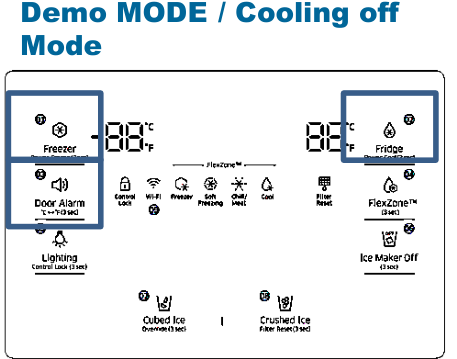

### Load Mode
Hold buttons - Freezer, Fridge and Flex Zone for 6 seconds. All on/off LED’s will blink. Stop pressing buttons to view load status. Refer to PAGE 3 for more detail.
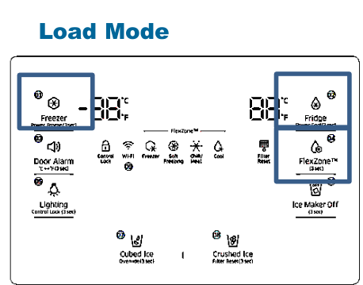

### Diagnostic Mode
Hold buttons – Freezer and Fridge for 6 seconds, screen will blink, continue to hold until blank screen or errors displayed. After 1 min the mode will exit. Refer to PAGE 4 to 6 for Error Code details.
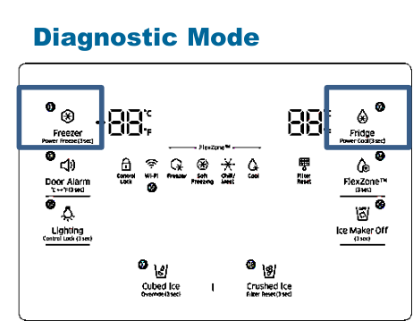

### Force Mode / Defrost
Hold Freezer and Flex zone for 6 seconds until screen goes blank and you hear a beep. Press Flex zone again to enter first mode 1.
To exit; after mode 5 the screen will be blank, if left alone for 1min, it will exit to normal operation.
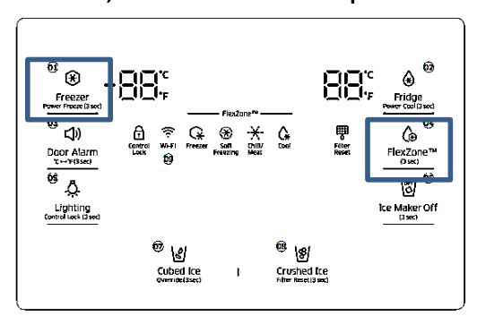

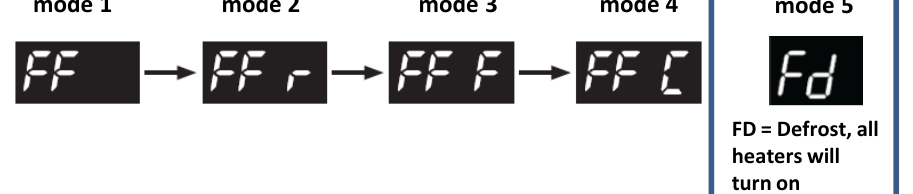

### Force-mode operation table
Source page label: DISPLAY / Operating Time / Operation.
| Freezer | Fridge | Operating Time | F-Fan (Freezer) | R-Fan (Fridge) | CV-Fan (FlexZone) | F Valve | R Valve | CV Valve |
| --- | --- | --- | --- | --- | --- | --- | --- | --- |
| FF |  | 24hr | Continuous operation | The temperature is controlled | Continuous operation | Swing | Swing | Swing |
| FF | r | 24hr | Continuous operation | Continuous operation | Continuous operation | OFF | ON | OFF |
| FF | F | 24hr | Continuous operation | Continuous operation | Continuous operation | ON | OFF | OFF |
| FF | C | 24hr | Continuous operation | Continuous operation | Continuous operation | OFF | OFF | ON |

---

## PDF page 2 — DC FAN MOTORS; Heat Release Ice Makers; Sensors

### DC FAN MOTORS
Brushless DC Fan motors are used to save energy. The fans operate at two speeds. Fan speed information is read by the Main PCB. If the fan speed exceeds 600 RPM or the speed is too slow, or stopped the fan drive circuit is disabled. After 10 seconds the circuit tries again with 3 seconds of DC voltage. If the fan continues this activity for 5 cycles, 10 seconds off 3 seconds on, the fan drive circuit is disabled for 10 minutes.

**TO TEST THE FAN CIRCUIT VOLTAGE.** Power off and back on to check the DC voltage to the motor, wait from 10 to 60 seconds for the fan voltage to kick in, and then check fan voltage, the average reading is 9 VDC. If you get 3 seconds of voltage every 10 seconds for the 5 fan power up cycles, then the Main PCB is good.

**NOTE:** You may need to put unit in FORCED FREEZE mode to activate the fans/compressor.
If the fan blade is blocked by ice, then defrost and check the motor again, after removing power from the unit.
If the evaporator is ice blocked and thus blocking the air flow, the fan will over RPM and is stopped. Remove ice and check the motor again. If everything is clear around the fan blade then the motor would be at fault. Continuous fan errors will be displayed on the front panel display. **PLEASE NOTE:** The door switches control the evaporator fan motors. Have them closed to test the motors. Delay time 10 – 60 seconds.

### Heat Release Ice Makers
**Heat Release Ice production Explanation**
Some time after the water fill is complete, the control board will check the temperature of the eject Thermistor, on the Ice Maker Head, if the Thermistor reads a temperature lower than 18.5 degrees for more than 5 seconds, then the ice production process is completed. The Ice maker will harvest if the ice bucket is not sensed as full. If a Fault Mode is detected with the Ice Maker operation, the Ice Maker stops working for 3 hours. Which means, the Ice Maker checks the operation every 3 hours until it works properly.

**Heat Release I/M Test Mode**
Press and hold the ICE TEST S/W for at least 1.5sec, the harvest function will start. If the ice maker Thermistor is below 0 degrees the Ice maker heater turns on for about 2 minutes. If the temperature exceeds 0 degrees, Ice maker heater turns on for 30 seconds. After the Ice maker heater turns on for 30 seconds, the heater turns off and then Ice maker harvest motor turns on. The motor will rotate in right direction for about 3 minutes, after this, water supply valve is turned on, then the valve is turned off, the test mode is completed. If the above operation is not carried out within 6 minutes, it will go into a fault mode.

### FREEZER TEMPERATURE CONTROL BY THE ICE MAKER
Interior Temperature of the freezer will be set to -14 degrees Fahrenheit until the ice bucket is full. When the ice bucket is full, the freezer will maintain original set temperature. Also, whenever the ice is used, the freezer will again set to -14 degrees Fahrenheit. Selecting “Ice Off” will allow the freezer to be controlled by the set temperature. If water is not hooked up, the freezer will always be at -14 unless “Ice Off” is selected.

### Temperature/Resistance/Voltage Chart for Samsung Refrigerators Sensors
**Chart block 1 (left to right on the original page):**
| Temp. (°F) | (Ω) | Volts |
| --- | --- | --- |
| -29.2°F | 64227 | 4.326 |
| -27.4°F | 61012 | 4.296 |
| -25.6°F | 57977 | 4.264 |
| -23.8°F | 55112 | 4.232 |
| -22.0°F | 52406 | 4.199 |
| -20.2°F | 49848 | 4.165 |
| -18.4°F | 47431 | 4.129 |
| -16.6°F | 45146 | 4.093 |
| -14.8°F | 42984 | 4.056 |
| -13.0°F | 40938 | 4.018 |
| -11.2°F | 39002 | 3.98 |
| -9.4°F | 37169 | 3.94 |
| -7.6°F | 35433 | 3.899 |
| -5.8°F | 33788 | 3.858 |
| -4.0°F | 32230 | 3.816 |
| -2.2°F | 30752 | 3.773 |
| -0.4°F | 29350 | 3.729 |

**Chart block 2 (left to right on the original page):**
| Temp. (°F) | (Ω) | Volts |
| --- | --- | --- |
| 1.4°F | 28021 | 3.685 |
| 3.2°F | 26760 | 3.64 |
| 5.0°F | 25562 | 3.594 |
| 6.8°F | 24425 | 3.548 |
| 8.6°F | 23345 | 3.501 |
| 10.4°F | 22320 | 3.453 |
| 12.2°F | 21345 | 3.405 |
| 14.0°F | 20418 | 3.356 |
| 15.8°F | 19537 | 3.307 |
| 17.6°F | 18698 | 3.258 |
| 19.4°F | 17901 | 3.208 |
| 21.2°F | 17142 | 3.158 |
| 23.0°F | 16419 | 3.107 |
| 24.8°F | 15731 | 3.057 |
| 26.6°F | 15076 | 3.006 |
| 28.4°F | 14452 | 2.955 |
| 30.2°F | 13857 | 2.904 |

**Chart block 3 (left to right on the original page):**
| Temp. (°F) | (Ω) | Volts |
| --- | --- | --- |
| 32.0°F | 13290 | 2.853 |
| 33.8°F | 12749 | 2.802 |
| 35.6°F | 12233 | 2.751 |
| 37.4°F | 11741 | 2.7 |
| 39.2°F | 11271 | 2.649 |
| 41.0°F | 10823 | 2.599 |
| 42.8°F | 10395 | 2.548 |
| 44.6°F | 9986 | 2.498 |
| 46.4°F | 9596 | 2.449 |
| 48.2°F | 9223 | 2.399 |
| 50.0°F | 8867 | 2.35 |
| 51.8°F | 8526 | 2.301 |
| 53.6°F | 8200 | 2.253 |
| 55.4°F | 7888 | 2.205 |
| 57.2°F | 7590 | 2.158 |
| 59.0°F | 7305 | 2.111 |
| 60.8°F | 7032 | 2.064 |

**Chart block 4 (left to right on the original page):**
| Temp. (°F) | (Ω) | Volts |
| --- | --- | --- |
| 62.6°F | 6771 | 2.019 |
| 64.4°F | 6521 | 1.974 |
| 66.2°F | 6281 | 1.929 |
| 68.0°F | 6052 | 1.885 |
| 69.8°F | 5832 | 1.842 |
| 71.6°F | 5621 | 1.799 |
| 75.2°F | 5225 | 1.716 |
| 77.0°F | 5000 | 1.675 |
| 78.8°F | 4861 | 1.636 |
| 80.6°F | 4690 | 1.596 |
| 86.0°F | 4218 | 1.483 |
| 87.8°F | 4072 | 1.447 |
| 89.6°F | 3933 | 1.412 |
| 91.4°F | 3799 | 1.377 |
| 95.0°F | 3547 | 1.309 |
| 96.8°F | 3428 | 1.277 |
| 100.4°F | 3204 | 1.213 |

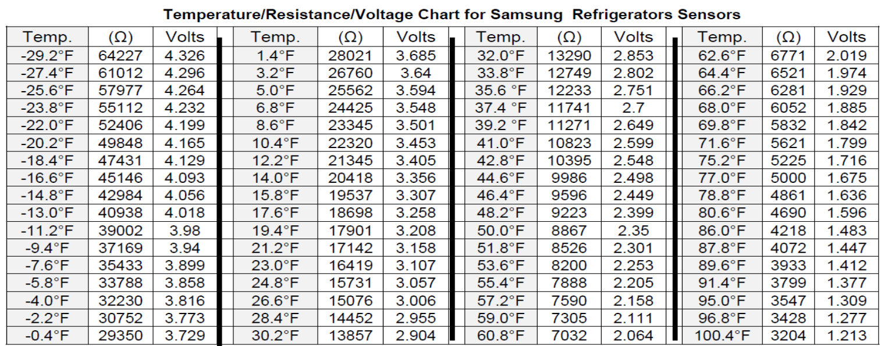

### DC voltage measurement and resistance notes
Make sure before measuring voltage of any DC component that circuit ground is used. Any marked GND on the main PCB will be your circuit ground. If Chassis ground is used, measurements will be incorrect.
A Sensor Resistance over 100K ohm is considered OPEN. A Sensor Resistance under 2K ohm is considered Shorted. But Note that a sensor could also give wrong values if it is out of tolerance.
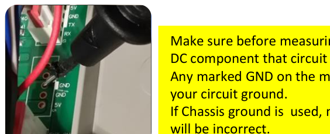

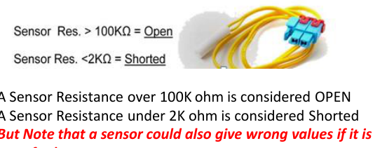

---

## PDF page 3 — Load Mode

Hold buttons - Freezer, Fridge and Flex Zone for 6 seconds. All on/off LED’s will blink, Stop pressing to view load status. Refer to next.
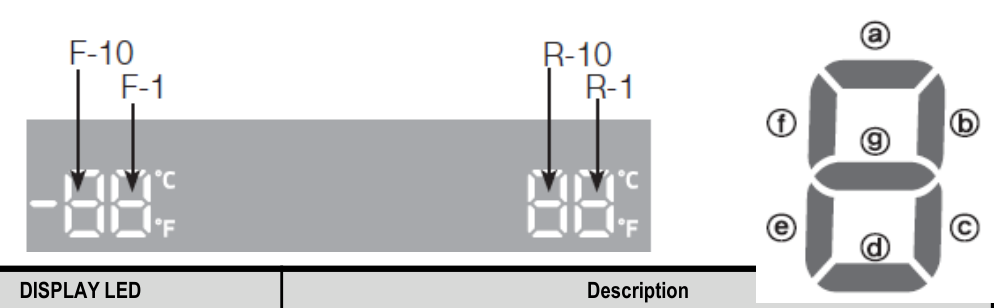

| NO | Part | DISPLAY LED | Description |
| --- | --- | --- | --- |
| 1 | R-FAN HIGHEST | "a" and "b" at the lowest order digit of the R compartment | In the case of the R-FAN HIGHEST operation, the corresponding LED is turned on. |
| 2 | R-FAN HIGH | "a" at the lowest order digit of the R compartment | In the case of the R-FAN HIGH operation, the corresponding LED is turned on. |
| 3 | R-FAN LOW | "b" at the lowest order digit of the R compartment | In the case of the R-FAN LOW operation, the corresponding LED is turned on. |
| 4 | Overload | "e" at the lowest order digit of the R compartment | If the external air temperature is 34℃ or higher, the corresponding LED is turned on. |
| 5 | Low Temperature | "f" at the lowest order digit of the R compartment | If the external air temperature is 21℃ or less, the corresponding LED is turned on. |
| 6 | Demo Mode | "g" at the lowest order digit of the R compartment | The LED is turned on in Demo Mode. |
| 7 | COMP | "a" at the lowest order digit of the F compartment | In the case of the F COMP operation, the corresponding LED is turned on. |
| 8 | F-FAN HIGHEST | "b" and "c" at the lowest order digit of the F compartment | In the case of the F-FAN HIGHEST operation, the corresponding LED is turned on. |
| 9 | F-FAN HIGH | "b" at the lowest order digit of the F compartment | In the case of the F-FAN HIGH operation, the corresponding LED is turned on. |
| 10 | F-FAN LOW | "c" at the lowest order digit of the F compartment | In the case of the F-FAN LOW operation, the corresponding LED is turned on. |
| 11 | F compartment defrost heater | "d" at the lowest order digit of the F compartment | The LED is turned on when the freezer defrosting heater operates. |
| 12 | C-FAN HIGHEST | "e" and "f" at the lowest order digit of the F compartment | In the case of the C-FAN HIGHEST operation, the corresponding LED is turned on. |
| 13 | C-FAN HIGH | "e" at the lowest order digit of the F compartment | In the case of the C-FAN HIGH operation, the corresponding LED is turned on. |
| 14 | C-FAN LOW | "f" at the lowest order digit of the F compartment | In the case of the C-FAN LOW operation, the corresponding LED is turned on. |
| 15 | F Valve | "b" at the second lowest order digit of the F compartment | In the case of the F valve open, the LED is turned on. |
| 16 | CV Valve | "c" at the second lowest order digit of the F compartment | If the CV valve opens, the LED is turned on. |
| 17 | R Valve | "f" at the second lowest order digit of the F compartment | If the R valve opens, the LED is turned on. |
| 18 | French Heater | "g" at the second lowest order digit of the F compartment | In the case of the French Heater operation, the corresponding LED is turned on. |
| 19 | CV-FAN HIGHEST | “Freezer” or “Thin Ice” for the CV compartment | In the case of the CV-FAN HIGHEST operation, the corresponding LED is turned on. |
| 20 | CV-FAN HIGH | “Freezer” for the CV compartment | In the case of the CV-FAN HIGH operation, the corresponding LED is turned on. |
| 21 | CV-FAN LOW | “Thin Ice” for the CV compartment | In the case of the CV-FAN LOW operation, the corresponding LED is turned on. |
| 22 | CV compartment defrosting heater | “Fridge” for the CV compartment | When the CV compartment defrosting heater operates, the LED is turned on. |
| 23 | Normal | "e" and "f" in the lowest order digits of the R compartment, and the LEDs are all turned off. | When the external temperature is within the range of 22℃~ 33℃. |
| 24 | Ice Room-FAN | "d" at the second lowest order digit of the F compartment | When Ice Room-FAN operates, applicable LED ON. |
| 25 | Ice maker full | “e" at the second lowest order digit of the R compartment | When the Ice Maker's Bucket is full, applicable LED ON |
| 26 |  | WiFi Status | Not connected to the IP sharer (AP) or the Internet: Off Router(AP) connected: Blink Internet connected: On |

---

## PDF page 4 — Diagnostic mode — error codes, part 1

Hold buttons – Freezer and Fridge for 6 seconds, screen will blink, continue to hold until blank screen or errors displayed. After 1 min the mode will exit.
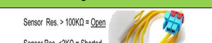

### Diagnostic mode table
| ERROR NUMBER | Item | Diagnostic method | Location Image |
| --- | --- | --- | --- |
| 1 | Freezer sensor error | Check if the Sensor is Open or Shorted The voltage between the Main PCB CN30 pins 1 and 3 should be within the 4.5V~1.0V range. | See Location Image crops below |
| 2 | Fridge sensor error | Check if the sensor is open or shorted The voltage between the Main PCB CN30 pins 1 and 5 should be within the 4.5V~1.0V range. | See Location Image crops below |
| 4 | Freezer defrost sensor error | Check if the sensor is open or shorted The voltage between the Main PCB CN30 pins 1 and 4 should be within the 4.5V~1.0V range. | See Location Image crops below |
| 5 | Fridge defrost sensor error | Check if the sensor is open or shorted The voltage between the Main PCB CN30 pins 1 and 6 should be within the 4.5V~1.0V range. | See Location Image crops below |
| 6 | Ambient sensor error | Check if the sensor is open or shorted The voltage between the Main PCB CN30 pins 1 and 2 should be within the 4.5V~1.0V range. | See Location Image crops below |
| 9 | Convertible zone sensor error | Check if the sensor is open or shorted The voltage between the Main PCB CN30 pins 11 and 12 should be within the 4.1V~0.8V range. | See Location Image crops below |
| 11 | Convertible zone defrost sensor error | Check if the sensor is open or shorted The voltage between the Main PCB CN30 pins 11 and 13 should be within the 4.1V~0.8V range. | See Location Image crops below |
| 13 | Humidity sensor error | The voltage between the Main PCB CN30 pins 7 and 9 should be within the 4.1V~0.8V range. | See Location Image crops below |
| 14 | Fridge Ice maker sensor error | Check if the sensor is open or shorted The voltage between MAIN PCB CN90 3↔ 8 should be within 4.5V~1.0V. | See Location Image crops below |
| 15 | Ice room sensor error | Check if the sensor is open or shorted The voltage between MAIN PCB CN30 10↔ 11should be within 4.5V~1.0V. | See Location Image crops below |
| 16 | Fridge humidity sensor error | Check if the sensor is open or shorted The voltage between the Main PCB CN30 pins 7 and 8 should be within the 4.1V~0.8V range. | See Location Image crops below |
| 21 | Freezer fan error | The voltage of the MAIN PCB CN74 1↔4: should be between 7V~12V. | See Location Image crops below |
| 22 | Fridge fan error | The voltage of the MAIN PCB CN74 1↔3: should be between 7V~12V. | See Location Image crops below |
| 23 | Comp room fan error | The voltage of the MAIN PCB CN74 1↔6: should be between 7V~12V. | See Location Image crops below |
| 24 | Freezer defrost error | After separating MAIN PCB CN70_1 wire from PCB, resistance value between CN70_1-7 ↔ 3 shall be 63(230) ohm ± 7%. (Resistance value is varied by input power) 0 ohm : heater short, ∞ ohm : wire/ bimetal open (Must power off) | See Location Image crops below |

#### Diagnostic table — cropped Location Image column
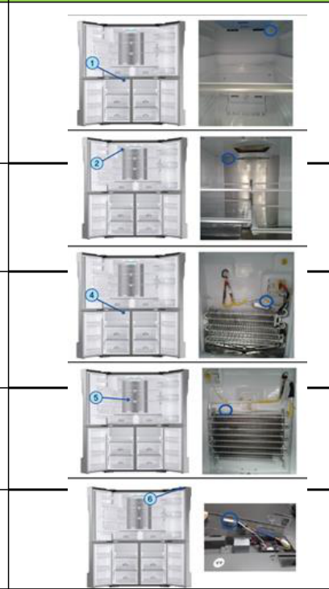

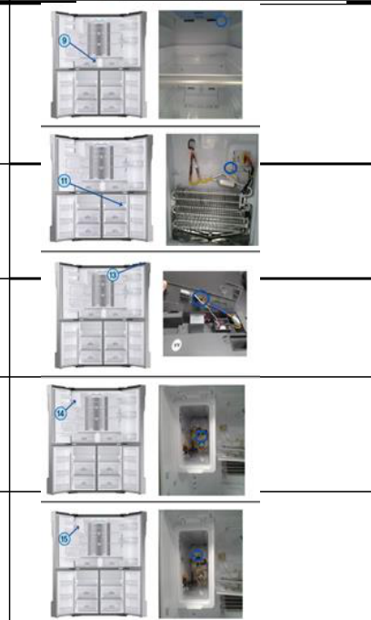

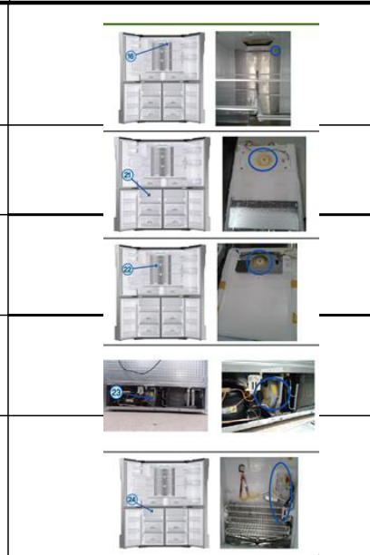

---

## PDF page 5 — Diagnostic mode — error codes, part 2

| ERROR NUMBER | Item | Diagnostic method | Location Image |
| --- | --- | --- | --- |
| 29 | Convertible zone defrost error | After separating MAIN PCB CN70 wire from PCB, resistance value between CN70_1-7 ↔ 1 shall be 63(230) ohm ± 7%. (Resistance value is varied by input power) 0 ohm : heater short, ∞ ohm : wire/ bimetal open (Must power off) | See Location Image crops below |
| 31 | Convertible zone fan error | The voltage of the MAIN PCB CN74 1↔5: should be between 7V~12V. | See Location Image crops below |
| 35 | Freezer low regist | ERROR_Freezer low regist | See Location Image crops below |
| 37 | Convertible zone low regist | ERROR_Convertible zone low regist | See Location Image crops below |
| 39 | Ice maker function error | After changing the Ice Maker(R), plug the refrigerator power code again, and check the operation. | See Location Image crops below |
| 40 | Ice maker fan error | The voltage of MAIN PCB CN52-1↔ 6: shall be between 7V~12V | See Location Image crops below |
| 41 | MAIN < - > Panel Comm error | Actually, If there is not a problem, it is desirable to replace Main and Panel PCB With the oscilloscope after a cable problem confirming. | See Location Image crops below |
| 44 | MAIN < - > INV Comm error | Actually, If there is not a problem, it is desirable to replace Main and Inverter PCB With the oscilloscope after a cable problem confirming. | See Location Image crops below |
| 46 | I/O Expander Comm error | It is desirable to replace Main PCB. | See Location Image crops below |
| 61 | Ice duct heater error | After separating MAIN PCB CN51 wire from PCB, resistance value between CN51 4↔6 shall be 135 ohm ± 7%. (Resistance value is varied by input power) 0 ohm : heater short, ∞ ohm : (Must power off) | See Location Image crops below |
| 65 | Ice bucket heater error | After separating MAIN PCB CN51 wire from PCB, resistance value between CN51 4↔7 wire shall be 135 ohm± 7%. 0 ohm : heater short, ∞ Ohm : wire. | See Location Image crops below |
| 66 | Door handle heater error | After separating MAIN PCB CN51 wire from PCB, resistance value between CN51 1↔2 wire shall be 135 ohm± 7%. 0 ohm : heater short, ∞ Ohm : wire. | See Location Image crops below |
| 71 | Freezer abnormal temp. error | The temperature has been abnormally increased. Check if the door has been open for a long time or if hot food has been stored in the compartment. If the reason for the error is removed, the error code disappears after a pre-determined period of time. | See Location Image crops below |
| 72 | Fridge abnormal temp. error | Check if the door has been open for a long time or if hot food has been stored in the compartment. If the reason for the error is removed, the error code disappears after a pre- determined period of time. | See Location Image crops below |
| 73 | Convertible zone chill error | Check if the door has been open for a long time or if hot food has been stored in the compartment. If the reason for the error is removed, the error code disappears after a pre- determined period of time. | See Location Image crops below |

#### Diagnostic table — cropped Location Image column
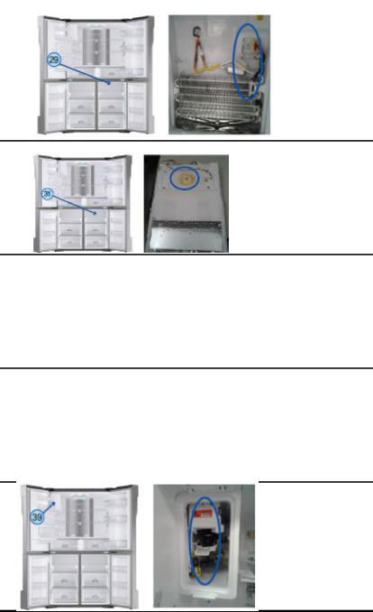

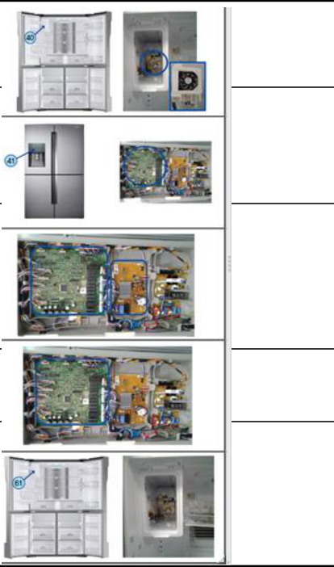

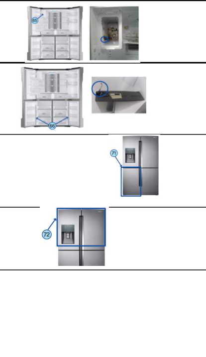

---

## PDF page 6 — Diagnostic mode — error codes, part 3

| ERROR NUMBER | Item | Diagnostic method | Location Image |
| --- | --- | --- | --- |
| 81 | COMP run error | Check the soldering status of the inverter PCB. (Check if any parts have short-circuited). Check if the DC 15V output is less than 13.5V. Check the Comp and Cycle. |  |
| 82 | COMP IPM fault | Check the soldering status of the inverter PCB. (Check if any parts have short-circuited). Check if the DC 15V output is less than 13.5V. Check the Comp and Cycle. |  |
| 83 | COMP current error | Check the compressor wire connections. Check the soldering status of the inverter PCB. (Check if any parts have short-circuited). Check the Comp and Cycle. |  |
| 84 | COMP Motor stall | Check if the compressor and the Cycle is normal.Check the input voltage. Check the soldering of the inverter PCB. (Check if any parts have short- circuited.) |  |
| 85 | COMP low voltage | Check the input voltage. (This error occurs when the input voltage is AC 106 V or lower.) |  |

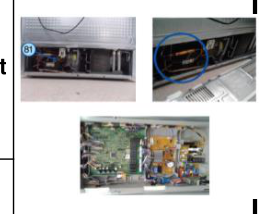

Communication error between Display and Main PCB – check connections
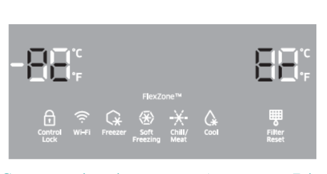

---

## PDF page 7 — General

| Symptom | Action |
| --- | --- |
| The front corners and sides become warm and form condensation. | • To prevent condensation from forming, the refrigerator has heat-proof piping in the front corners. If the ambient temperature rises, this equipment may not work effectively. This is not a system failure. • Make sure the door is closed properly. Condensation may form if you leave the door open for an extended period of time. • Condensation may form on the exterior surface of the refrigerator if humid air comes into contact with the cool surface of the refrigerator. |
| The ice maker does not make ice. | • If you have used all the ice in the ice bucket, you must wait for 12 hours for the refrigerator to make more ice. • See if the Ice Maker Off icon is lit. On the family hub under Fridge Manager, if off turn on • Make sure the freezer temp is set properly. • Make sure the water tank is filled with water. • Check if the ice bucket contains ice clumps. If it does, empty the ice bucket and try again. |
| The water dispenser is not functioning. | • Check if the water tank is frozen. If so, select a higher fridge temperature. • Make sure the water tank is filled with water. • Make sure the water tank is installed properly. • Make sure the water filter is installed properly. |
| You hear a bubbling sound. | • This is normal. The bubbling sound comes from refrigerant circulating through the refrigerator. |
| A bad smell comes from inside the refrigerator. | • Check for any spoiled food. We recommend cleaning the refrigerator on a regular basis and removing any spoiled or suspect food items. • Make sure strong smelling food is wrapped tightly or stored in air tight containers. |
| Frost forms on the interior walls. | • Make sure no food blocks the vents of the refrigerator. It is also important to arrange food items evenly for ventilation. • Make sure the door is closed properly. |
| Condensation forms on the interior walls or around vegetables. | • This happens when food containing a high proportion of water is stored uncovered, or the door has been left open for an extended period of time. • Make sure food is covered or put in sealed containers. |

---

## PDF page 8 — Samsung Smart Home - Troubleshooting

| Symptom | Action |
| --- | --- |
| Could not find “Samsung Smart Home” in the app market. | • The Samsung Smart Home app is available for smartphones that run Android 4.0 (ICS) or higher, or iOS 7.0 or higher |
| The Samsung Smart Home app fails to operate. | • The Samsung Smart Home app is available on applicable models only. • The old Samsung Smart Refrigerator app cannot connect with Samsung Smart Home models. |
| The Samsung Smart Home app is installed but is not connected to my refrigerator. | • You must log into your Samsung account to use the app. • Make sure that your router is operating normally. • If the Wi-Fi icon on the refrigerator’s display is off, this indicates that no network connection has been established yet. In this case, use the Samsung Smart Home app to connect and register your refrigerator to the access point (AP) of your house. |
| Could not log into the app. | • You must log into your Samsung account to use the app. • If you don’t have a Samsung account, follow the app’s onscreen instructions to create one. |
| An error message appears when I try to register my refrigerator. | • Easy Connection may fail due to the distance from your access point (AP) or electrical interference from the surrounding environment. Wait a moment and try again. |
| The Samsung Smart Home app is successfully connected to my refrigerator but does not run. | • Exit and restart the Samsung Smart Home app, or disconnect and reconnect the router. • Unplug the power cord of the refrigerator, and plug it again after 1 minute. |

---

## PDF page 9 — Removal procedures

### Removal of Ice Bucket and Ice Maker
1. Wait for 5 minutes after manual defrost of freezer and fresh food compartments. (Reference of Forced Defrost method in troubleshooting)  
2. Lift up the Ice Bucket and pull it out.  
3. Remove the screw from the Wire Housing Cover.  
4. Remove the Wire Housing Cover.  
5. Disconnect the Ice Maker Housing Connector.  
6. Remove the screw from the Duct Tray-Ice.  
7. With a flat blade screwdriver, push the duct to the right and remove it from the locking tab. (Refer to the image.)  
8. Push down the refrigerant pipe slightly and separate the refrigerant pipe and the Ice Maker Assembly completely.  
9. While pressing the Hook, pull out the Ice Maker.  
10. While pushing down the Duct-Tray-Ice, pull out the Ice Maker carefully and remove it.  
**Warning (as printed):** When removing the ice maker, be careful not to damage the grommets on the tray or the refrigerant tube. (Refer to the dotted parts on the right side photo.)
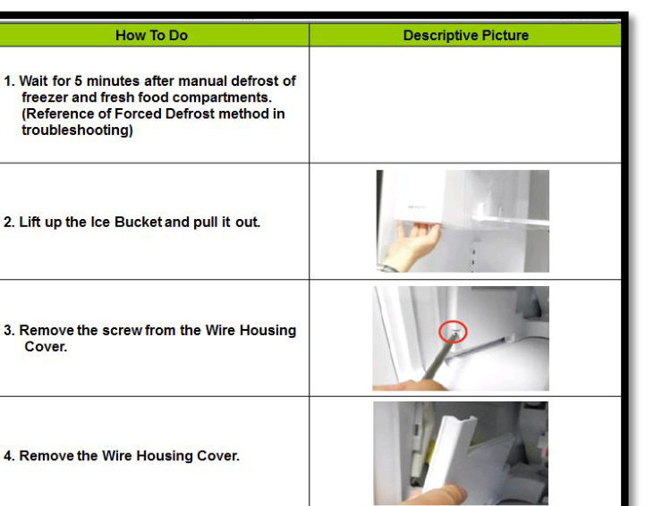

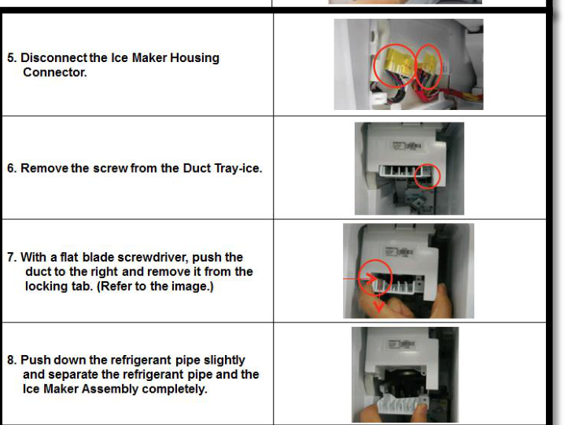

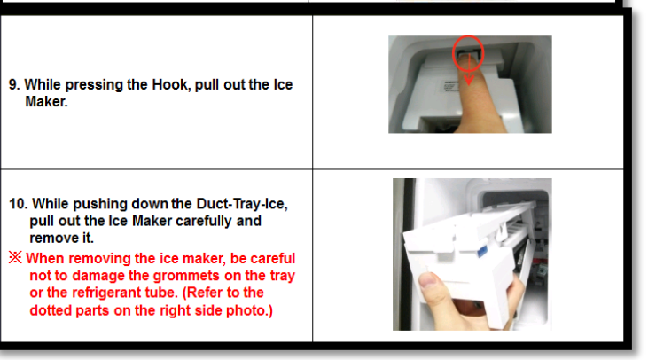

### Removal of the Auger Motor Assy
1. Disconnect the FAN-AUGER-ASSY Connector.  
2. Hold the Hook on the bottom of the FAN-AUGER ASSY and lift it up to make it free from the Locking Tab.  
3. While lifting it up, take the FAN-AUGER-ASSY out of the Ice Maker Compartment.  
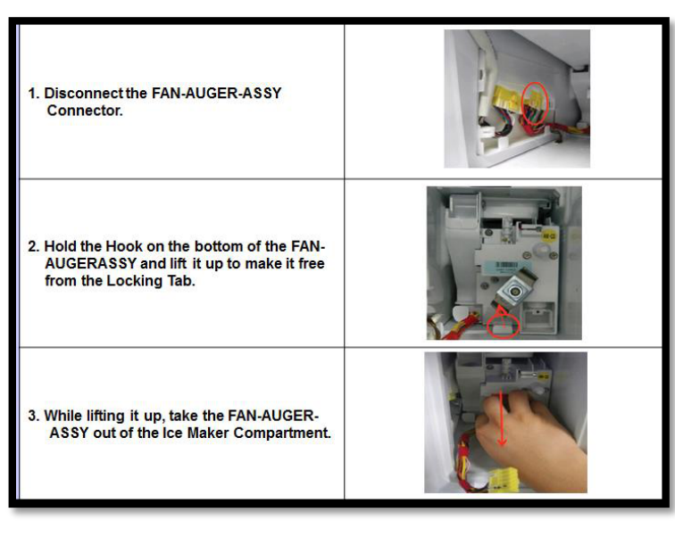

---

## PDF page 10 — TDM 4 Way Valve; parallel cycle

### About Natural Defrosting
This is a technology that helps keep food fresh by raising the humidity in the refrigerator by removing frost that has formed on the evaporator by running the fan when the cooling operation is not being executed.
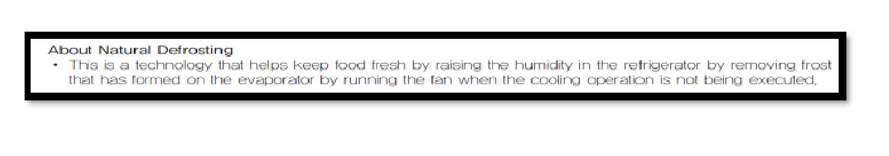

### TDM 4 Way Valve
Swing operation means moving of PAD inside 4Way Valve. It makes refrigerant flow to each evaporator.
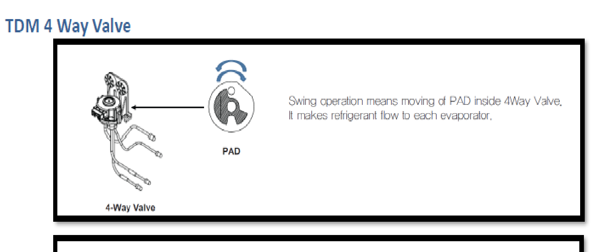

### About the Parallel Cycle (1-compressor is applied.)
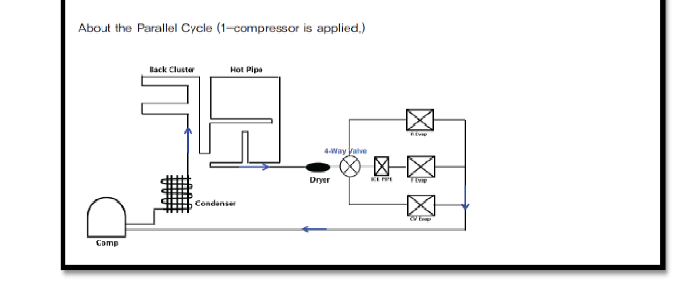

### TDM VALVE
#1 Input from Drier  
#3 Outputs to Evaporators  
FF Section – Yellow Tube  
FRE Section – No Color  
Conv. Zone – Red Tube  
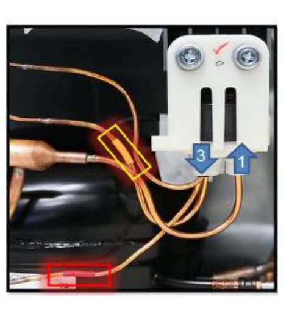

---

## PDF page 11 — Main Board of Fridge Layout

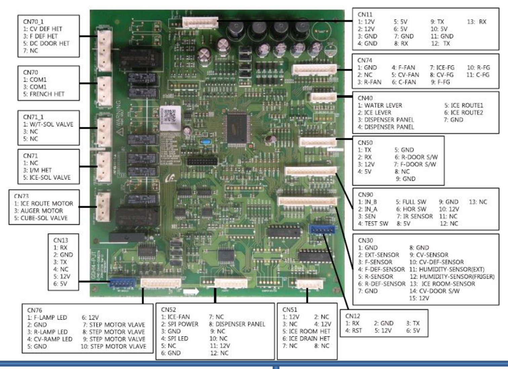

### SMPS
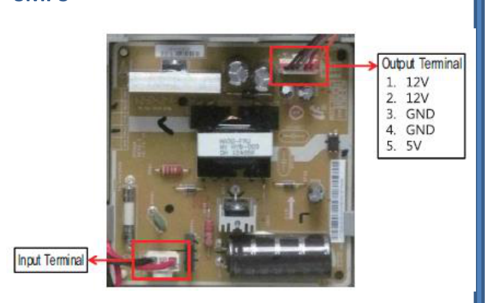

### Inverter Board (Compressor)
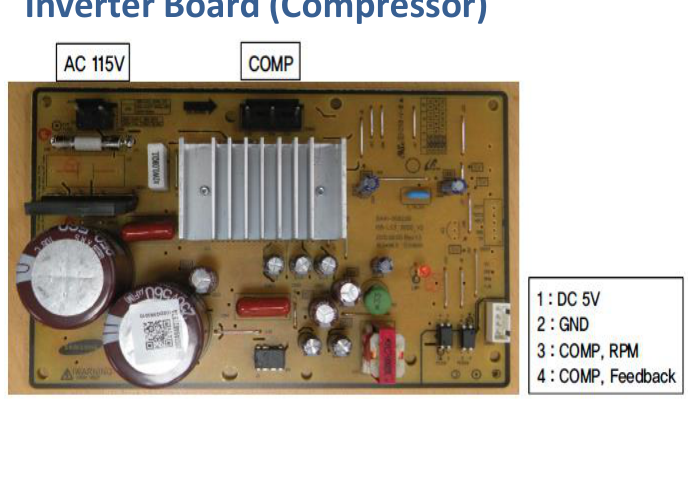

**[Caution]** AC input power and high voltage generated at SMPS PCB and INVERTER PCB power terminal. Please be cautious during repair and measurement.

---

## PDF page 12 — Wiring Diagram

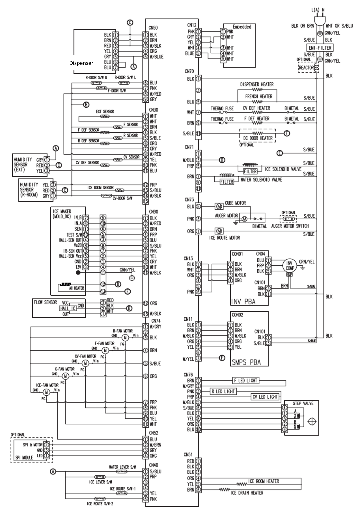

Dispenser
