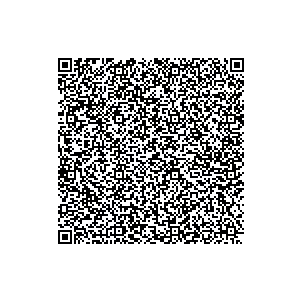

## Summary
The user manual for the Samsung RF28K9070SG refrigerator includes essential safety information, installation instructions, and operational guidelines. The latest chunk focuses on troubleshooting the Smart Grid and Energy Management functions, detailing necessary devices, registration, and common issues. The current chunk emphasizes safety compliance with Canadian regulations and provides detailed installation steps for adjusting door heights and connecting the water supply.

## Safety Information
- The manual provides extensive safety warnings and installation guidelines, emphasizing the need for proper handling and maintenance to avoid hazards such as electric shock, fire, and injury.

## Installation Instructions
- Detailed instructions for connecting the water supply line to the Samsung RF28K9070SG refrigerator, including safety precautions, steps for flushing the water filter, and initial settings for the refrigerator.

### Installation Steps
```markdown
| Step | Action                                                                                      |
|------|---------------------------------------------------------------------------------------------|
| 1    | Plug the power cord into the wall socket to turn the refrigerator on.                      |
| 2    | Open the door, and check if the interior light lights up.                                   |
| 3    | Set the temperature to the coldest setting, and then wait for about an hour.               |
| 4    | Wait until the refrigerator reaches the set temperature. Now the refrigerator is ready to use. |
```

## Water Supply Connection
- The process of connecting the water supply line to the refrigerator is critical for the operation of the refrigerator's water dispenser and ice maker.

## Initial Settings
- Steps to ensure the refrigerator is operational after installation.

## Smart Grid
- A system that allows for energy management and demand response.

## Energy Management System (EMS)
- A service that supports Smart Grid functions.

## IC Compliance
- Refers to the compliance with Canadian Industry standards for radio transmission.

## Door Height Adjustment
- The process of adjusting the height of the refrigerator doors using provided circlips.

## Door Gap Correction
- Instructions for correcting gaps between the refrigerator doors.

## Troubleshooting
- Detailed troubleshooting steps for various operational issues, particularly focusing on the Smart Grid and Energy Management functions.

### Troubleshooting Symptoms
```markdown
| Symptom                                      | Action                                                                                                           |
|----------------------------------------------|------------------------------------------------------------------------------------------------------------------|
| The refrigerator does not work or cool.     | Ensure the power cord is plugged in correctly. Adjust the temperature setting. Ensure proper ventilation.        |
| Food in the refrigerator is frozen.         | Check if the temperature dial is set too low. Adjust accordingly. Move high-water-content foods away from cooling vents. |
| Unusual noises occur.                        | Ensure the refrigerator is on a stable surface. Check for foreign objects inside or under the refrigerator.      |
| Front and side corners are warm and condensing. | This is normal; ensure the door is closed properly. Condensation may form in humid conditions.                   |
| Ice maker does not produce ice.              | Wait 12 hours if the ice bin is empty. Check if the Ice Maker Off icon is illuminated. Ensure water supply is connected. |
| Water dispenser does not work.               | Check water supply connection and ensure the water line is not damaged. Verify the water filter is installed correctly. |
| You hear bubbling noise.                      | This is normal; it comes from refrigerant circulation.                                                          |
| A bad odor comes from the refrigerator.      | Check for expired food and clean the refrigerator regularly. Ensure strong-smelling foods are sealed properly.   |
| Frost forms on interior walls.               | Ensure vents are not blocked and the door is closed properly.                                                   |
| Condensation or water droplets form on the vertical hinge. | This can occur in high humidity environments.                                                                  |
| SmartThings app is missing from app store.   | Ensure your device meets the app requirements.                                                                  |
| SmartThings app does not work.                | Ensure compatibility with your refrigerator model.                                                               |
| Cannot connect to the app.                   | Log in to your Samsung account. Follow on-screen instructions to create an account if needed.                   |
| Error message when registering refrigerator.  | Easy Connection may fail due to distance or interference; retry after a moment.                                 |
| Smart Grid and Energy Management requirements. | Requires a wireless access point, compatible refrigerator, smartphone, and EMS subscription from your utility provider. |
| Why Energy Management is not functioning.    | Ensure your router is working and the refrigerator is connected.                                                |
| Why defrost capacity is not functioning.     | Ensure your router is functioning and check for error codes on the display.                                     |
```

## Warranty Information
- Provides warranty information specific to Canada, including coverage details and exclusions.

<!-- llm-wiki:embedded-images -->
## Embedded Images

### Page 1


### Page 73



### Page 149


<!-- llm-wiki:embedded-images -->
