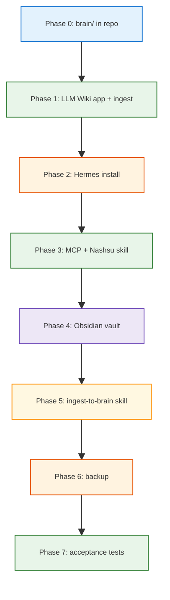

<h1 id="plan-title" style="color:#0d47a1;font-size:1.5em;font-weight:700;border-bottom:2px solid #90caf9;padding-bottom:0.25em;margin-top:0">PLAN: Second Brain in <code>second_brain</code> (Hermes + Nashsu LLM Wiki)</h1>

**Status:** Draft implementation plan (3 October 2026)  
**Architecture source:** [`second-brain-llm-wiki-architecture.md`](./second-brain-llm-wiki-architecture.md) · [`MORE_SECOND_BRAIN_QUERY_HERMES_MCP.md`](./MORE_SECOND_BRAIN_QUERY_HERMES_MCP.md) (Query / read path) · [`rank_llm_wiki_projects_…txt`](../utils/chatgpt/transcripts/rank_llm_wiki_projects_6ac0a93d-aee4-83e8-bb20-02de4c2dbbd2.txt)  
**Default harness:** [Hermes Agent](https://hermes-agent.nousresearch.com/) · **Knowledge core:** [nashsu/llm_wiki](https://github.com/nashsu/llm_wiki)

<h2 id="document-outline" style="color:#1565c0;font-size:1.22em;font-weight:650;border-left:4px solid #42a5f5;padding-left:10px;margin-top:1.1em">Document outline</h2>

1. [Is this practical?](#1-is-this-practical) — yes/no, constraints, recommended topology.
2. [Scope in this repo](#2-scope-in-this-repo) — what lives in `second_brain` vs external installs.
3. [Deployment topologies](#3-deployment-topologies) — local-first vs split VPS.
4. [Prerequisites](#4-prerequisites) — accounts, keys, hardware.
5. [Phase 0 — Repo corpus layout](#5-phase-0--repo-corpus-layout) — `brain/` tree and git policy.
6. [Phase 1 — Nashsu LLM Wiki](#6-phase-1--nashsu-llm-wiki) — install, project, API/MCP.
7. [Phase 2 — Hermes harness](#7-phase-2--hermes-harness) — CLI or Docker, gateway, MCP.
8. [Phase 3 — Wire harness ↔ compiler](#8-phase-3--wire-harness--compiler) — skills, disable duplicate compiler.
9. [Phase 4 — Obsidian human UI](#9-phase-4--obsidian-human-ui) — vault on compiled wiki.
10. [Phase 5 — Ingestion workflows](#10-phase-5--ingestion-workflows) — Second-Brain contract v1.
11. [Phase 6 — Backup and ops](#11-phase-6--backup-and-ops) — Drive, cron, verify loop.
12. [Phase 7 — Acceptance tests](#12-phase-7--acceptance-tests) — from architecture doc.
13. [Later phases (optional)](#13-later-phases-optional) — VPS, connectors, OpenClaw/DSH.
14. [Risks and mitigations](#14-risks-and-mitigations) — headless, scale, cost.
15. [Reference commands](#15-reference-commands) — CLI cheat sheet.
16. [References](#16-references) — official docs.

---

<h2 id="1-is-this-practical" style="color:#1565c0;font-size:1.22em;font-weight:650;border-left:4px solid #42a5f5;padding-left:10px;margin-top:1.1em">1. Is this practical?</h2>

**Short answer:** <span style="background:#c8e6c9;padding:2px 4px">Yes</span> — for a **personal Second Brain anchored in this repo**, with a **local-first Phase 1** on your Mac, then optional remote Hermes later.

**Why it is feasible now (Oct 2026):**

- **Nashsu LLM Wiki** ships ingest queue, source watch, graph, review, HTTP API (`127.0.0.1:19828`), MCP server, and an official [agent skill](https://github.com/nashsu/llm_wiki_skill) — matching the architecture’s “compiler owns knowledge” split.
- **Hermes** installs via **one-line script** or **Docker**, supports **MCP client** config in `~/.hermes/config.yaml`, messaging gateway (Telegram, etc.), and Google Workspace skills — matching HERMES-1…4 orchestration roles.
- **Integration surface already exists:** use Nashsu’s MCP + skill; **do not** rely on Hermes’s bundled Karpathy `llm-wiki` skill as the compiler (it makes Hermes the wiki author and duplicates Nashsu).

**Hard constraint (must plan around):**

LLM Wiki’s MCP and API talk to the **desktop app on localhost** (`http://127.0.0.1:19828/api/v1`). The MCP subprocess does not replace the app. Therefore:

- **Hermes and LLM Wiki must run on the same machine** (or you need a deliberate tunnel/sync design — see [§3](#3-deployment-topologies)).
- There is **no supported headless Docker-only LLM Wiki** today (Tauri desktop `.dmg` / `.deb` / AppImage from [GitHub Releases](https://github.com/nashsu/llm_wiki/releases)).

**What you build in `second_brain` vs what you install globally:**

<table>
<thead>
<tr style="background:#1565c0;color:white"><th>In repo</th><th>On host (CLI/app)</th></tr>
</thead>
<tbody>
<tr><td style="background:#e3f2fd"><code>brain/</code> corpus (raw + compiled wiki)</td><td style="background:#e8f5e9">LLM Wiki desktop app</td></tr>
<tr><td style="background:#e3f2fd">Docs, plans, manifests schema</td><td style="background:#e8f5e9">Hermes (<code>~/.hermes</code>)</td></tr>
<tr><td style="background:#e3f2fd">Optional: ingestion skills/scripts under <code>harness/</code></td><td style="background:#e8f5e9">Obsidian (vault = wiki tree)</td></tr>
<tr><td style="background:#e3f2fd">Backup/sync scripts</td><td style="background:#fff3e0">Docker (optional, for Hermes only)</td></tr>
</tbody>
</table>

**Recommended first milestone:** **Topology A** (all on Mac, corpus in repo) until ingest + MCP + one Telegram “add to brain” path works; then consider Topology B (Hermes on VPS) if you need 24/7 gateway.

---

<h2 id="2-scope-in-this-repo" style="color:#1565c0;font-size:1.22em;font-weight:650;border-left:4px solid #42a5f5;padding-left:10px;margin-top:1.1em">2. Scope in this repo</h2>

This repository today is mostly **shared utilities** and **`bootstrap_webapp/`** scaffolding — not yet a running Second Brain. This plan adds a **dedicated corpus** and **harness contract** without merging into the webapp stack.

**Second-Brain contract (v1 — from architecture):**

```text
INPUT       → acquire → brain/raw/sources/
KNOWLEDGE   → nashsu/llm_wiki → brain/wiki/ (and Nashsu-managed tree)
INTERFACE   → MCP / local HTTP API (127.0.0.1:19828)
WORKFLOWS   → ingest-to-brain | query-brain | audit-brain | research-gap
```

**Hermes responsibilities (default harness):** HERMES-1 intent → HERMES-2 acquisition → *(Nashsu compiles)* → HERMES-3 query/audit via MCP → HERMES-4 research → new files in `raw/sources/`.

**Explicit non-goals for V1:**

- No custom wiki compiler in Python/TS in this repo.
- No Kubernetes, MinIO, Postgres, or separate vector DB.
- No dependency on Hermes bundled `llm-wiki` skill for compilation.
- No requirement to host LLM Wiki on a VPS until upstream supports headless/server mode.

---

<h2 id="3-deployment-topologies" style="color:#1565c0;font-size:1.22em;font-weight:650;border-left:4px solid #42a5f5;padding-left:10px;margin-top:1.1em">3. Deployment topologies</h2>

<h3 id="31-topology-a-local-first-recommended" style="color:#00695c;font-size:1.05em;font-weight:600;margin-top:0.85em">3.1 Topology A — local-first (recommended)</h3>

```text
┌─────────────────────────────────────────────────────────┐
│  Mac (same host)                                         │
│                                                          │
│  second_brain/brain/  ◄── LLM Wiki project root         │
│       raw/sources/  ◄── Hermes writes ingest snapshots   │
│       wiki/         ◄── Nashsu compiles (watcher)        │
│                                                          │
│  LLM Wiki.app (GUI) ── API :19828 ── MCP stdio          │
│         ▲                              │                 │
│         │                              ▼                 │
│  Obsidian vault ── human UI      Hermes (CLI or Docker   │
│                                   with brain volume)     │
└─────────────────────────────────────────────────────────┘
```

- **Practical for development:** MCP and API work without network hacks.
- **Repo path:** `/Users/jjw8053/projects/second_brain/brain` as LLM Wiki “project folder”.

<h3 id="32-topology-b-split-vps--mac-later" style="color:#00695c;font-size:1.05em;font-weight:600;margin-top:0.85em">3.2 Topology B — split VPS + Mac (later)</h3>

From the architecture transcript: Hermes on **Hostinger Ubuntu + Docker** is viable; **LLM Wiki on the same VPS is unproven** (Tauri desktop). Practical split:

```text
Telegram ──► Hermes (VPS Docker)
                 │
                 │  writes + sync
                 ▼
         Google Drive / Syncthing
                 │
                 ▼
         Mac: brain/raw/sources/
                 │
                 ▼
         LLM Wiki (Mac, must be running)
                 │
                 ▼
         brain/wiki/  ──► Obsidian
```

Only pursue after Topology A works. Requires **folder sync** (Syncthing, Drive desktop sync, or `rclone bisync`) and acceptance of **eventual consistency**.

<h3 id="33-topology-c-all-on-vps-not-recommended-yet" style="color:#00695c;font-size:1.05em;font-weight:600;margin-top:0.85em">3.3 Topology C — all on VPS (not recommended yet)</h3>

Would need LLM Wiki running on Linux with display or undocumented headless mode. **Gate:** spike Phase 1.5 on Ubuntu `.AppImage` + API/MCP before paying for VPS-as-brain.

---

<h2 id="4-prerequisites" style="color:#1565c0;font-size:1.22em;font-weight:650;border-left:4px solid #42a5f5;padding-left:10px;margin-top:1.1em">4. Prerequisites</h2>

| Item | Purpose |
|------|---------|
| **macOS** (your current dev host) | LLM Wiki desktop + local Hermes |
| **Node.js 20+** | Hermes MCP subprocess, optional skill tooling |
| **Docker Desktop** (optional) | Hermes in container; mount `brain/` read-write |
| **LLM API key(s)** | Nashsu ingest + chat models (OpenAI, Anthropic, Google, or Ollama) |
| **Hermes model routing** | OpenRouter or direct provider keys in `~/.hermes/.env` |
| **Obsidian** (optional but planned) | Human UI on `brain/wiki/` or Nashsu-generated vault root |
| **Google account** (optional V1.1) | Drive archive + Hermes Google skills |
| **Telegram bot** (optional V1.1) | HERMES-1 mobile “add to brain” |

**Secrets:** keep API keys in `~/.hermes/.env` and LLM Wiki app settings — **never commit**. Add repo-level `.env.example` and `brain/.gitignore` in Phase 0.

---

<h2 id="5-phase-0--repo-corpus-layout" style="color:#1565c0;font-size:1.22em;font-weight:650;border-left:4px solid #42a5f5;padding-left:10px;margin-top:1.1em">5. Phase 0 — Repo corpus layout</h2>

**Goal:** Single canonical corpus directory inside the project that Nashsu opens as a **project** and Hermes can write into under `raw/sources/`.

**Create tree (aligns with Nashsu + architecture transcript):**

```text
second_brain/
├── brain/                          # LLM Wiki project root (open in app)
│   ├── purpose.md                  # Nashsu: goals / scope (app may seed)
│   ├── schema.md                   # structural rules (or schema.md per app)
│   ├── raw/
│   │   ├── sources/
│   │   │   ├── personal/
│   │   │   ├── uploads/
│   │   │   ├── drive/
│   │   │   ├── gmail/
│   │   │   ├── github/
│   │   │   ├── web/
│   │   │   └── chat/
│   │   └── assets/
│   ├── wiki/                       # compiled Markdown (Nashsu-maintained)
│   ├── manifests/                  # source envelope JSON/YAML (project-owned)
│   └── .gitignore                    # ignore large binaries under raw/
├── docs/
│   ├── second-brain-llm-wiki-architecture.md
│   └── PLAN_SECOND_BRAIN_HERMES_V1.md   # this file
└── harness/                        # optional Phase 5
    └── second-brain/
        ├── README.md
        └── skills/                   # thin ingest-to-brain SKILL.md copies
```

**Git policy (recommended):**

- Commit: `wiki/` (or a subset), `manifests/`, small text under `raw/sources/web/`.
- Gitignore: `raw/sources/**/*.{pdf,docx,epub,zip,png,...}`, `.llm-wiki/` internal state if copied into tree, secrets.

**Deliverable:** `brain/raw/sources/` exists; README at repo root points to this plan.

**Effort:** ~1 hour (no external installs).

---

<h2 id="6-phase-1--nashsu-llm-wiki" style="color:#1565c0;font-size:1.22em;font-weight:650;border-left:4px solid #42a5f5;padding-left:10px;margin-top:1.1em">6. Phase 1 — Nashsu LLM Wiki</h2>

**Goal:** Desktop compiler running against `brain/`, with source watch and at least one successful ingest.

<h3 id="61-install-macos" style="color:#00695c;font-size:1.05em;font-weight:600;margin-top:0.85em">6.1 Install (macOS)</h3>

**Option A — Pre-built (recommended):**

1. Download latest **`.dmg`** from [nashsu/llm_wiki Releases](https://github.com/nashsu/llm_wiki/releases).
2. Install to Applications.
3. Launch LLM Wiki; create/open project pointing at:
   `/Users/jjw8053/projects/second_brain/brain`

**Option B — Build from source (if you need MCP path dev):**

```bash
# Prerequisites: Node 20+, Rust 1.88+, protoc (brew install protobuf)
git clone https://github.com/nashsu/llm_wiki.git ~/src/llm_wiki
cd ~/src/llm_wiki
npm install
npm --prefix mcp-server ci && npm run mcp:build
npm run tauri dev    # dev
# npm run tauri build  # production .app
```

<h3 id="62-configure-models" style="color:#00695c;font-size:1.05em;font-weight:600;margin-top:0.85em">6.2 Configure models (in app UI)</h3>

In **Settings → LLM**:

- Set **ingest model** and **chat model** (can differ — e.g. stronger model for ingest, cheaper for chat).
- Providers per [upstream README](https://github.com/nashsu/llm_wiki): OpenAI, Anthropic, Google, Ollama, custom endpoints.

**Smoke test:**

1. Drop a small `.md` or `.pdf` into `brain/raw/sources/uploads/`.
2. Confirm **Source Folder Auto-Watch** picks it up (Activity panel).
3. Confirm new/updated pages under `brain/wiki/`.

<h3 id="63-enable-api-and-mcp" style="color:#00695c;font-size:1.05em;font-weight:600;margin-top:0.85em">6.3 Enable API + MCP</h3>

In **Settings → API + MCP**:

1. Enable **local HTTP API** (`127.0.0.1:19828`).
2. Generate **API token** (or enable local unauthenticated access for dev only — prefer token).
3. Enable **MCP access**.
4. Copy the suggested MCP client snippet (path to bundled `mcp-server/dist/src/index.js`).

Verify API (app must be running):

```bash
# Replace TOKEN; project endpoints per app docs
curl -sS -H "Authorization: Bearer TOKEN" \
  "http://127.0.0.1:19828/api/v1/health" || true
```

**Deliverable:** One ingested source; compiled wiki pages; API enabled; token stored in password manager (not repo).

**Effort:** ~2–4 hours including model tuning and first ingest wait time.

---

<h2 id="7-phase-2--hermes-harness" style="color:#1565c0;font-size:1.22em;font-weight:650;border-left:4px solid #42a5f5;padding-left:10px;margin-top:1.1em">7. Phase 2 — Hermes harness</h2>

**Goal:** Hermes installed, configured, reachable via CLI; optional Telegram gateway.

<h3 id="71-install-hermes-cli-macos" style="color:#00695c;font-size:1.05em;font-weight:600;margin-top:0.85em">7.1 Install Hermes CLI (macOS)</h3>

Per [Installation](https://hermes-agent.nousresearch.com/docs/getting-started/installation):

```bash
curl -fsSL https://hermes-agent.nousresearch.com/install.sh | bash
# Reload shell, then:
hermes doctor
hermes setup          # or: hermes setup --portal
```

Config lives under `~/.hermes/` (`config.yaml`, `.env`).

**Optional — import from Cursor/Claude:**

```bash
hermes import-agent cursor    # if supported on your version
# MCP: Claude mcpServers → Hermes mcp_servers
```

<h3 id="72-install-hermes-docker-alternative" style="color:#00695c;font-size:1.05em;font-weight:600;margin-top:0.85em">7.2 Install Hermes via Docker (alternative)</h3>

Per [Docker setup](https://hermes-agent.nousresearch.com/docs/user-guide/docker):

```bash
mkdir -p ~/.hermes
docker run -it --rm -v ~/.hermes:/opt/data nousresearch/hermes-agent setup

docker run -d --name hermes --restart unless-stopped \
  -v ~/.hermes:/opt/data \
  -v /Users/jjw8053/projects/second_brain/brain:/brain:rw \
  -p 8642:8642 \
  nousresearch/hermes-agent gateway run
```

Use SSH for VPS setup — not browser VPS console (documented paste corruption issue).

**Note:** Mount `/brain` so ingestion skills write to ` /brain/raw/sources/`. MCP to LLM Wiki still requires the **app on the host network namespace** — for Docker Hermes on Mac, prefer **CLI install on host** for Phase 1, not Docker, unless you validate MCP reachability to `host.docker.internal:19828` (may be blocked by LLM Wiki binding to `127.0.0.1` only).

<h3 id="73-gateway-telegram-optional" style="color:#00695c;font-size:1.05em;font-weight:600;margin-top:0.85em">7.3 Gateway (Telegram, optional)</h3>

Complete `hermes setup` messaging section (Telegram bot token, etc.). Run:

```bash
hermes gateway run
# or Docker equivalent above
```

**Deliverable:** `hermes doctor` clean; one interactive `hermes` chat works; gateway running if messaging desired.

**Effort:** ~1–2 hours.

---

<h2 id="8-phase-3--wire-harness--compiler" style="color:#1565c0;font-size:1.22em;font-weight:650;border-left:4px solid #42a5f5;padding-left:10px;margin-top:1.1em">8. Phase 3 — Wire harness ↔ compiler</h2>

**Goal:** Hermes uses **Nashsu** for knowledge; bundled Hermes wiki skill does **not** compete.

<h3 id="81-install-nashsu-agent-skill" style="color:#00695c;font-size:1.05em;font-weight:600;margin-top:0.85em">8.1 Install Nashsu agent skill</h3>

Per [llm_wiki_skill](https://github.com/nashsu/llm_wiki_skill):

```bash
npx skills add https://github.com/nashsu/llm_wiki_skill.git --skill llm-wiki
```

Install into Hermes skills path if prompted (or copy `SKILL.md` into `~/.hermes/skills/` per Hermes docs).

<h3 id="82-configure-mcp-in-hermes" style="color:#00695c;font-size:1.05em;font-weight:600;margin-top:0.85em">8.2 Configure MCP in Hermes</h3>

Edit `~/.hermes/config.yaml` — add under `mcp_servers` (paths from LLM Wiki Settings → API + MCP):

```yaml
mcp_servers:
  llm_wiki:
    command: node
    args:
      - /ABSOLUTE/PATH/TO/llm_wiki/mcp-server/dist/src/index.js
    env:
      LLM_WIKI_API_TOKEN: "your-token-from-app-settings"
      # LLM_WIKI_API_BASE_URL: "http://127.0.0.1:19828/api/v1"  # if needed
```

Reload MCP in Hermes session: `/reload-mcp` (see [MCP guide](https://hermes-agent.nousresearch.com/docs/user-guide/features/mcp)).

**Filesystem MCP (ingestion helper):** optional parallel server for deterministic file ops:

```yaml
  second_brain_fs:
    command: npx
    args:
      - "-y"
      - "@modelcontextprotocol/server-filesystem"
      - /Users/jjw8053/projects/second_brain/brain
```

<h3 id="83-disable-hermes-built-in-llm-wiki-skill" style="color:#00695c;font-size:1.05em;font-weight:600;margin-top:0.85em">8.3 Disable Hermes built-in `llm-wiki` skill</h3>

The bundled [Hermes `llm-wiki` skill](https://github.com/NousResearch/hermes-agent/blob/main/skills/research/llm-wiki/SKILL.md) (v2.1.0) instructs Hermes to **be** the compiler. Disable or remove it from active skills so only Nashsu compiles:

- Remove/disable in Hermes skill settings, **or**
- Do not set `WIKI_PATH` for that skill’s default `~/wiki` workflow.

**Rule:** additions go to `brain/raw/sources/`; queries/audits use Nashsu MCP tools.

<h3 id="84-smoke-test-mcp" style="color:#00695c;font-size:1.05em;font-weight:600;margin-top:0.85em">8.4 Smoke test</h3>

With LLM Wiki app running:

1. Ask Hermes: “Use LLM Wiki MCP: hybrid-search for a term from my last ingest.”
2. Ask Hermes: “List projects / read wiki page X via MCP.”
3. Confirm Hermes does **not** rewrite `brain/wiki/` directly except via Nashsu ingest pipeline.

**Deliverable:** MCP tools visible; successful search/read; single compiler path verified.

**Effort:** ~2 hours.

---

<h2 id="9-phase-4--obsidian-human-ui" style="color:#1565c0;font-size:1.22em;font-weight:650;border-left:4px solid #42a5f5;padding-left:10px;margin-top:1.1em">9. Phase 4 — Obsidian human UI</h2>

**Goal:** Browse and lightly edit compiled knowledge.

1. Install [Obsidian](https://obsidian.md/) if needed.
2. **Open folder as vault:** prefer Nashsu’s wiki root (often `brain/wiki/` or project root if `.obsidian/` generated at project level — follow what LLM Wiki created after first project open).
3. Enable wikilinks; optional Dataview plugin.

Nashsu generates Obsidian-compatible layout; LLM Wiki may create `.obsidian/` under project — do not hand-edit compiler-owned config unless you understand sync implications.

**Deliverable:** Graph view shows links after several ingests; manual note in vault survives (prefer edits in `wiki/` pages Hermes does not own, or use Review workflow in LLM Wiki).

**Effort:** ~30 minutes.

---

<h2 id="10-phase-5--ingestion-workflows" style="color:#1565c0;font-size:1.22em;font-weight:650;border-left:4px solid #42a5f5;padding-left:10px;margin-top:1.1em">10. Phase 5 — Ingestion workflows</h2>

**Goal:** Implement **Second-Brain contract** workflows in repo + Hermes skills (thin adapters).

| Workflow | Owner | V1 behavior |
|----------|-------|-------------|
| **ingest-to-brain** | Hermes (HERMES-2) | Copy/fetch artifact → `brain/raw/sources/<channel>/` + optional `manifests/<id>.yaml` |
| **query-brain** | Hermes (HERMES-3) | Nashsu MCP hybrid search + read pages |
| **audit-brain** | Hermes (HERMES-3) | Prompted audit using MCP + LLM Wiki Lint/Review in app |
| **research-gap** | Hermes (HERMES-4) | Deep research → save to `raw/sources/web/` → Nashsu watch |

**Query / read path (HERMES-3):** Treat Nashsu’s desktop **API + MCP** as the **Knowledge Access Layer** — hybrid search, graph, and/or `llm_wiki_chat` over **`brain/wiki/`**, not a second search index inside this repo. Hermes plans and synthesizes; it does not reimplement BM25/LanceDB. Patterns, tool names, and caveats: [`MORE_SECOND_BRAIN_QUERY_HERMES_MCP.md`](./MORE_SECOND_BRAIN_QUERY_HERMES_MCP.md). Operational setup: [`SECOND_BRAIN_RUNBOOK.md`](./SECOND_BRAIN_RUNBOOK.md) (embeddings optional, MCP preflight).

**Source envelope (minimal manifest — implement in Phase 5):**

```yaml
source_id: "drive:1abc..."   # stable external id
original_uri: "https://..."
content_hash: "sha256:..."
captured_at: "2026-10-03T..."
source_type: web | drive | upload | github | chat
capture_method: hermes | manual
relative_path: raw/sources/web/article.md
```

**Hermes ingestion rules (from architecture):**

- **Capture + adapt**, not “LLM convert every PDF to Markdown” if Nashsu parses PDF natively.
- Hermes **stops** after materializing into `raw/sources/`; Nashsu owns compilation.

**Repo work:**

- Add `harness/second-brain/skills/ingest-to-brain/SKILL.md` documenting paths, manifest schema, and prohibited actions (no direct `wiki/` edits).
- Optional shell helper: `scripts/brain/ingest.sh` copying files with hash + manifest.

**Deliverable:** One end-to-end path: “Add file X to brain” → file in `raw/sources/` → Nashsu ingest → answer question via Hermes MCP.

**Effort:** ~1–2 days for first skill + manifest; connectors (Drive/Gmail) incremental.

---

<h2 id="11-phase-6--backup-and-ops" style="color:#1565c0;font-size:1.22em;font-weight:650;border-left:4px solid #42a5f5;padding-left:10px;margin-top:1.1em">11. Phase 6 — Backup and ops</h2>

**V1 (architecture-aligned):**

```text
Live corpus:     brain/ on Mac disk
Durable backup:  Google Drive "My Second Brain/Backups/" (versioned)
                 optional Raw Archive/ for Telegram uploads etc.
```

- **Nightly:** zip or `rsync` `brain/wiki/` + `manifests/` to Drive (compiled brain is the high-value asset).
- **LLM Wiki:** use built-in project export periodically ([project archive](https://github.com/nashsu/llm_wiki) feature).
- **Hermes:** `~/.hermes` backup separately (skills, config — not the wiki).

**Ops checklist:**

| Check | Frequency |
|-------|-----------|
| LLM Wiki app running if you rely on watch/MCP | daily / always-on Mac |
| Ingest queue drained | after bulk imports |
| `hermes doctor` | weekly |
| API token rotation | quarterly |

**Effort:** ~2 hours setup.

---

<h2 id="12-phase-7--acceptance-tests" style="color:#1565c0;font-size:1.22em;font-weight:650;border-left:4px solid #42a5f5;padding-left:10px;margin-top:1.1em">12. Phase 7 — Acceptance tests</h2>

From architecture doc — manual acceptance for V1:

1. Ingest a **multi-document mini-corpus** (3–5 PDFs/MD on one topic).
2. **Query:** “What claims in [page] are weakly supported by primary sources?” (HERMES-3 + MCP).
3. **Gap:** “Which concepts from source set are missing from the wiki?”
4. **Contradiction:** Introduce conflicting source; confirm Review/Lint surfaces it in LLM Wiki.
5. **Harness independence:** Document steps to swap only MCP config (simulate OpenClaw later) without moving `brain/`.

**Performance expectation:** accept LLM token cost for Nashsu ingest + Hermes re-reasoning; use wiki-first retrieval then drill to raw when needed (architecture §13).

---

<h2 id="13-later-phases-optional" style="color:#1565c0;font-size:1.22em;font-weight:650;border-left:4px solid #42a5f5;padding-left:10px;margin-top:1.1em">13. Later phases (optional)</h2>

| Phase | Content |
|-------|---------|
| **1.5 VPS spike** | Ubuntu VM + LLM Wiki AppImage + API/MCP; document headless feasibility |
| **B Topology** | Hermes Docker on Hostinger; Syncthing/Drive sync to Mac LLM Wiki |
| **Connectors** | Hermes Google Drive/Gmail/GitHub skills → `raw/sources/*` |
| **RAGFlow bake-off** | Same corpus in RAGFlow Knowledge Compilation vs Nashsu |
| **OpenClaw / DSH** | Thin adapters to same `brain/` + MCP contract |

---

<h2 id="14-risks-and-mitigations" style="color:#1565c0;font-size:1.22em;font-weight:650;border-left:4px solid #42a5f5;padding-left:10px;margin-top:1.1em">14. Risks and mitigations</h2>

<table>
<thead>
<tr style="background:#1565c0;color:white"><th>Risk</th><th>Impact</th><th>Mitigation</th></tr>
</thead>
<tbody>
<tr><td style="background:#e3f2fd">LLM Wiki desktop-only</td><td style="background:#ffebee">Blocks pure VPS brain</td><td style="background:#e8f5e9">Topology A first; sync for B</td></tr>
<tr><td style="background:#e3f2fd">API bound to 127.0.0.1</td><td style="background:#fff3e0">Remote Hermes cannot MCP</td><td style="background:#e8f5e9">Co-locate Hermes + app on Mac for V1</td></tr>
<tr><td style="background:#e3f2fd">Two compilers active</td><td style="background:#ffebee">Corrupt wiki</td><td style="background:#e8f5e9">Disable Hermes <code>llm-wiki</code> skill</td></tr>
<tr><td style="background:#e3f2fd">Ingest scale (1k+ pages)</td><td style="background:#fff3e0">Slow/costly retrieval during ingest</td><td style="background:#fff3e0">Monitor; architecture open question</td></tr>
<tr><td style="background:#e3f2fd">Token duplication</td><td style="background:#fff3e0">Cost</td><td style="background:#e8f5e9">Cheaper ingest/chat models; wiki-first queries</td></tr>
<tr><td style="background:#e3f2fd">Large binaries in git</td><td style="background:#fff3e0">Repo bloat</td><td style="background:#e8f5e9"><code>brain/.gitignore</code> + Drive archive</td></tr>
</tbody>
</table>

---

<h2 id="15-reference-commands" style="color:#1565c0;font-size:1.22em;font-weight:650;border-left:4px solid #42a5f5;padding-left:10px;margin-top:1.1em">15. Reference commands</h2>

```bash
# --- Hermes ---
curl -fsSL https://hermes-agent.nousresearch.com/install.sh | bash
hermes doctor
hermes setup
hermes config set model anthropic/claude-sonnet-4   # example
hermes gateway run

# --- Hermes Docker ---
mkdir -p ~/.hermes
docker run -it --rm -v ~/.hermes:/opt/data nousresearch/hermes-agent setup
docker run -d --name hermes --restart unless-stopped \
  -v ~/.hermes:/opt/data -p 8642:8642 nousresearch/hermes-agent gateway run

# --- Nashsu skill (any skills-compatible host) ---
npx skills add https://github.com/nashsu/llm_wiki_skill.git --skill llm-wiki

# --- LLM Wiki MCP (manual run; app must be up) ---
cd ~/src/llm_wiki/mcp-server && npm install && npm run build
LLM_WIKI_API_TOKEN=... node dist/src/index.js

# --- ChatGPT extract (this repo) ---
cd utils/chatgpt/playwright && node fetch_share.mjs "https://chatgpt.com/share/..."
```

---

<h2 id="16-references" style="color:#1565c0;font-size:1.22em;font-weight:650;border-left:4px solid #42a5f5;padding-left:10px;margin-top:1.1em">16. References</h2>

| Topic | URL |
|-------|-----|
| Architecture (this repo) | [`docs/second-brain-llm-wiki-architecture.md`](./second-brain-llm-wiki-architecture.md) |
| Query layer + Hermes MCP (follow-on) | [`docs/MORE_SECOND_BRAIN_QUERY_HERMES_MCP.md`](./MORE_SECOND_BRAIN_QUERY_HERMES_MCP.md) |
| Setup runbook | [`docs/SECOND_BRAIN_RUNBOOK.md`](./SECOND_BRAIN_RUNBOOK.md) |
| Nashsu LLM Wiki | https://github.com/nashsu/llm_wiki |
| LLM Wiki MCP server | https://github.com/nashsu/llm_wiki/tree/main/mcp-server |
| Nashsu agent skill | https://github.com/nashsu/llm_wiki_skill |
| Hermes installation | https://hermes-agent.nousresearch.com/docs/getting-started/installation |
| Hermes Docker | https://hermes-agent.nousresearch.com/docs/user-guide/docker |
| Hermes MCP | https://hermes-agent.nousresearch.com/docs/user-guide/features/mcp |
| Hermes MCP config reference | https://hermes-agent.nousresearch.com/docs/reference/mcp-config-reference |
| Hermes bundled llm-wiki skill (disable for this plan) | https://github.com/NousResearch/hermes-agent/blob/main/skills/research/llm-wiki/SKILL.md |
| Karpathy pattern (reference) | https://gist.github.com/karpathy/442a6bf555914893e9891c11519de94f |

---

<h2 id="implementation-summary" style="color:#1565c0;font-size:1.22em;font-weight:650;border-left:4px solid #42a5f5;padding-left:10px;margin-top:1.1em">Implementation summary</h2>



**Estimated calendar time (solo, part-time):** ~1–2 weeks to Phase 7 on Topology A; add 1+ weeks for VPS/sync if pursuing Topology B.

**Next actionable step:** Execute **Phase 0** (create `brain/` tree + `.gitignore`) then install LLM Wiki and point it at that folder.
