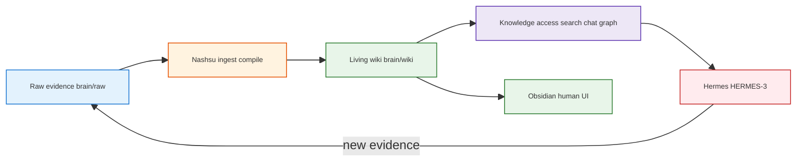
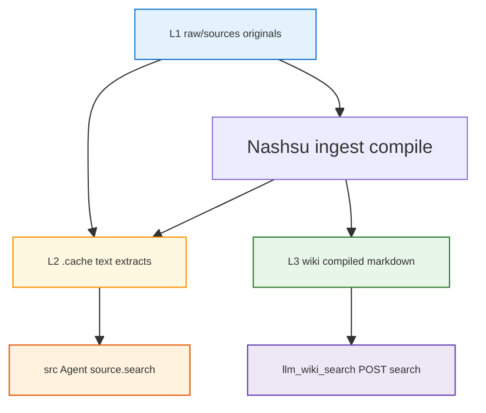

<h1 id="doc-title" style="color:#0d47a1;font-size:1.5em;font-weight:700;border-bottom:2px solid #90caf9;padding-bottom:0.25em;margin-top:0">Second Brain — Query layer, live LLM Wiki, and Hermes (follow-on)</h1>

**Source:** [ChatGPT share — 6ac1d050-44dc-83e8-9d93-88785c5cd9f1](https://chatgpt.com/share/6ac1d050-44dc-83e8-9d93-88785c5cd9f1) (fetched **4 October 2026**).  
**Partition:** User message at **“review and remind me here… Kapathy's llm wiki github post”** (Karpathy gist) separates **older architecture thread** from **today’s Query / Knowledge Access discussion**.  
**Repo context:** Implementation and ops live in [`PLAN_SECOND_BRAIN_HERMES_V1.md`](./PLAN_SECOND_BRAIN_HERMES_V1.md), [`SECOND_BRAIN_RUNBOOK.md`](./SECOND_BRAIN_RUNBOOK.md), [`second-brain-llm-wiki-architecture.md`](./second-brain-llm-wiki-architecture.md). This doc **does not replace** them; it adds the **read path** and **Hermes ↔ Nashsu query** contract.

<h2 id="document-outline" style="color:#1565c0;font-size:1.22em;font-weight:650;border-left:4px solid #42a5f5;padding-left:10px;margin-top:1.1em">Document outline</h2>

1. [How this chat maps to repo docs](#1-map) — before vs after the partition.
2. [Part A — Prior thread (summary)](#2-part-a) — already captured elsewhere.
3. [Part B — Query / Knowledge Access (today)](#3-part-b) — chat thesis in plain terms.
4. [Nashsu “Query” in the product](#4-nashsu-query) — UI vs API vs MCP (verified).
5. [Hermes integration patterns](#5-hermes) — three ways to ask the brain.
6. [Caveats for smooth Hermes query](#6-caveats) — major vs minor.
7. [ChatGPT accuracy vs `nashsu/llm_wiki`](#7-verification) — corrections from codebase.
8. [Recommended design for this repo](#8-recommendation) — HERMES-3 `query-brain`.
9. [Three retrieval layers (L1 / L2 / L3)](#9-layers) — where answers actually come from.
10. [Known gaps / Nashsu backlog](#10-backlog) — repo-checked limits; targeted upstream work.
11. [Open work (this repo only)](#11-open) — spikes and docs to add later.

---

<h2 id="1-map" style="color:#1565c0;font-size:1.22em;font-weight:650;border-left:4px solid #42a5f5;padding-left:10px;margin-top:1.1em">1. How this chat maps to repo docs</h2>

<table>
<thead>
<tr style="background:#1565c0;color:white"><th>Chat segment</th><th>Lines (approx.)</th><th>Already in repo?</th></tr>
</thead>
<tbody>
<tr><td style="background:#e3f2fd">Karpathy gist → Second Brain stack (Raw, Wiki, Obsidian, Hermes, Nashsu compiler, harness swap, ingestion adapter, job agent sketch)</td><td>Start → ~4290</td><td style="background:#e8f5e9"><strong>Yes</strong> — <code>second-brain-llm-wiki-architecture.md</code>, <code>PLAN_…</code>, runbook</td></tr>
<tr><td style="background:#e3f2fd">Reminder + <strong>Query / Knowledge Access Layer</strong>, RAG-over-Wiki, five retrieval levels, YouTube “Query” diagram, Hermes via MCP</td><td>4292 → end</td><td style="background:#fff3e0"><strong>New focus</strong> — this file</td></tr>
</tbody>
</table>

**Karpathy reference (partition anchor):** [LLM Wiki gist](https://gist.github.com/karpathy/442a6bf555914893e9891c11519de94f) — compile Raw → living Markdown; at scale move from `index.md` browsing to **proper search** (hybrid lexical + vector + rerank). Today’s chat argues that insight is the **read path**, not a rejection of retrieval.

---

<h2 id="2-part-a" style="color:#1565c0;font-size:1.22em;font-weight:650;border-left:4px solid #42a5f5;padding-left:10px;margin-top:1.1em">2. Part A — Prior thread (summary)</h2>

The pre-partition conversation aligns with what we already implemented or planned:

- **Immutable Raw + provenance** under `brain/raw/`; **compiled wiki** under `brain/wiki/`; **Nashsu** owns compilation; **Hermes** owns capture/orchestration/query/audit workflows (HERMES-1…4).
- **Do not** use Hermes’s bundled Karpathy `llm-wiki` skill as a second compiler — use [Nashsu skill](https://github.com/nashsu/llm_wiki_skill) + MCP for **read**, ingest skill for **write** to `raw/`.
- **Topology A (Mac):** desktop LLM Wiki + local API `127.0.0.1:19828` + MCP stdio; corpus path **`second_brain/brain`** (not an unrelated “New project” folder elsewhere).
- **Portable asset:** files + schema + manifests; agents and models are replaceable.

No need to duplicate Part A here; use the three existing docs for diagrams, phases, and HG gates.

---

<h2 id="3-part-b" style="color:#1565c0;font-size:1.22em;font-weight:650;border-left:4px solid #42a5f5;padding-left:10px;margin-top:1.1em">3. Part B — Query / Knowledge Access (today)</h2>

<h3 id="3-1-thesis" style="color:#00695c;font-size:1.05em;font-weight:600;margin-top:0.85em">3.1 Core thesis from the chat</h3>

1. **Compilation (write path)** and **query (read path)** are both required. Beautiful `wiki/*.md` alone does not give agents reliable recall.
2. **RAG over the compiled Wiki** is not the same as **RAG over Raw PDFs**. Search should prioritize **`wiki/`**, then descend to **`raw/`** only for verification, gaps, or evidence-critical tasks (“Wiki first, Raw when needed”).
3. **Knowledge Access Layer** sits between Wiki and Hermes: hybrid retrieval (lexical ± vector ± graph), context budget, full-page reads, citations — ideally **one implementation** (Nashsu), not re-built inside Hermes.
4. **Hermes** should **plan** (question type → retrieval strategy) and **act**; it should not reimplement LanceDB/BM25/graph unless Nashsu’s API/MCP is insufficient.

<h3 id="3-2-write-read" style="color:#00695c;font-size:1.05em;font-weight:600;margin-top:0.85em">3.2 Write path vs read path</h3>



<h3 id="3-3-youtube-query" style="color:#00695c;font-size:1.05em;font-weight:600;margin-top:0.85em">3.3 YouTube / diagram (“Query” step)</h3>

The chat’s screenshot flow (question → active context → `index.md` → hybrid search → read selected wiki pages → answer + cite; **“不是搜 raw，是读 wiki”**) matches the **intent** of Nashsu’s in-app **Chat/Agent** pipeline: software retrieval narrows pages, then the model reads **full page content**, not raw blobs. Our Second Brain adds an explicit **provenance escalation** to `raw/sources/` when answers must be evidence-bound (job years, legal claims, etc.) — that escalation is **Hermes’s job**, not automatic in every Nashsu chat turn.

---

<h2 id="4-nashsu-query" style="color:#1565c0;font-size:1.22em;font-weight:650;border-left:4px solid #42a5f5;padding-left:10px;margin-top:1.1em">4. Nashsu “Query” in the product (verified)</h2>

**Hard dependency:** The **Tauri desktop app** must be running with **API + MCP** enabled. MCP does not read the disk tree directly; it calls the same local HTTP API as documented in the app (**Settings → API + MCP**) and in sibling repo `mcp-server/README.md`.

<h3 id="4-1-surfaces" style="color:#00695c;font-size:1.05em;font-weight:600;margin-top:0.85em">4.1 Three surfaces</h3>

<table>
<thead>
<tr style="background:#1565c0;color:white"><th>Surface</th><th>Who uses it</th><th>What it does</th></tr>
</thead>
<tbody>
<tr><td style="background:#e3f2fd"><strong>Desktop UI — Chat / Agent</strong></td><td>Human</td><td>Full retrieval loop, tool events, Deep Research workspace, Review/Lint integration</td></tr>
<tr><td style="background:#e3f2fd"><strong>HTTP API</strong> <code>127.0.0.1:19828/api/v1</code></td><td>Scripts, curl, MCP server</td><td><code>GET …/projects/{id}/files</code>, <code>POST …/search</code>, <code>POST …/chat</code> (optional SSE), <code>GET …/graph</code></td></tr>
<tr><td style="background:#e3f2fd"><strong>MCP tools</strong> (stdio)</td><td>Hermes, Claude Code, etc.</td><td>Thin wrappers over that API — same search/graph/chat backend</td></tr>
</tbody>
</table>

<h3 id="4-2-mcp-tools" style="color:#00695c;font-size:1.05em;font-weight:600;margin-top:0.85em">4.2 MCP tools relevant to query (actual names)</h3>

| Tool | Query role |
|------|------------|
| `llm_wiki_set_project` | Pin MCP session to `…/second_brain/brain` (path or UUID) |
| `llm_wiki_search` | Hybrid keyword + vector retrieval (embedding config in app) |
| `llm_wiki_read_file` | Read allowed paths (e.g. `wiki/index.md`, source summaries) |
| `llm_wiki_graph` | Wikilink graph expansion |
| `llm_wiki_chat` | **Delegated** Agent turn: Nashsu runs plan → retrieve → answer + references |
| `llm_wiki_files` | Discover tree (`root=wiki\|sources\|all`) |
| `llm_wiki_rescan_sources` | Write-path helper; not query |

Example Hermes wiring: [`docs/harness/hermes-mcp.example.yaml`](../docs/harness/hermes-mcp.example.yaml).

<h3 id="4-3-chat-vs-compose" style="color:#00695c;font-size:1.05em;font-weight:600;margin-top:0.85em">4.3 `llm_wiki_chat` vs compose-your-own retrieval</h3>

- **`llm_wiki_chat`:** One call → Nashsu’s **Rust Agent** does multi-step retrieval internally (similar to built-in UI chat). Good for **fast Q&A**; Hermes sees aggregate answer + references/tool events depending on client. **`mode: deep`** widens evidence collection; **full Deep Research UI** remains desktop-only per upstream docs.
- **Search + read (multi-tool):** Hermes explicitly **plans**, calls `llm_wiki_search`, then `llm_wiki_read_file` (and optionally `llm_wiki_graph`), then **Hermes’s own LLM** synthesizes. Good for **auditable steps**, custom routing, and combining Wiki answers with **filesystem MCP** on `brain/raw/`.

Both are valid HERMES-3 implementations; the plan already names **“Nashsu MCP hybrid search + read pages”** as V1 `query-brain`.

---

<h2 id="5-hermes" style="color:#1565c0;font-size:1.22em;font-weight:650;border-left:4px solid #42a5f5;padding-left:10px;margin-top:1.1em">5. Hermes integration patterns</h2>

<h3 id="5-1-pattern-a" style="color:#00695c;font-size:1.05em;font-weight:600;margin-top:0.85em">5.1 Pattern A — Thin client (recommended default)</h3>

```text
User → Hermes → llm_wiki_set_project(brain)
            → llm_wiki_search(query)
            → llm_wiki_read_file(top paths)
            → [optional] second_brain_fs MCP → raw file for provenance
            → Hermes model → answer + cite wiki paths
```

Matches chat **Levels 0–2** (schema/index overview + search + page read) without duplicating indexes.

<h3 id="5-2-pattern-b" style="color:#00695c;font-size:1.05em;font-weight:600;margin-top:0.85em">5.2 Pattern B — Delegate to Nashsu Agent</h3>

```text
User → Hermes → llm_wiki_chat(message, stream optional)
            → answer + references from Nashsu
```

Fewer moving parts; less control over intermediate steps; same LLM ingest/chat **model settings** as the desktop app.

<h3 id="5-3-pattern-c" style="color:#00695c;font-size:1.05em;font-weight:600;margin-top:0.85em">5.3 Pattern C — Human in the loop</h3>

User asks in **LLM Wiki UI** on project **brain**; Hermes used only for capture (`ingest-to-brain`) and external actions. Query stays in Nashsu. Still valid for debugging retrieval quality before automating Hermes.

---

<h2 id="6-caveats" style="color:#1565c0;font-size:1.22em;font-weight:650;border-left:4px solid #42a5f5;padding-left:10px;margin-top:1.1em">6. Caveats — can Hermes query smoothly?</h2>

<h3 id="6-1-major" style="color:#00695c;font-size:1.05em;font-weight:600;margin-top:0.85em">6.1 Major (architecture / ops)</h3>

| Caveat | Impact | Mitigation |
|--------|--------|------------|
| **Desktop app must be up** | No API/MCP → Hermes cannot query | Run `tauri dev` or installed app; health `GET /api/v1/health` |
| **API bound to localhost** | Remote/VPS Hermes cannot MCP without tunnel/LAN setting | **Topology A:** Hermes on same Mac as LLM Wiki (plan V1) |
| **Active project** | `current` and search scope follow **desktop “current project”**; MCP can **`llm_wiki_set_project`** but UI and MCP session can diverge | Open **`second_brain/brain`** in app; set MCP project to same path |
| **Embeddings optional** | Vector leg of hybrid search needs **embedding config** in app | Configure in Settings → Embeddings; else lexical-heavy retrieval |
| **Two compilers forbidden** | Hermes bundled `llm-wiki` skill writes wiki pages | Disable bundled skill; use Nashsu for compile, MCP for read |

<h3 id="6-2-minor" style="color:#00695c;font-size:1.05em;font-weight:600;margin-top:0.85em">6.2 Minor (behavior / expectations)</h3>

| Caveat | Notes |
|--------|--------|
| **`hot.md` naming** | Community diagrams use “hot.md”; Nashsu templates often use **`overview.md`**, **`index.md`**, **`log.md`**. Same role, different filenames. |
| **Ingest ≠ rich entity graph** | First ingest may create **`wiki/sources/…`** summaries without many **`entities/`** / **`concepts/`** pages; query still works over sources + index. |
| **Raw escalation** | Not implicit in every chat turn; use **`llm_wiki_read_file`** on allowed paths, **direct read of L2 `.cache` extracts** (see [§9](#9-layers)), or **filesystem MCP** on `brain/raw/`. |
| **MCP has no `source.search`** | Desktop Agent tool **`source.search`** is **not** an MCP tool; Hermes cannot invoke it via `llm_wiki_*` unless Nashsu adds an API/MCP wrapper. |
| **Token / auth** | Local API bearer (`LLM_WIKI_API_TOKEN`); separate from OpenAI/Gemini keys in Settings → LLM. |
| **Streaming** | HTTP chat supports SSE; MCP client may expose aggregated text only. |

**Bottom line:** Hermes **can** serve as the primary Q&A harness **smoothly** if we treat Nashsu as the **Knowledge Access Layer** (Patterns A or B) and accept **co-located desktop + Hermes** for V1. The chat’s five-level retrieval roadmap is **product direction** for Hermes skills and routing, not something we must implement inside Hermes on day one.

---

<h2 id="7-verification" style="color:#1565c0;font-size:1.22em;font-weight:650;border-left:4px solid #42a5f5;padding-left:10px;margin-top:1.1em">7. ChatGPT accuracy vs `nashsu/llm_wiki` (repo-checked)</h2>

Verified against upstream **`mcp-server/README.md`** and Second Brain implementation experience (ingest, API, MCP token):

| Chat claim | Verdict |
|------------|---------|
| Hybrid search + graph + Agent chat exposed via **API and MCP** | <span style="background:#c8e6c9;padding:2px 4px">Accurate</span> |
| MCP calls **desktop API**, does not reimplement search on disk | <span style="background:#c8e6c9;padding:2px 4px">Accurate</span> |
| Hermes should **not** reimplement BM25/LanceDB/graph stack | <span style="background:#c8e6c9;padding:2px 4px">Accurate</span> |
| Fictional tool names `search_wiki()`, `read_page()`, `graph_neighbors()` | <span style="background:#ffcdd2;padding:2px 4px">Rename</span> → `llm_wiki_search`, `llm_wiki_read_file`, `llm_wiki_graph` |
| “20K+ stars”, exact phase pipeline wording | <span style="background:#fff9c4;padding:2px 4px">Treat as chat-time marketing</span>; confirm on GitHub if needed |
| **`hot.md`** as first-class Nashsu file | <span style="background:#fff9c4;padding:2px 4px">Often community diagram</span>; use `overview.md` / `index.md` in this repo |
| Headless / Docker-only LLM Wiki for server Hermes | <span style="background:#ffcdd2;padding:2px 4px">Not supported</span> today (Tauri desktop) |
| Query never touches Raw | <span style="background:#fff9c4;padding:2px 4px">Nuanced</span> — **`POST …/search`** and **`llm_wiki_search`** index **`wiki/**/*.md` only**; Raw/L2 via Agent **`source.search`** (in-app) or manual reads |
| Agent **`source.search`** is hybrid RAG | <span style="background:#ffcdd2;padding:2px 4px">No</span> — filesystem keyword scan + **500-char** snippet; not LanceDB/BM25 ranked passages |
| **`wiki.search`** vs MCP **`llm_wiki_search`** | <span style="background:#c8e6c9;padding:2px 4px">Same backend</span> — Agent builtin name **`wiki.search`** maps to shared hybrid retrieval over **wiki** pages |

**Code anchors (sibling clone `nu_llm_wiki`, checked Oct 2026):**

| Behavior | Location |
|----------|----------|
| Hybrid **`POST /search`** walks **`wiki/`** markdown only | `src-tauri/src/commands/search.rs` — `search_project_inner` |
| LanceDB vector leg | same module — `search_by_embedding`; pages embedded via API `…/pages/embed` |
| Agent **`source.search`** | `src-tauri/src/agent/tools.rs` — `search_sources`, constants `MAX_SOURCE_SNIPPET_CHARS = 500`, `MAX_SOURCE_SEARCH_FILES = 10_000` |
| L2 text for binaries | `read_preprocessed_cache` in `src-tauri/src/commands/fs.rs` → `raw/sources/**/.cache/<file>.txt` (mtime-fresh) |
| MCP tool surface | `mcp-server/README.md` — no raw-source search tool |

---

<h2 id="8-recommendation" style="color:#1565c0;font-size:1.22em;font-weight:650;border-left:4px solid #42a5f5;padding-left:10px;margin-top:1.1em">8. Recommended design for this repo</h2>

1. **HERMES-3 `query-brain` skill (future P6+):** Document Pattern A as default; Pattern B as “quick ask.”
2. **Mandatory preflight:** `llm_wiki_status` / health; `llm_wiki_set_project` → absolute path to **`brain`**.
3. **Routing (from chat §20):** Encode light question classes in the skill (lookup vs semantic vs evidence-critical → add Raw read).
4. **Do not** add a second search index in `second_brain` for V1.
5. **Acceptance test (extends HG-2 / P4):** With app up and `brain` current, Hermes (or curl) runs search + read on a known page (e.g. smoke-test source summary) and returns a cited answer.

Aligns with existing plan row:

```text
query-brain | Hermes (HERMES-3) | Nashsu MCP hybrid search + read pages
```

**V1 scope decision (Hermes / Second Brain):** Do **not** block P3–P4 on a full Nashsu refactor. Ship **`query-brain`** on **wiki hybrid search + read** (Pattern A). Treat [§10 backlog](#10-backlog) as **query-fidelity** improvements—required for **table/spreadsheet lookup** and **strict evidence-bound** Q&A, optional for narrative wiki Q&A.

---

<h2 id="9-layers" style="color:#1565c0;font-size:1.22em;font-weight:650;border-left:4px solid #42a5f5;padding-left:10px;margin-top:1.1em">9. Three retrieval layers (L1 / L2 / L3)</h2>

Second Brain operators hit three different “copies” of the same upload. Confusing them explains most **missed conjugation cell** and **“it answered from general knowledge”** reports.



<table>
<thead>
<tr style="background:#1565c0;color:white"><th>Layer</th><th>Path (under project e.g. <code>brain/</code>)</th><th>Fidelity</th><th>Default retrieval</th></tr>
</thead>
<tbody>
<tr><td style="background:#e3f2fd"><strong>L1</strong> Raw</td><td><code>raw/sources/…</code> (`.xlsx`, `.pdf`, …)</td><td>Authoritative binary; not searched by hybrid API</td><td>Human open file; Hermes **filesystem MCP**; optional re-parse in app</td></tr>
<tr><td style="background:#e3f2fd"><strong>L2</strong> Parse cache</td><td><code>raw/sources/**/.cache/&lt;name&gt;.txt</code> (+ <code>.txt.parser</code> for office)</td><td><span style="background:#c8e6c9;padding:2px 4px">High</span> for spreadsheets — full sheet text from parser (e.g. James conjugation workbook)</td><td>Agent <strong><code>source.search</code></strong> only (desktop Agent / <code>llm_wiki_chat</code> internal tools) — <strong>not</strong> <code>llm_wiki_search</code>; <strong>not</strong> embedded in LanceDB by default</td></tr>
<tr><td style="background:#e3f2fd"><strong>L3</strong> Wiki</td><td><code>wiki/sources/…</code>, <code>wiki/concepts/…</code></td><td><span style="background:#fff9c4;padding:2px 4px">Summary</span> — ingest LLM may omit or compress wide tables</td><td><strong><code>llm_wiki_search</code></strong>, UI search, lexical + optional vector + graph over <code>wiki/**/*.md</code></td></tr>
</tbody>
</table>

**Hermes implication:** Pattern A over MCP alone is **L3-first**. For **lookup questions** (verb form, row/column, dates in tables), plan an explicit **L2 escalation** (read the matching `.cache/*.txt` via allowed file read or FS MCP) until backlog item **NB-1** exists.

**Ingest settings (already in upstream):** **Settings → Multilingual** output language preserves mixed-language source text in **L3** summaries (`src/lib/output-language.ts`); it does **not** change **`source.search`** mechanics.

---

<h2 id="10-backlog" style="color:#1565c0;font-size:1.22em;font-weight:650;border-left:4px solid #42a5f5;padding-left:10px;margin-top:1.1em">10. Known gaps / Nashsu backlog</h2>

Items below are **verified against `nu_llm_wiki`** (Oct 2026). IDs are for the [delivery plan](../docs/plans/second-brain-hermes-v1-plan.md) cross-reference. **Owner:** Nashsu upstream unless noted **SB** (this repo).

<h3 id="10-1-gaps" style="color:#00695c;font-size:1.05em;font-weight:600;margin-top:0.85em">10.1 Product gaps (behavior today)</h3>

<table>
<thead>
<tr style="background:#1565c0;color:white"><th>ID</th><th>Gap</th><th>Evidence / symptom</th><th>Workaround (V1)</th></tr>
</thead>
<tbody>
<tr><td style="background:#e3f2fd"><strong>G1</strong></td><td><strong>L3 compile lossy</strong> for wide spreadsheets</td><td>Wiki source page summarizes; full matrix may exist only in L2</td><td>Read L2 <code>.cache/*.txt</code>; re-ingest with Multilingual; split sheets if needed</td></tr>
<tr><td style="background:#e3f2fd"><strong>G2</strong></td><td><strong><code>source.search</code> is not RAG</strong></td><td>Walk <code>raw/sources</code>; first substring hit; <strong>500</strong>-char snippet; <code>topK</code> ≤ 10; no score ranking</td><td>Short keyword queries; read full cache file after hit; avoid stopword-only phrases</td></tr>
<tr><td style="background:#e3f2fd"><strong>G3</strong></td><td><strong>Term splitting</strong> drops tokens &lt; 2 chars</td><td>Natural questions with “the”, “a”, … rely on full-string match first — can miss inflected forms (e.g. query “Viver” vs cell “vivo”)</td><td>Query with distinctive **lemma or table token**; use L2 full-file read</td></tr>
<tr><td style="background:#e3f2fd"><strong>G4</strong></td><td><strong>MCP / API search is wiki-only</strong></td><td><code>search_project_inner</code> scans <code>wiki/</code> only</td><td>Hermes FS MCP or future NB-4; delegate <code>llm_wiki_chat</code> for in-app <code>source.search</code></td></tr>
<tr><td style="background:#e3f2fd"><strong>G5</strong></td><td><strong>Vectors not on L2</strong></td><td>Embeddings index wiki pages under <code>.llm-wiki/</code></td><td>Lexical search on L2 via G2; or NB-1</td></tr>
<tr><td style="background:#e3f2fd"><strong>G6</strong></td><td><strong>Not fail-closed</strong></td><td>Model may answer from parametric knowledge when snippets lack evidence</td><td><strong>SB:</strong> <code>query-brain</code> skill — cite wiki/L2 path or abstain</td></tr>
<tr><td style="background:#e3f2fd"><strong>G7</strong></td><td><strong>Source Watch incremental</strong></td><td>Only new/changed files queue; deleted-source cache cleanup depends on ingest version</td><td>Touch file / book re-ingest / rescan per runbook; use sibling fixes on ingest-cache invalidation</td></tr>
<tr><td style="background:#e3f2fd"><strong>G8</strong></td><td><strong>Desktop coupling</strong></td><td>No headless MCP host</td><td>Topology A — Hermes on same Mac as LLM Wiki (plan V1)</td></tr>
</tbody>
</table>

<h3 id="10-2-backlog" style="color:#00695c;font-size:1.05em;font-weight:600;margin-top:0.85em">10.2 Targeted Nashsu backlog (do not block Hermes wiring)</h3>

| ID | Proposal | Rationale |
|----|----------|-----------|
| **NB-1** | Hybrid **passage search over L2** `.cache` extracts (ranked snippets, configurable window) | Parity with wiki search for spreadsheet / PDF lookup |
| **NB-2** | Ingest option: **preserve full tables** on `wiki/sources/…` or explicit **L2 link block** in source pages | Reduces G1 without abandoning summarization |
| **NB-3** | Agent mode: **evidence-required** — refuse when retrieved text lacks answer | Addresses G6 at product layer |
| **NB-4** | **API + MCP** tool for raw/L2 search (wrapper over improved search, not raw disk in MCP) | Lets Hermes Pattern A stay MCP-only |
| **NB-5** | Document **Agent builtin names** (`wiki.search`, `source.search`) vs **MCP names** (`llm_wiki_search`, …) in upstream README | Integrator confusion (see §7) |

<span style="background:#2e7d32;color:white;padding:1px 4px">SB-only</span> **NB-SB1:** Acceptance test in P8 — one **table lookup** (James conjugation or smoke fixture) answered with **L2 or L3 citation**, no uncited parametric fill.

**Refactor?** Full llm_wiki rewrite is **not** required for Hermes MCP V1. Prioritize **NB-1 / NB-2 / NB-SB1** if the brain must answer **faithful cell-level** questions from uploads.

---

<h2 id="11-open" style="color:#1565c0;font-size:1.22em;font-weight:650;border-left:4px solid #42a5f5;padding-left:10px;margin-top:1.1em">11. Open work (this repo only)</h2>

1. **Persist transcript** under `utils/chatgpt/transcripts/` (same fetch script as `rank_llm_wiki_projects_…`) for offline diffing.
2. **`harness/second-brain/skills/query-brain/SKILL.md`** — Pattern A/B, **L1/L2/L3 escalation**, cite-or-abstain (G6).
3. **Spike:** Same question via **`llm_wiki_chat`** (may call `source.search`) vs **MCP search+read** (L3 only) on **`brain`** — record in Decisions.
4. **Delivery plan:** Track **NB-*** and **NB-SB1** in [`docs/plans/second-brain-hermes-v1-plan.md`](../docs/plans/second-brain-hermes-v1-plan.md) (see plan § *Query fidelity*).

---

<h2 id="refs" style="color:#1565c0;font-size:1.22em;font-weight:650;border-left:4px solid #42a5f5;padding-left:10px;margin-top:1.1em">References</h2>

| Item | URL / path |
|------|------------|
| This ChatGPT share | https://chatgpt.com/share/6ac1d050-44dc-83e8-9d93-88785c5cd9f1 |
| Karpathy LLM Wiki gist | https://gist.github.com/karpathy/442a6bf555914893e9891c11519de94f |
| Nashsu LLM Wiki | https://github.com/nashsu/llm_wiki |
| MCP server README | `nu_llm_wiki/mcp-server/README.md` (sibling clone) |
| Hermes MCP example | [`docs/harness/hermes-mcp.example.yaml`](../docs/harness/hermes-mcp.example.yaml) |
| Delivery plan (query fidelity) | [`docs/plans/second-brain-hermes-v1-plan.md`](../docs/plans/second-brain-hermes-v1-plan.md) |
| Local runbook | [`docs_manual_gen/SECOND_BRAIN_RUNBOOK.md`](./SECOND_BRAIN_RUNBOOK.md) |
