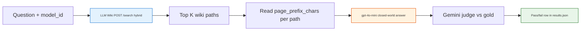

<h1 id="four-lane-title" style="color:#0d47a1;font-size:1.5em;font-weight:700;border-bottom:2px solid #90caf9;padding-bottom:0.25em;margin-top:0">Four-lane retail manual benchmark — analysis and learnings</h1>

**Audience:** Teams deciding **how to preprocess complex product PDFs** (user manuals, repair guides) and **how to search** that content to answer customer questions accurately.  
**Deep dive (B vs D):** [`ABOUT_LANE_B_D_DETAILED_ANALYSIS.md`](./ABOUT_LANE_B_D_DETAILED_ANALYSIS.md).  
**Implementation plan:** [`REFACTOR_RETAIL_MANUAL_INGEST_ABCD_BENCHMARK.md`](../ref_plan/new/REFACTOR_RETAIL_MANUAL_INGEST_ABCD_BENCHMARK.md).  
**Canonical run:** `ops/runs/retail-lane-abcd/abcd-full-openai-v2/` · **360** eval rows (90 questions × 4 lanes).  
**Last updated:** 2026-10-21.

<h2 id="four-lane-outline" style="color:#1565c0;font-size:1.22em;font-weight:650;border-left:4px solid #42a5f5;padding-left:10px;margin-top:1.1em">Document outline</h2>

1. [Motivation and goal](#four-lane-goal) — PDFs, preprocessing, accurate Q&A.
2. [What we built](#four-lane-harness) — suite, harness, fairness rules.
3. [The four lanes (A–D)](#four-lane-lanes) — ingest strategies compared.
4. [Evaluation pipeline](#four-lane-pipeline) — search, evidence, answer, judge.
5. [Headline results](#four-lane-results) — abcd-full-openai-v2.
6. [How to read the scores](#four-lane-read-scores) — negatives vs answerable.
7. [Lane-by-lane characterization](#four-lane-by-lane) — A, B, C, D.
8. [Winner and practical recommendation](#four-lane-winner) — D, with caveats.
9. [Investigations after the full run](#four-lane-followups) — mixed outcomes, sources-only, RRF.
10. [Operational learnings](#four-lane-ops) — wiki health, logging, duration.
11. [Relation to ticket search (RRF)](#four-lane-rrf) — same family, different wiring.
12. [Benchmark gaps and next questions](#four-lane-next) — gold vs wiki, symptom IDs.
13. [Appendix](#four-lane-appendix) — artifacts, config, future Q&A examples.

---

<h2 id="four-lane-goal" style="color:#1565c0;font-size:1.22em;font-weight:650;border-left:4px solid #42a5f5;padding-left:10px;margin-top:1.1em">1. Motivation and goal</h2>

Customer questions about fridges (installation, controls, troubleshooting, parts) are answered from **long PDF manuals** and sometimes **repair guides**. Before deploying search in production we need to know:

1. **Preprocessing:** Should we ingest PDFs **inside LLM Wiki**, as **external Markdown**, as **plain text**, or as **LLM-digested topic shards**?
2. **Retrieval:** Hybrid **keyword + vector + graph** search over wiki pages — does it surface the right **source** text, or mostly **concept cards**?
3. **Answering:** Given fixed top‑**k** pages and a **closed-world** prompt, which lane maximizes **factual** pass rate on a **fixed 90-question** suite?

The four-lane experiment holds **questions, models, top‑k, and char budget** constant and varies **only** the brain project / ingest path per lane.

---

<h2 id="four-lane-harness" style="color:#1565c0;font-size:1.22em;font-weight:650;border-left:4px solid #42a5f5;padding-left:10px;margin-top:1.1em">2. What we built</h2>

| Piece | Location |
|-------|----------|
| **90-question suite** | `tests/retail_multi_profiles/data/retail-manual-qa-test-suite.json` |
| **Runner** | `python -m tests.retail_multi_profiles --full` |
| **Lane registry** | `config/retail-ingest-lanes.yaml` |
| **Evidence defaults** | `config/brain-stack.example.yaml` → `second_brain.retail_evidence` |
| **Eval models** | `data/run-config.yaml` → OpenAI **`gpt-4o-mini`**, Gemini judge **`gemini-3.1-flash-lite`**, temp 0 |

**Models in suite:** `ge_GNE27JYMFS`, `kitchenaid_KRFF507HPS`, `samsung_RF28K9070SG` (30 questions each: 10 easy, 10 hard, 10 negative).

**Query shape:** `{model_id} {question}` — SKU-scoped search, no ticket Postgres leg in v1.

---

<h2 id="four-lane-lanes" style="color:#1565c0;font-size:1.22em;font-weight:650;border-left:4px solid #42a5f5;padding-left:10px;margin-top:1.1em">3. The four lanes (A–D)</h2>

<table>
<thead>
<tr style="background:#1565c0;color:white"><th>Lane</th><th>Brain folder</th><th>Preprocessing strategy</th><th>Role in experiment</th></tr>
</thead>
<tbody>
<tr><td style="background:#e3f2fd"><strong>A</strong></td><td><code>brain/retail</code></td><td style="background:#e8f5e9">Native PDF in LLM Wiki (in-app compile)</td><td style="background:#fff3e0">Baseline “PDF in app”</td></tr>
<tr><td style="background:#e3f2fd"><strong>B</strong></td><td><code>brain/retail-md</code></td><td style="background:#e8f5e9">External PDF→MD (Docling-style), per-page files</td><td style="background:#fff3e0">Rich layout, many small source pages</td></tr>
<tr><td style="background:#e3f2fd"><strong>C</strong></td><td><code>brain/retail-txt</code></td><td style="background:#e8f5e9">External PDF→plain text</td><td style="background:#fff3e0">Lossy structure, simple text index</td></tr>
<tr><td style="background:#e3f2fd"><strong>D</strong></td><td><code>brain/retail-md-learned</code></td><td style="background:#e8f5e9">Prompt C topic shards + full-copy sources</td><td style="background:#e8f5e9"><span style="background:#2e7d32;color:white;padding:1px 4px">Best answerable scores</span></td></tr>
</tbody>
</table>

Each lane is a **separate LLM Wiki project** (own `wiki/`, embeddings, graph). Lanes are **not** selected via `BRAIN_PROFILE`; the harness passes **absolute project paths** from YAML.

---

<h2 id="four-lane-pipeline" style="color:#1565c0;font-size:1.22em;font-weight:650;border-left:4px solid #42a5f5;padding-left:10px;margin-top:1.1em">4. Evaluation pipeline</h2>



**Defaults (abcd-full-openai-v2):** `search_top_k: 5`, `page_prefix_chars: 8000`, `evidence_mode: page_prefix`.

**Negative questions:** Pass iff answer equals **`Insufficient_Information_Based_On_Given_PDF`** (normalized) — **no judge LLM**.

**Answerable (easy + hard):** LLM-as-judge against gold prose; paraphrase OK, unsupported claims fail.

This is **retrieve-then-answer**, not LLM Wiki chat/RAG (see plan **D2**).

---

<h2 id="four-lane-results" style="color:#1565c0;font-size:1.22em;font-weight:650;border-left:4px solid #42a5f5;padding-left:10px;margin-top:1.1em">5. Headline results</h2>

**Run id:** `abcd-full-openai-v2` · **Git:** `8130551f…` · **Kind:** full (90×4).

<table>
<thead>
<tr style="background:#1565c0;color:white"><th>Lane</th><th>Overall</th><th>Easy (30)</th><th>Hard (30)</th><th>Negative (30)</th><th>Answerable (60)</th></tr>
</thead>
<tbody>
<tr><td style="background:#e3f2fd">A</td><td>33 / 90</td><td>3</td><td>0</td><td>30</td><td style="background:#ffebee">3 / 60 (5%)</td></tr>
<tr><td style="background:#e3f2fd">B</td><td>39 / 90</td><td>8</td><td>1</td><td>30</td><td style="background:#fff3e0">9 / 60 (15%)</td></tr>
<tr><td style="background:#e3f2fd">C</td><td>34 / 90</td><td>4</td><td>0</td><td>30</td><td style="background:#ffebee">4 / 60 (7%)</td></tr>
<tr><td style="background:#e3f2fd">D</td><td><strong>61 / 90</strong></td><td><strong>19</strong></td><td><strong>12</strong></td><td>30</td><td style="background:#e8f5e9"><strong>31 / 60 (52%)</strong></td></tr>
</tbody>
</table>

**Ordering on answerable accuracy:** **D ≫ B > C ≈ A** for this corpus and harness.

Row-level table: `ops/runs/retail-lane-abcd/abcd-full-openai-v2/scoreboard.md`.

---

<h2 id="four-lane-read-scores" style="color:#1565c0;font-size:1.22em;font-weight:650;border-left:4px solid #42a5f5;padding-left:10px;margin-top:1.1em">6. How to read the scores</h2>

- **Overall 90** includes **30 negatives** that all lanes pass trivially if the answer model emits the configured INSUF literal — do **not** treat **61/90** as “68% factual accuracy.”
- **Answerable 60** is the primary product metric for “did we answer from the manual?”
- **Hard** remains weak for A/B/C (0–1 passes); **D** is the only lane with double-digit hard passes (**12/30**).
- Some rows show **pass with INSUF** or judge quirks — spot-check `results.json` / mixed-outcomes report when interpreting edge tickets.

---

<h2 id="four-lane-by-lane" style="color:#1565c0;font-size:1.22em;font-weight:650;border-left:4px solid #42a5f5;padding-left:10px;margin-top:1.1em">7. Lane-by-lane characterization</h2>

<h3 id="four-lane-a" style="color:#00695c;font-size:1.05em;font-weight:600;margin-top:0.85em">7.1 Lane A — PDF in app</h3>

Often retrieves **large compiled source** pages (e.g. single GE user-guide source blob). Answerable accuracy **3/60** — similar failure modes to B (wrong or insufficient evidence in prefix) with different path shapes. Not the leading strategy for this benchmark.

<h3 id="four-lane-b" style="color:#00695c;font-size:1.05em;font-weight:600;margin-top:0.85em">7.2 Lane B — external per-page Markdown</h3>

Concept/entity cards frequently **outrank** per-page **`wiki/sources/`**. Image-caption-heavy pages may omit PDF text-layer facts. **9/60** answerable. Full analysis: [**ABOUT_LANE_B_D_DETAILED_ANALYSIS.md**](./ABOUT_LANE_B_D_DETAILED_ANALYSIS.md).

<h3 id="four-lane-c" style="color:#00695c;font-size:1.05em;font-weight:600;margin-top:0.85em">7.3 Lane C — plain text</h3>

**4/60** answerable — structure-poor text hurts both lexical and embedding retrieval; no advantage over B or D on this suite.

<h3 id="four-lane-d" style="color:#00695c;font-size:1.05em;font-weight:600;margin-top:0.85em">7.4 Lane D — learned shards</h3>

**31/60** answerable — topic shards (troubleshooting, water/ice, controls) rank high with strong **vector** scores; symptom-style blocks help the answer model. Tradeoff: **summarization can drop** fine-grained gold facts (e.g. door-alarm **2-minute** threshold) even when retrieval looks excellent — see B/D doc [§10 Gold vs searchable corpus](./ABOUT_LANE_B_D_DETAILED_ANALYSIS.md#b-d-gold-gap).

---

<h2 id="four-lane-winner" style="color:#1565c0;font-size:1.22em;font-weight:650;border-left:4px solid #42a5f5;padding-left:10px;margin-top:1.1em">8. Winner and practical recommendation</h2>

**Default recommendation for manual Q&A search index:** **Lane D** (`brain/retail-md-learned`) for **answerable** accuracy on this benchmark, **provided** ongoing ingest keeps symptom/procedure facts needed by gold.

**Not a blanket “D wins everything”:**

- Validate **gold** against **`wiki/sources`** text (grep / human) when adding questions.
- Consider **full-copy** or less aggressive summarization for control-panel timing and similar specs.
- Production Hermes path (tickets + wiki + tools) differs from this harness — benchmark proves **wiki leg quality** for manuals, not full agent stack.

**B** remains useful as a **Docling/per-page** reference and for comparing **entity/concept pollution** in rankings.

---

<h2 id="four-lane-followups" style="color:#1565c0;font-size:1.22em;font-weight:650;border-left:4px solid #42a5f5;padding-left:10px;margin-top:1.1em">9. Investigations after the full run</h2>

| Study | Question | Outcome |
|-------|----------|---------|
| **B vs D mixed (38 tickets)** | Where do lanes disagree? | `b-vs-d-mixed-outcomes.md` — mostly B INSUF vs D PASS or partial |
| **Sources-only replay** | Same tickets; top 10; **`wiki/sources/`** only | B **3/38**, D **24/38** — gap not only concept cards |
| **RRF / vector tables** | Explain scores on E02 | `SOURCES_ONLY_RRF_VECTOR_SCORES.md` |
| **Harness D14** | Persist `top_hits`, `search_meta` on new runs | Implemented; full overnight run not backfilled |

Mechanism details (keyword walk, RRF **`1/(60+rank)`**, graph slot reservation): [**B/D doc §9**](./ABOUT_LANE_B_D_DETAILED_ANALYSIS.md#b-d-search) — not repeated here (DRY).

---

<h2 id="four-lane-ops" style="color:#1565c0;font-size:1.22em;font-weight:650;border-left:4px solid #42a5f5;padding-left:10px;margin-top:1.1em">10. Operational learnings</h2>

- **Wall time:** Full **360**-row run on the order of **~49 minutes**; retrieval dominated row latency (~**73%** in sampling).
- **LLM Wiki health:** Hybrid search with **`vectorHits: 0`** (embedding timeout/failure) produces misleading keyword-only rankings — probe search before long runs; same API process may recover after minutes.
- **Logs:** `logs/ops/retail-lane-abcd-abcd-full-openai-v2.log` — use for row-level debugging.
- **Negative 100%:** Expected when INSUF literal is wired in prompt + exact match scorer — **not** evidence of “perfect understanding” of unanswerable questions.

---

<h2 id="four-lane-rrf" style="color:#1565c0;font-size:1.22em;font-weight:650;border-left:4px solid #42a5f5;padding-left:10px;margin-top:1.1em">11. Relation to ticket search (RRF)</h2>

Fridge **ticket** hybrid search (Postgres + Tantivy) uses **reciprocal rank fusion** with **`k = 60`** and optional **`rrf_term_boosted`** for diagnostic codes in query text — see [`ABOUT_SEARCH_RRF_FRU.md`](./ABOUT_SEARCH_RRF_FRU.md).

**LLM Wiki manual search** uses the **same k** but:

- **Unweighted** sum of keyword + vector legs (no 0.5/0.5).
- Lexical **bonuses** before rank (filename, title phrase, token weights).
- **Graph** leg reserving top‑K slots.
- Display **`vector_score`** is chunk similarity, separate from fused **`score`**.

Future work: **symptom ID boost** in wiki search when queries cite **`SAM-SYMPTOM-005`** / **`GE-SYMPTOM-026`** (manuals already contain these in Lane D).

---

<h2 id="four-lane-next" style="color:#1565c0;font-size:1.22em;font-weight:650;border-left:4px solid #42a5f5;padding-left:10px;margin-top:1.1em">12. Benchmark gaps and next questions</h2>

1. **Gold ↔ wiki alignment:** Several gold answers trace to **`raw/.../user-guide.md`** or PDF text not present in searchable **`wiki/sources`** (E02 door alarm). Add suite questions only after verifying text in target lane.
2. **Symptom-ID stratum:** Add easy/hard rows that quote **`GE-SYMPTOM-*`** / **`SAM-SYMPTOM-*`** (and later wire wiki-side term boost analogous to **`rrf_term_boosted`**).
3. **Citation / page score:** Deferred in plan v1 (`reference_points` for human audit only).
4. **Article / methods export:** Outline only in plan — this artifact family supports that narrative.

---

<h2 id="four-lane-appendix" style="color:#1565c0;font-size:1.22em;font-weight:650;border-left:4px solid #42a5f5;padding-left:10px;margin-top:1.1em">13. Appendix</h2>

<h3 id="four-lane-appendix-artifacts" style="color:#00695c;font-size:1.05em;font-weight:600;margin-top:0.85em">13.1 Run and report artifacts</h3>

| Item | Path |
|------|------|
| Full JSON | `ops/runs/retail-lane-abcd/abcd-full-openai-v2/results.json` |
| JSONL (if present) | `…/results.jsonl` |
| Scoreboard MD/HTML | `…/scoreboard.md`, `…/scoreboard.html` |
| B vs D mixed | `…/b-vs-d-mixed-outcomes.md`, `…/b-vs-d-mixed-outcomes.json` |
| Sources-only run | `ops/runs/retail-lane-abcd/abcd-sources-only-topk10/` |
| Operator runbook | `docs_manual_gen/SECOND_BRAIN_RUNBOOK.md` |
| Learned ingest operator | `docs_manual_gen/artifacts/RETAIL_LEARNED_FULL_COPY_OPERATOR.md` |

<h3 id="four-lane-appendix-config" style="color:#00695c;font-size:1.05em;font-weight:600;margin-top:0.85em">13.2 Config snapshot (full run)</h3>

```yaml
search_top_k: 5
query_template: "{model_id} {question}"
page_prefix_chars: 8000
insufficient_literal: Insufficient_Information_Based_On_Given_PDF
answer: { provider: openai, model: gpt-4o-mini, temperature: 0 }
judge: { provider: gemini, model: gemini-3.1-flash-lite, temperature: 0 }
```

<h3 id="four-lane-appendix-symptom-qa" style="color:#00695c;font-size:1.05em;font-weight:600;margin-top:0.85em">13.3 Example future Q&A (symptom IDs in learned sources)</h3>

Manuals under `brain/retail-md-learned/wiki/sources/` already expose stable IDs suitable for a **code-in-query** stratum (pattern similar to ticket **`SAM-E###`** boost, but IDs are **`SAM-SYMPTOM-NNN`** / **`GE-SYMPTOM-NNN`**):

| Proposed id | Query sketch | Gold source (Lane D) |
|-------------|--------------|----------------------|
| `samsung_RF28K9070SG-E-SAM005` | “RF28K9070SG — **SAM-SYMPTOM-005** ice maker does not make ice. Documented checks?” | `…x2hw9n.md` — wait 12h, Ice Maker Off 3s, freezer temp, water line, clumps |
| `ge_GNE27JYMFS-E-GE026` | “GNE27JYMFS — **GE-SYMPTOM-026** refrigerator is beeping. Documented cause/action?” | `…u3xq2c.md` — door open → close door |
| `ge_GNE27JYMFS-E-GE033` | “Display shows **tc** (**GE-SYMPTOM-033**). What does the manual say?” | Same troubleshooting shard |

**Samsung connectivity:** **`SAM-SYMPTOM-011`–`019`** in `…tirx9w.md` for SmartThings / energy-management failures.

Before adding to `retail-manual-qa-test-suite.json`, grep the ID in the target lane’s `wiki/sources/` and lock gold to verbatim documented checks.

<h3 id="four-lane-appendix-related-docs" style="color:#00695c;font-size:1.05em;font-weight:600;margin-top:0.85em">13.4 Related internal docs</h3>

| Doc | Topic |
|-----|--------|
| [`ABOUT_LANE_B_D_DETAILED_ANALYSIS.md`](./ABOUT_LANE_B_D_DETAILED_ANALYSIS.md) | RRF, E02, graph, corpus gaps, sources-only |
| [`ABOUT_SEARCH_RRF_FRU.md`](./ABOUT_SEARCH_RRF_FRU.md) | Ticket hybrid RRF (contrast) |
| [`LEARNED_MD_VS_TXT_WIKI_SEARCH.md`](./LEARNED_MD_VS_TXT_WIKI_SEARCH.md) | Earlier learned vs txt notes |
