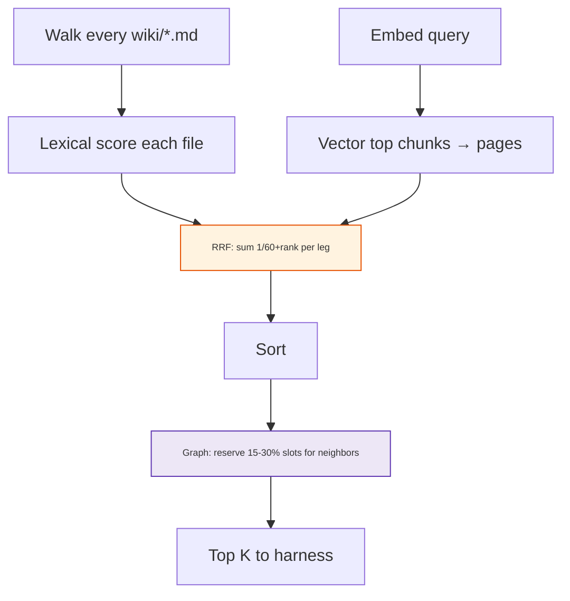

<h1 id="b-d-title" style="color:#0d47a1;font-size:1.5em;font-weight:700;border-bottom:2px solid #90caf9;padding-bottom:0.25em;margin-top:0">Lane B vs Lane D — detailed analysis (retail manual benchmark)</h1>

**Audience:** Engineers choosing **PDF preprocessing + wiki ingest** for product-manual Q&A.  
**Parent doc:** [`ABOUT_FOUR_LANE_TEST_ANALYSIS.md`](./ABOUT_FOUR_LANE_TEST_ANALYSIS.md) — full A–D context, headline metrics, harness.  
**Plan / spec:** [`REFACTOR_RETAIL_MANUAL_INGEST_ABCD_BENCHMARK.md`](../ref_plan/new/REFACTOR_RETAIL_MANUAL_INGEST_ABCD_BENCHMARK.md).  
**Primary run:** `ops/runs/retail-lane-abcd/abcd-full-openai-v2/` (90 questions × 2 lanes among 360 rows).  
**Last updated:** 2026-10-21.

<h2 id="b-d-outline" style="color:#1565c0;font-size:1.22em;font-weight:650;border-left:4px solid #42a5f5;padding-left:10px;margin-top:1.1em">Document outline</h2>

1. [Why compare B and D](#b-d-why) — two Markdown lanes, one search stack.
2. [Executive summary](#b-d-exec) — numbers and one-sentence verdict.
3. [What B and D are](#b-d-lanes) — folders, ingest, wiki shape.
4. [Full-run gap (answerable questions)](#b-d-full) — where B loses.
5. [Failure mode on B](#b-d-b-fail) — concepts win, sources lag.
6. [Why D wins retrieval](#b-d-d-win) — shards, vector leg, density.
7. [Worked example: ge_GNE27JYMFS-E02](#b-d-e02) — scores, graph, corpus.
8. [Sources-only replay](#b-d-sources-replay) — isolating `wiki/sources/`.
9. [LLM Wiki hybrid search (shared by B and D)](#b-d-search) — keyword, vector, RRF, graph.
10. [Gold vs searchable corpus](#b-d-gold-gap) — 2-minute door alarm lesson.
11. [Follow-ups and deferred work](#b-d-next) — IDs, boosts, ingest.
12. [Appendix](#b-d-appendix) — artifacts, formulas, file paths.

---

<h2 id="b-d-why" style="color:#1565c0;font-size:1.22em;font-weight:650;border-left:4px solid #42a5f5;padding-left:10px;margin-top:1.1em">1. Why compare B and D</h2>

Both lanes use the **same** LLM Wiki project layout (`wiki/entities`, `wiki/concepts`, `wiki/sources`, embeddings, hybrid search). Both answer with the **same** harness (top‑**5** hits, **8000**‑char page prefix, `gpt-4o-mini`, Gemini judge). The **only** experimental variable is **how manual PDFs were turned into wiki text before ingest**:

- **B** — external **per-page Markdown** (Docling-style PDF→MD, one file per PDF page).
- **D** — **learned Markdown** (Prompt C v3 **topic shards** + **full-copy** source pages under `brain/retail-md-learned`).

The overnight **abcd-full-openai-v2** run showed the largest **answerable** spread between these two lanes. Follow-up replays asked: is the gap **search ranking** or **corpus content**?

---

<h2 id="b-d-exec" style="color:#1565c0;font-size:1.22em;font-weight:650;border-left:4px solid #42a5f5;padding-left:10px;margin-top:1.1em">2. Executive summary</h2>

<table>
<thead>
<tr style="background:#1565c0;color:white"><th>Metric</th><th>Lane B (<code>retail-md</code>)</th><th>Lane D (<code>retail-md-learned</code>)</th></tr>
</thead>
<tbody>
<tr><td style="background:#e3f2fd">Overall pass (90 Q)</td><td style="background:#fff3e0">39 / 90</td><td style="background:#e8f5e9"><strong>61 / 90</strong></td></tr>
<tr><td style="background:#e3f2fd">Easy factual (30)</td><td style="background:#fff3e0">8 / 30</td><td style="background:#e8f5e9">19 / 30</td></tr>
<tr><td style="background:#e3f2fd">Hard factual (30)</td><td style="background:#fff3e0">1 / 30</td><td style="background:#e8f5e9">12 / 30</td></tr>
<tr><td style="background:#e3f2fd">Answerable combined (60)</td><td style="background:#fff3e0"><strong>9 / 60 (15%)</strong></td><td style="background:#e8f5e9"><strong>31 / 60 (52%)</strong></td></tr>
<tr><td style="background:#e3f2fd">Negative (30)</td><td style="background:#e8f5e9">30 / 30</td><td style="background:#e8f5e9">30 / 30</td></tr>
<tr><td style="background:#e3f2fd">Mixed outcomes (not both PASS / both INSUF)</td><td colspan="2" style="background:#fff3e0"><strong>38</strong> tickets — see <code>b-vs-d-mixed-outcomes.md</code></td></tr>
<tr><td style="background:#e3f2fd">Sources-only replay (38 × B/D, top 10, sources filter)</td><td style="background:#fff3e0">3 / 38</td><td style="background:#e8f5e9">24 / 38</td></tr>
</tbody>
</table>

**Verdict:** D’s **ingest shape** (fewer, topic-aligned **`wiki/sources/`** shards plus cards) makes hybrid search surface **answer-bearing manual text** far more often than B’s **per-page MD + concept cards**. B additionally loses when **entity/concept** pages rank above **source** pages; even when sources appear in the top 10, B’s page-level MD often lacks the facts D’s shards retain—or never captured them from PDF.

---

<h2 id="b-d-lanes" style="color:#1565c0;font-size:1.22em;font-weight:650;border-left:4px solid #42a5f5;padding-left:10px;margin-top:1.1em">3. What B and D are</h2>

| Aspect | Lane B | Lane D |
|--------|--------|--------|
| **Path** | `brain/retail-md` | `brain/retail-md-learned` |
| **Raw input** | `fridge-docs_md/…` per-page `.md` | `fridge-docs-split-less/…` topic `.md` + full-copy wiki sources |
| **Typical source page** | `13-fridge-docsmd--…--page009--….md` (one PDF page) | `22-fridge-docs-split-less--…--user-guide-part-06-troubleshooting-other--….md` |
| **Concept cards** | LLM Wiki compile from B raw | Service-manual profile + Prompt C |
| **Config** | `config/retail-ingest-lanes.yaml` → `external_markdown` vs `learned_markdown` |

---

<h2 id="b-d-full" style="color:#1565c0;font-size:1.22em;font-weight:650;border-left:4px solid #42a5f5;padding-left:10px;margin-top:1.1em">4. Full-run gap (answerable questions)</h2>

On **60** questions with a real gold answer (easy + hard), **B** passes **9** and **D** passes **31**. Negatives (**30**) pass on **literal match** only (`Insufficient_Information_Based_On_Given_PDF`); **no LLM judge** on negatives — all four lanes score **30/30** there, so **overall** totals mix “real QA” with “refusal discipline.”

**B’s dominant failure:** model output **`Insufficient_Information_Based_On_Given_PDF`** while retrieval top hits are **`wiki/concepts/*`** or **`wiki/entities/*`**, not the manual passage that contains the fact. **D** often puts a **`wiki/sources/…split-less…`** shard at rank 1–3 with text structured for troubleshooting or controls.

Deep ticket-level write-up:  
`ops/runs/retail-lane-abcd/abcd-full-openai-v2/b-vs-d-mixed-outcomes.md` (38 tickets where B and D disagree in outcome).

---

<h2 id="b-d-b-fail" style="color:#1565c0;font-size:1.22em;font-weight:650;border-left:4px solid #42a5f5;padding-left:10px;margin-top:1.1em">5. Failure mode on B</h2>

1. **Ranking:** Token (keyword) leg favors **titles** with query words (*door*, *filter*, model id) on **concept** pages; per-page **sources** often rank **9–10** or enter via **graph** with low RRF.
2. **Vector leg:** Many B source pages have **`vector_score: null`** (not in dense top‑10); concepts/entities consume vector slots.
3. **Evidence:** Default **`search_top_k: 5`** and **`page_prefix_chars: 8000`** — if top 5 are cards, the answer model never sees source PDF markdown.
4. **Content:** Per-page MD body is often **image captions**; facts that exist in consolidated **`raw/.../user-guide.md`** may be **absent** from `wiki/sources/*.md` (see [Gold vs searchable corpus](#b-d-gold-gap)).

---

<h2 id="b-d-d-win" style="color:#1565c0;font-size:1.22em;font-weight:650;border-left:4px solid #42a5f5;padding-left:10px;margin-top:1.1em">6. Why D wins retrieval</h2>

- **Topic shards** bundle related symptoms/procedures; embeddings match customer questions with **`vector_score` ≈ 1.0** more often.
- **More `wiki/sources/` in top 10** (sources-only replay: avg **4.13** vs B **2.89** slots per question).
- **Structured symptom blocks** (e.g. **GE-SYMPTOM-026**) give the answer model scannable cause/action pairs — even when gold asks for finer detail (timing) the model at least extracts *something* judgeable.

Sources-only replay shows the gap **persists** when both lanes are restricted to **`wiki/sources/`** only (**3/38** vs **24/38**) — so D’s **source corpus**, not only entity/concept cards, is more answer-ready.

Report: `ops/runs/retail-lane-abcd/abcd-sources-only-topk10/SOURCES_ONLY_REPLAY_REPORT.md`.

---

<h2 id="b-d-e02" style="color:#1565c0;font-size:1.22em;font-weight:650;border-left:4px solid #42a5f5;padding-left:10px;margin-top:1.1em">7. Worked example: ge_GNE27JYMFS-E02</h2>

**Question:** When will the door alarm beep if I leave a refrigerator door open?  
**Gold:** When the door alarm is enabled, either door open **> 2 minutes** → sound; closing door stops beeping.

### 7.1 Full-run outcomes

| Lane | Top hit (typical) | Candidate | Pass |
|------|-------------------|-----------|------|
| B | `wiki/concepts/reversing-refrigerator-doors.md` | `Insufficient_Information_Based_On_Given_PDF` | no |
| D | `wiki/sources/…part-06-troubleshooting-other--u3xq2c.md` | “The door alarm will beep if the door is open.” | no (missing **2 minutes**) |

### 7.2 Hybrid scores on B rank #1 (concept)

| Field | Value | Meaning |
|-------|-------|---------|
| **RRF `score`** | **0.031319** | `1/61 + 1/67` → keyword rank **1**, vector rank **7** (`RRF_K = 60`) |
| **`vector_score`** | **0.691336** | Best chunk similarity `1/(1+distance)` on that page — “door/refrigerator”-ish, not alarm timing |

### 7.3 Hybrid scores on D rank #1 (source)

| Field | Value | Meaning |
|-------|-------|---------|
| **RRF `score`** | **0.032266** | `1/63 + 1/61` → keyword rank **3**, vector rank **1** |
| **`vector_score`** | **1.0** | Best chunk ≈ **GE-SYMPTOM-026** (beeping → door open → close door) |

Vector **1.0** does **not** imply full gold coverage — only that the **best embedded chunk** matches the query wording; the **2-minute** rule is not in that shard (see [Gold vs searchable corpus](#b-d-gold-gap)).

### 7.4 B sources at ranks 9–10 (graph, not higher RRF)

- **`page034` / `page036`**: RRF **`0.012821 = 1/78`** → keyword-only rank **18**, **`vector_score: null`**.
- They appear in the UI top 10 because the **graph leg** reserves ~**2** of **10** slots for **one-hop neighbors** of early seeds (here: **Reversing Refrigerator Doors**). Graph **does not increase** RRF for pages already in the keyword set — it **reuses** score **1/78** and sets **`graph_related_to`**.
- Neighbor weight for ranking *which* graph pages fill slots: from seed at list position `rank`, add **`1/(rank+1)`** per link (`related:` frontmatter + `[[wikilinks]]`).

Score tables: `ops/runs/retail-lane-abcd/abcd-sources-only-topk10/SOURCES_ONLY_RRF_VECTOR_SCORES.md`.

---

<h2 id="b-d-sources-replay" style="color:#1565c0;font-size:1.22em;font-weight:650;border-left:4px solid #42a5f5;padding-left:10px;margin-top:1.1em">8. Sources-only replay</h2>

**Method (D14):** 38 mixed-outcome tickets; search **top 10**; keep only paths under **`wiki/sources/`**; same 8k prefix + answer/judge as full run.

**Learnings:**

- **Every** row had ≥1 source in top 10 — B is not “missing sources entirely” on these tickets.
- B still **3/38** pass — ranking density and **page content** dominate.
- B averages **2.89** source slots in top 10 vs D **4.13**; **43** distinct B source paths vs **26** for D (B spreads hits across many per-page files).

---

<h2 id="b-d-search" style="color:#1565c0;font-size:1.22em;font-weight:650;border-left:4px solid #42a5f5;padding-left:10px;margin-top:1.1em">9. LLM Wiki hybrid search (shared by B and D)</h2>

Implementation: `nu_llm_wiki/src-tauri/src/commands/search.rs` (same for both brain folders).

**Keyword “candidates”:** There is **no separate index**. Every markdown file under `wiki/` is read; **`score_file`** must be **> 0** (token/phrase hit) to enter the pool (E02 B: **269** files).

**RRF display `score`:** For each page, **`1/(60+keyword_rank) + 1/(60+vector_rank)`** (omit term if leg missing). **Not** the same as ticket **`rrf_term_boosted`** (no SAM-E λ bump in wiki); ticket fusion may use **0.5/0.5 leg weights** — wiki uses **unweighted sum**.

**`vector_score`:** Per-page **best chunk** similarity **`1/(1+distance)`**, with optional multi-chunk blend — stored for display; **does not** add to RRF.

**Answer step (harness):** Concat **first 8000 chars** of each selected hit path — independent of search lexical scan.

Ticket-side RRF background: [`ABOUT_SEARCH_RRF_FRU.md`](./ABOUT_SEARCH_RRF_FRU.md).

---

<h2 id="b-d-gold-gap" style="color:#1565c0;font-size:1.22em;font-weight:650;border-left:4px solid #42a5f5;padding-left:10px;margin-top:1.1em">10. Gold vs searchable corpus</h2>

Benchmark gold for E02 includes **Alarm pad** and **> 2 minutes**. Text search shows:

| Location | Contains 2-minute door alarm rule? |
|----------|--------------------------------------|
| `brain/retail-md/raw/.../ge_GNE27JYMFS/user-guide.md` | **Yes** (consolidated PDF extract) |
| `brain/retail-md/wiki/sources/*gegne27jymfs*` | **No** — only caption mentions “door alarm” on e.g. page 009 |
| `brain/retail-md-learned/wiki/sources/*` (32 files) | **No** — GE-SYMPTOM-026 covers beep/open/close; “2 minutes” appears only for **water/dispenser** contexts |

So judges may mark **fail** on D even when retrieval “looks perfect” (**vector 1.0**): the **learned shard** never ingested the control-panel timing sentence. Gold was authored from **full manual** prose; **searchable wiki** for both B and D is **incomplete** for that fact — a benchmark integrity lesson, not only a ranking bug.

---

<h2 id="b-d-next" style="color:#1565c0;font-size:1.22em;font-weight:650;border-left:4px solid #42a5f5;padding-left:10px;margin-top:1.1em">11. Follow-ups and deferred work</h2>

- **Persist `top_hits` on all future full runs** (D14) — `abcd-full-openai-v2` predates per-hit JSONL backfill.
- **Wiki symptom ID boost** (analog to ticket **`rrf_term_boosted`**): manuals already expose **`GE-SYMPTOM-*`**, **`SAM-SYMPTOM-*`** in D shards — candidate benchmark questions citing those IDs (see parent doc appendix).
- **Ingest:** Preserve control-panel timing facts in learned shards or full-copy sources; align gold authoring with **`wiki/sources`** grep checks.
- **Graph / `related:`:** Helpful when the **seed** is on-topic; on E02 graph pulled **door reversal** PDF pages — see [7.4](#b-d-e02).

---

<h2 id="b-d-appendix" style="color:#1565c0;font-size:1.22em;font-weight:650;border-left:4px solid #42a5f5;padding-left:10px;margin-top:1.1em">12. Appendix</h2>

<h3 id="b-d-appendix-artifacts" style="color:#00695c;font-size:1.05em;font-weight:600;margin-top:0.85em">12.1 Artifact paths</h3>

| Artifact | Path |
|----------|------|
| Full results | `ops/runs/retail-lane-abcd/abcd-full-openai-v2/results.json` |
| Scoreboard | `ops/runs/retail-lane-abcd/abcd-full-openai-v2/scoreboard.md` |
| B vs D mixed | `ops/runs/retail-lane-abcd/abcd-full-openai-v2/b-vs-d-mixed-outcomes.md` |
| Sources-only | `ops/runs/retail-lane-abcd/abcd-sources-only-topk10/` |
| RRF/vector tables | `…/SOURCES_ONLY_RRF_VECTOR_SCORES.md` |

<h3 id="b-d-appendix-formulas" style="color:#00695c;font-size:1.05em;font-weight:600;margin-top:0.85em">12.2 Formulas (wiki hybrid)</h3>

| Name | Formula |
|------|---------|
| RRF leg | `1 / (60 + rank)` per keyword and/or vector leg |
| Chunk similarity | `vector_score = 1 / (1 + distance)` |
| Graph slot quota (10 hits, full vector) | ~**2** graph slots, **8** pure RRF |
| Graph neighbor score (selection) | `+= 1 / (seed_position + 1)` per edge |
| New graph-only page display score | `graph_weight / 61` |

<h3 id="b-d-appendix-lexical" style="color:#00695c;font-size:1.05em;font-weight:600;margin-top:0.85em">12.3 Lexical bonuses (keyword leg sort key)</h3>

Filename exact **+200**; phrase in title **+50**; phrase in body **+20×** (cap 10); title token **×5**; body token **×1** — then sort descending before ranks feed RRF.
