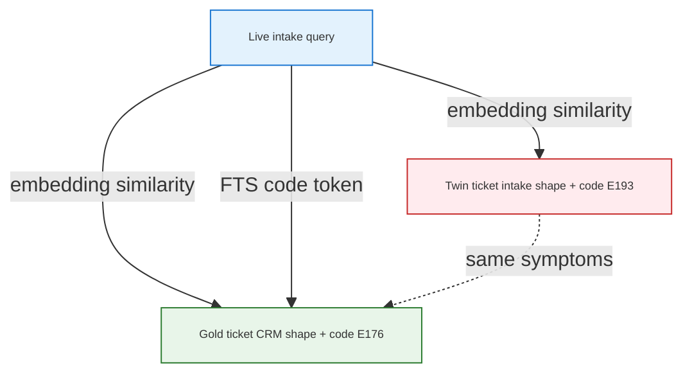
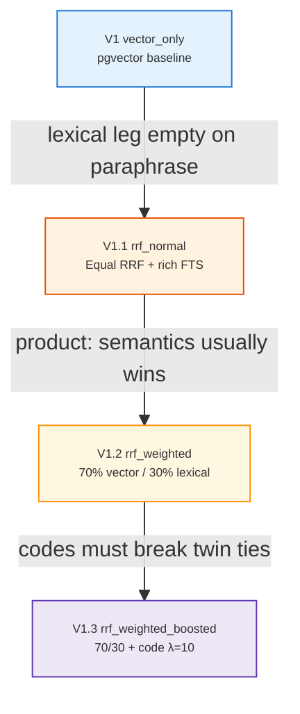
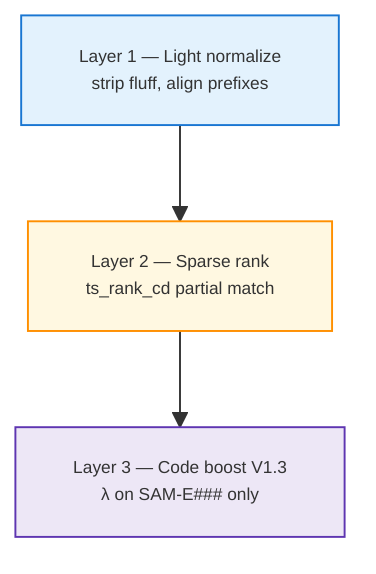

<h1 id="about-search-rrf" style="color:#0d47a1;font-size:1.55em;font-weight:700;border-bottom:3px solid #1976d2;padding-bottom:0.3em;margin-top:0;background:linear-gradient(90deg,#e3f2fd 0%,transparent 55%)">Hybrid ticket search: from vector-only to weighted RRF (a V1 → V1.3 evolution)</h1>

**Audience:** Engineers and product leaders building **repair-desk / retail** retrieval on **Postgres + pgvector**.  
**Purpose:** Publishable narrative — *why* each ticket-search version exists, *what* we measured, and *what* we implement next.  
**Status:** **living document** — Phase 7 implementation in flight ([`REFACTOR_RETAIL_TICKET_SEARCH_V1X.md`](../../cursor_gen/refactor_plans/wip/REFACTOR_RETAIL_TICKET_SEARCH_V1X.md)).  
**Last updated:** 2026-10-11  
**Context:** Samsung Australia retail **Second Brain** prototype (`second_brain` repo) — synthetic tickets, real **Gemini** embeddings, operator A/B on Postgres.

<!-- Formulas use HTML (not $LaTeX$) so tables and Cursor preview render correctly. -->
<style>
  .art-formula { background:#f3e5f5;border-left:5px solid #7e57c2;padding:14px 18px;margin:1em 0;font-size:1.08em;line-height:1.7;font-family:Georgia,'Times New Roman',serif;color:#311b92; }
  .art-formula-warm { background:#fff3e0;border-left:5px solid #fb8c00;padding:14px 18px;margin:1em 0;font-size:1.08em;line-height:1.7;font-family:Georgia,serif;color:#e65100; }
  .art-frac { display:inline-block;text-align:center;vertical-align:middle;line-height:1.1;margin:0 2px; }
  .art-frac-num { display:block;border-bottom:1px solid currentColor;padding:0 4px; }
  .art-frac-den { display:block;padding:0 4px;font-size:0.92em; }
</style>

<h2 id="about-outline" style="color:#3949ab;font-size:1.22em;font-weight:650;border-left:5px solid #5c6bc0;padding-left:10px;margin-top:1.1em;background:#e8eaf6">Document outline</h2>

1. [Executive summary](#1-exec) — one-screen takeaway for LinkedIn readers.
2. [The business problem](#2-problem) — paraphrase, twins, error codes.
3. [Two retrieval legs](#3-legs) — dense vs sparse; what Postgres runs today.
4. [Evolution timeline](#4-timeline) — visual journey V1 → V1.3.
5. [Version 0 — baseline V1 (vector only)](#5-v1) — FRU pattern; when it is enough.
6. [Version 1 — V1.1 equal hybrid (`rrf_normal`)](#6-v11) — why add FTS + RRF; demo-era lesson.
7. [Version 2 — V1.2 weighted fusion (`rrf_weighted`)](#7-v12) — 70/30 semantics-first.
8. [Version 3 — V1.3 code boost (`rrf_weighted_boosted`)](#8-v13) — λ on parsed codes.
9. [Mathematics of fusion](#9-math) — RRF, weights, boost, tie-break.
10. [Worked example: `eval-0006`](#10-example) — full query, tickets, scores.
11. [Lexical leg deep dive](#11-lexical) — normalize, `ts_rank_cd`, vs BM25.
12. [Eval design and metrics](#12-eval) — gold, strata, what “win” means.
13. [Results ledger](#13-results) — operator numbers; update after each run.
14. [Config reference](#14-config) — env modes and code paths.
15. [What comes after V1.3](#15-future) — reserved V1.x, not wiki “V2”.

<table>
<thead>
<tr style="background:#37474f;color:white"><th>Section color</th><th>Topics</th></tr>
</thead>
<tbody>
<tr><td style="background:#e3f2fd;color:#0d47a1"><strong>Blue</strong></td><td style="background:#f5f5f5">§1–4 — problem, legs, timeline</td></tr>
<tr><td style="background:#e0f2f1;color:#00695c"><strong>Teal</strong></td><td style="background:#f5f5f5">§5–8 — V1, V1.1, V1.2, V1.3 evolution</td></tr>
<tr><td style="background:#ede7f6;color:#4527a0"><strong>Purple</strong></td><td style="background:#f5f5f5">§9 — formulas (HTML boxes + stacked fractions)</td></tr>
<tr><td style="background:#fff3e0;color:#e65100"><strong>Orange</strong></td><td style="background:#f5f5f5">§10 — worked <code>eval-0006</code> example</td></tr>
<tr><td style="background:#e1f5fe;color:#0277bd"><strong>Light blue</strong></td><td style="background:#f5f5f5">§11–13 — lexical, eval, results</td></tr>
</tbody>
</table>

---

<h2 id="1-exec" style="color:#0d47a1;font-size:1.22em;font-weight:650;border-left:5px solid #1976d2;padding-left:10px;margin-top:1.1em;background:#e3f2fd">1. Executive summary</h2>

We are building **prior-case lookup** for agents: given a live intake (symptoms, model, sometimes an **error code**), return the best matching **resolved ticket**.

<table>
<thead>
<tr style="background:#1565c0;color:white"><th>Insight</th><th>Plain language</th></tr>
</thead>
<tbody>
<tr><td style="background:#e3f2fd"><strong>One leg is not enough</strong></td><td style="background:#fff3e0">Embeddings catch paraphrase; they can pick a <strong>wrong twin</strong> with the same symptoms. Keywords catch exact tokens (e.g. codes) but miss meaning if used naively.</td></tr>
<tr><td style="background:#e3f2fd"><strong>Fusion ≠ rerank</strong></td><td style="background:#e8f5e9">We <strong>merge two ranked lists</strong> (RRF). We do not run a second neural reranker on top (that would be a different, costlier stage).</td></tr>
<tr><td style="background:#e3f2fd"><strong>Stage the story</strong></td><td style="background:#ede7f6"><strong>V1.1</strong> = honest hybrid + rich FTS · <strong>V1.2</strong> = trust semantics more (70/30) · <strong>V1.3</strong> = strong code signal (λ) without requiring a filled DB column.</td></tr>
<tr><td style="background:#e3f2fd"><strong>Measure honestly</strong></td><td style="background:#ffebee">Hybrid “wins” only when <strong>fused rank #1 = gold</strong>, not when lexical merely saw gold somewhere in the list.</td></tr>
</tbody>
</table>

**Demo-era headline (2026-10-11, synthetic 67-case eval):** vector **0.567** → equal hybrid **0.672**, entirely from **`error_code`** stratum (7 hybrid-only wins). That proved the *mechanism*; **V1.1 refactor** moves lexical search toward **production-shaped** token overlap, accepting short-term **`error_code`** regression until **V1.3** λ ships.

---

<h2 id="2-problem" style="color:#0d47a1;font-size:1.22em;font-weight:650;border-left:5px solid #1976d2;padding-left:10px;margin-top:1.1em;background:#e3f2fd">2. The business problem</h2>

<h3 id="2-1-intake" style="color:#1565c0;font-size:1.05em;font-weight:600;margin-top:0.85em">2.1 What the agent sees</h3>

- **Customer language:** “Battery dies by noon,” not the exact phrase stored on last month’s ticket.
- **Structured hints:** model name (`Galaxy A15 5G`), sometimes **`Error code SAM-E176`** from a screenshot.
- **Historical record:** CRM-style stored text plus a **technician line** (`Technician log: diagnostic code …`) that may not appear in the customer’s wording.

<h3 id="2-2-twins" style="color:#1565c0;font-size:1.05em;font-weight:600;margin-top:0.85em">2.2 Twins (the hard case)</h3>

We deliberately seed **pairs** of tickets: **same underlying issue and symptom slots**, **different diagnostic codes**, and (in the demo fixture) **different intake shape** on the distractor:

- **Gold (even index):** `Customer reports: …` (CRM prose).
- **Twin (odd index):** `Need help: {model}, {issue}. …` (intake-shaped — closer to live query wording).

**Vector-only** can rank the **twin #1** while the agent’s query names the **gold’s code**. That is the scenario hybrid search must address — without cheating eval gold after seeing scores.



---

<h2 id="3-legs" style="color:#0d47a1;font-size:1.22em;font-weight:650;border-left:5px solid #1976d2;padding-left:10px;margin-top:1.1em;background:#e3f2fd">3. Two retrieval legs</h2>

<table>
<thead>
<tr style="background:#1565c0;color:white"><th>Leg</th><th>Engine</th><th>Indexed / queried text</th><th>Strength</th><th>Weakness</th></tr>
</thead>
<tbody>
<tr><td style="background:#e3f2fd"><strong>Vector</strong></td><td style="background:#fff3e0">pgvector + cosine on Gemini embeddings</td><td style="background:#fff3e0">Document: customer prose (tech line stripped at embed). Query: full live intake.</td><td style="background:#e8f5e9">Paraphrase, semantic neighborhood</td><td style="background:#ffebee">Twin with similar wording; codes diluted in long symptom text</td></tr>
<tr><td style="background:#e3f2fd"><strong>Lexical</strong></td><td style="background:#fff8e1">Postgres FTS — <code>tsvector</code>, <code>websearch_to_tsquery</code>, <code>ts_rank_cd</code></td><td style="background:#fff8e1"><code>search_text</code> — prefix stripped, <strong>tech line kept</strong></td><td style="background:#e8f5e9">Exact tokens (code, SKU fragments, city)</td><td style="background:#ffebee">Brittle if query is over-normalized or all-or-nothing AND queries</td></tr>
</tbody>
</table>

**Important:** Our operator path uses **`ts_rank_cd`**, not a Python BM25 library. It is **sparse, word-based ranking in Postgres** — BM25-*like* in spirit, not identical (see [§11](#11-lexical)).

---

<h2 id="4-timeline" style="color:#0d47a1;font-size:1.22em;font-weight:650;border-left:5px solid #1976d2;padding-left:10px;margin-top:1.1em;background:#e3f2fd">4. Evolution timeline</h2>



<table>
<thead>
<tr style="background:#1565c0;color:white"><th>Version</th><th>Config mode</th><th>One-line “why next?”</th></tr>
</thead>
<tbody>
<tr><td style="background:#e3f2fd"><strong>V1</strong></td><td style="background:#e8f5e9"><code>vector_only</code></td><td style="background:#fff3e0">Establish FRU-style semantic baseline; simplest ops story.</td></tr>
<tr><td style="background:#e3f2fd"><strong>V1.1</strong></td><td style="background:#e8f5e9"><code>rrf_normal</code></td><td style="background:#fff3e0">Lexical leg was empty on real paraphrase queries — hybrid must earn its keep with <strong>production FTS</strong>, not query hacks.</td></tr>
<tr><td style="background:#e3f2fd"><strong>V1.2</strong></td><td style="background:#fff3e0"><code>rrf_weighted</code></td><td style="background:#fff3e0">In repair intake, <strong>meaning</strong> usually beats keyword overlap; down-weight lexical noise on paraphrase-heavy traffic.</td></tr>
<tr><td style="background:#e3f2fd"><strong>V1.3</strong></td><td style="background:#ede7f6"><code>rrf_weighted_boosted</code></td><td style="background:#ede7f6">When a code is present, it is <strong>high value</strong> — add λ on parsed code only, without mandating a structured column in every ticket.</td></tr>
</tbody>
</table>

**Naming:** These are **ticket-plane V1.x** versions. **Samsung wiki automation** in the parent refactor is a separate **“Samsung V2”** slice — do not conflate.

---

<h2 id="5-v1" style="color:#00695c;font-size:1.22em;font-weight:650;border-left:5px solid #00897b;padding-left:10px;margin-top:1.1em;background:#e0f2f1">5. Version 0 — baseline V1 (vector only)</h2>

<h3 id="5-1-what" style="color:#00796b;font-size:1.05em;font-weight:600;margin-top:0.85em">5.1 What we shipped</h3>

- **pgvector** nearest-neighbor on **768-d** Gemini embeddings (`RETRIEVAL_DOCUMENT` / `RETRIEVAL_QUERY`).
- **`model_filter`** in eval (and eventually from open ticket in product) to scope candidates.
- Matches the common **“vector RAG on Postgres”** pattern (see industry write-ups on pgvector in support stacks).

<h3 id="5-2-why-stop" style="color:#00796b;font-size:1.05em;font-weight:600;margin-top:0.85em">5.2 Why V1 alone is insufficient</h3>

<table>
<thead>
<tr style="background:#1565c0;color:white"><th>Scenario</th><th>V1 behavior</th></tr>
</thead>
<tbody>
<tr><td style="background:#e3f2fd">Paraphrased symptoms</td><td style="background:#e8f5e9">Often good — this is the happy path.</td></tr>
<tr><td style="background:#e3f2fd">Twin with intake-shaped text</td><td style="background:#ffebee">Can rank **wrong ticket #1** despite correct code in query (see [§10](#10-example)).</td></tr>
<tr><td style="background:#e3f2fd">Explicit error code in query</td><td style="background:#fff3e0">Embedding may under-weight short code span vs long symptom field.</td></tr>
</tbody>
</table>

<h3 id="5-3-why-next" style="color:#00796b;font-size:1.05em;font-weight:600;margin-top:0.85em">5.3 Why we moved to V1.1</h3>

**Hypothesis:** A **second leg** that rewards **token overlap** (including technician-line codes) can **correct** vector mistakes when legs disagree — merged with **RRF** so we do not hand-tune a single distance threshold per stratum.

**Early operator pain:** First hybrid wiring returned **lexical lists empty** on paraphrase eval queries because indexed text and live query **did not share token shape**. That led to **FTS normalize** (`search_text`, `fts_query_text`) — war story #4 in repo — before we could trust any hybrid A/B.

---

<h2 id="6-v11" style="color:#00695c;font-size:1.22em;font-weight:650;border-left:5px solid #00897b;padding-left:10px;margin-top:1.1em;background:#e0f2f1">6. Version 1 — V1.1 equal hybrid (`rrf_normal`)</h2>

<h3 id="6-1-design" style="color:#00796b;font-size:1.05em;font-weight:600;margin-top:0.85em">6.1 Design intent (target after Phase 7)</h3>

1. **Light normalize** query and documents — strip CRM boilerplate, keep symptoms + model + location tokens in the FTS query.
2. **Do not** replace the entire live query with a single technician sentence (demo shortcut — see below).
3. **Fuse** vector and lexical ranks with **equal weights** (<strong>w<sub>v</sub> = w<sub>l</sub> = 0.5</strong>) as the **first** hybrid baseline.

<h3 id="6-2-demo" style="color:#00796b;font-size:1.05em;font-weight:600;margin-top:0.85em">6.2 Demo-era shortcut (what we ran before the refactor)</h3>

For screenshot-style eval rows (`Error code SAM-E176`), **`fts_query_text`** collapsed the query to:

```text
Technician log: diagnostic code SAM-E176.
```

Postgres then required documents to match that **AND** query — twins with **SAM-E193** dropped out; gold with **SAM-E176** survived. That is a **code lookup**, not general **lexical similarity**.

<table>
<thead>
<tr style="background:#1565c0;color:white"><th></th><th>Demo shortcut</th><th>V1.1 target (production-shaped)</th></tr>
</thead>
<tbody>
<tr><td style="background:#e3f2fd">Query tokens</td><td style="background:#ffebee">Tech line only</td><td style="background:#e8f5e9">Symptoms + model + code (light normalize)</td></tr>
<tr><td style="background:#e3f2fd">Twin disambiguation</td><td style="background:#e8f5e9">Hard filter via code AND</td><td style="background:#fff3e0">Partial overlap + **V1.3** code boost</td></tr>
<tr><td style="background:#e3f2fd">LinkedIn honesty</td><td style="background:#fff3e0">Great for proving RRF mechanism</td><td style="background:#e8f5e9">What we deploy to real intakes</td></tr>
</tbody>
</table>

<h3 id="6-3-mechanisms" style="color:#00796b;font-size:1.05em;font-weight:600;margin-top:0.85em">6.3 Extra mechanisms in the demo corpus</h3>

- **Embed split:** document vectors exclude tech line; FTS index **includes** it — asymmetry mirrors “customer embed vs cabinet keywords.”
- **Lexical tie-break:** when RRF scores tie, prefer the document **lexical rank #1** (fixes “vector #1 twin, lexical #1 gold, fusion picks twin by ticket id”).
- **Synthetic pairs + `error_code` stratum** — generation-time twins, not post-hoc CSV edits.

<h3 id="6-4-results" style="color:#00796b;font-size:1.05em;font-weight:600;margin-top:0.85em">6.4 Measured result (demo-era equal RRF)</h3>

| Mode | recall@1 | `error_code` (n=7) |
|------|----------|---------------------|
| V1 vector | **0.567** (38/67) | **0/7** |
| V1.1 hybrid (equal) | **0.672** (45/67) | **7/7** |

**Interpretation:** All **+7** hybrid-only wins were **`error_code`** rows — not paraphrase. Hybrid helped exactly where **vector picked twin** and **lexical isolated gold by code** (demo FTS rewrite).

<h3 id="6-5-why-next-v12" style="color:#00796b;font-size:1.05em;font-weight:600;margin-top:0.85em">6.5 Why we still want V1.2 after V1.1</h3>

Equal RRF treats **keyword leg** as loud as **semantic leg**. In our product judgment, most intakes are **story-first** (symptoms, context); keywords should **break ties**, not **dominate** when vector is confident. Hence **70/30** — implemented as V1.2, not a breaking change to V1.1’s role as the “fair hybrid baseline.”

**Expected tradeoff:** After rich FTS lands, **`error_code`** recall may **dip vs demo** until V1.3 — **accepted** (parent plan **D18**).

---

<h2 id="7-v12" style="color:#00695c;font-size:1.22em;font-weight:650;border-left:5px solid #00897b;padding-left:10px;margin-top:1.1em;background:#e0f2f1">7. Version 2 — V1.2 weighted fusion (`rrf_weighted`)</h2>

<h3 id="7-1-belief" style="color:#00796b;font-size:1.05em;font-weight:600;margin-top:0.85em">7.1 Product belief</h3>

> **Semantic similarity is usually more important than literal word overlap** for repair intakes — but we still want lexical signal in the mix.

So we scale each leg’s RRF contributions:

<div class="art-formula-warm">
  <strong>w<sub>v</sub> = 0.7</strong> &nbsp;&nbsp;·&nbsp;&nbsp; <strong>w<sub>l</sub> = 0.3</strong>
</div>

(Same formula as [§9](#9-math); only the weights change.)

<h3 id="7-2-not" style="color:#00796b;font-size:1.05em;font-weight:600;margin-top:0.85em">7.2 What 70/30 does *not* mean</h3>

<table>
<thead>
<tr style="background:#1565c0;color:white"><th>Myth</th><th>Reality</th></tr>
</thead>
<tbody>
<tr><td style="background:#e3f2fd">“Vector always wins”</td><td style="background:#e8f5e9">If vector ranks twin **#1** and lexical ranks gold **#1**, both legs contribute; 70/30 **biases** toward vector’s top choice — hybrid can still miss.</td></tr>
<tr><td style="background:#e3f2fd">“We changed k or rerank order”</td><td style="background:#e8f5e9">We scale **RRF terms** per leg; **k = 60** unchanged; no cross-encoder rerank.</td></tr>
</tbody>
</table>

<h3 id="7-3-why-next-v13" style="color:#00796b;font-size:1.05em;font-weight:600;margin-top:0.85em">7.3 Why V1.3 follows V1.2</h3>

Down-weighting lexical mass **helps paraphrase** but **hurts** the case where **only the code** separates twins. V1.3 adds a **surgical** boost on **`SAM-E###`** — not on the whole lexical leg — so codes can **punch above** 30% weight when present.

---

<h2 id="8-v13" style="color:#00695c;font-size:1.22em;font-weight:650;border-left:5px solid #00897b;padding-left:10px;margin-top:1.1em;background:#e0f2f1">8. Version 3 — V1.3 code boost (`rrf_weighted_boosted`)</h2>

<h3 id="8-1-policy" style="color:#00796b;font-size:1.05em;font-weight:600;margin-top:0.85em">8.1 Policy (locked for this iteration)</h3>

- **Parse** `\bSAM-E\d{3}\b` from query and from stored text — **no mandatory** `diagnostic_code` column (real tickets often omit structured fields).
- **λ = 10** default (`RETAIL_LEXICAL_CODE_BOOST`) — **prefer strong over weak** code influence; fixed default, no holdout sweep this iteration.
- Apply λ **only** to the **code-specific** signal, on top of **V1.2** 70/30 fusion.

<h3 id="8-2-stack" style="color:#00796b;font-size:1.05em;font-weight:600;margin-top:0.85em">8.2 Three-layer lexical story (article framing)</h3>



This matches industry pattern: **rich text BM25/FTS** + **entity boost** (here, regex-parsed code instead of a facet column).

<h3 id="8-3-limits" style="color:#00796b;font-size:1.05em;font-weight:600;margin-top:0.85em">8.3 Known limitations (explicit)</h3>

- **Negation** (“not caused by SAM-E176”) — low priority for templated intakes; not solved in V1.3.
- **λ too high** — could overweight a mistyped code; we start at 10 and tune in a future **V1.x** if prod telemetry demands it.

---

<h2 id="9-math" style="color:#4527a0;font-size:1.22em;font-weight:650;border-left:5px solid #7e57c2;padding-left:10px;margin-top:1.1em;background:#ede7f6">9. Mathematics of fusion</h2>

<h3 id="9-1-rrf" style="color:#5e35b1;font-size:1.05em;font-weight:600;margin-top:0.85em">9.1 Reciprocal rank fusion (single leg contribution)</h3>

For document (ticket) <strong>d</strong>, appear at rank <strong>r</strong> in a ranked list (1 = best), with classic smoothing constant <strong>k = 60</strong>:

<div class="art-formula">
  RRF<sub>leg</sub>(d) = Σ<sub>ℓ ∈ {vector, lexical}</sub> &nbsp; w<sub>ℓ</sub> ·
  <span class="art-frac"><span class="art-frac-num">1</span><span class="art-frac-den">k + r<sub>ℓ</sub>(d)</span></span>
</div>

If <strong>d</strong> is **absent** from a leg’s list, that leg contributes **0** for that document.

<h3 id="9-2-weights" style="color:#5e35b1;font-size:1.05em;font-weight:600;margin-top:0.85em">9.2 Leg weights by version</h3>

<table>
<thead>
<tr style="background:#4527a0;color:white"><th>Version</th><th>w<sub>v</sub> (vector)</th><th>w<sub>l</sub> (lexical)</th></tr>
</thead>
<tbody>
<tr><td style="background:#e3f2fd">V1.1 <code>rrf_normal</code></td><td style="background:#e8f5e9"><strong>0.5</strong></td><td style="background:#e8f5e9"><strong>0.5</strong></td></tr>
<tr><td style="background:#e3f2fd">V1.2 / V1.3</td><td style="background:#fff3e0"><strong>0.7</strong></td><td style="background:#fff3e0"><strong>0.3</strong></td></tr>
</tbody>
</table>

<h3 id="9-3-boost" style="color:#5e35b1;font-size:1.05em;font-weight:600;margin-top:0.85em">9.3 V1.3 code boost term</h3>

Let <strong>c(q)</strong> be the parsed code from query <strong>q</strong> (or empty). Let <strong>match(d, c)</strong> be 1 if ticket <strong>d</strong>’s indexed text contains the same code, else 0.

<div class="art-formula">
  score(d) = RRF<sub>vector</sub>(d) + RRF<sub>lexical</sub>(d) + λ · match(d, c(q)) &nbsp; when c(q) is present
</div>

Default <strong>λ = 10</strong>. Implementation may equivalently add weighted RRF mass from a **code-only** lexical sub-query — behavior must match this intent.

<h3 id="9-4-sort" style="color:#5e35b1;font-size:1.05em;font-weight:600;margin-top:0.85em">9.4 Sorting and tie-break</h3>

Sort documents by:

1. **Descending** score(d)
2. On tie: **ascending** lexical rank r<sub>l</sub>(d) (missing → large sentinel)
3. Then stable **ticket_id**

---

<h2 id="10-example" style="color:#e65100;font-size:1.22em;font-weight:650;border-left:5px solid #fb8c00;padding-left:10px;margin-top:1.1em;background:#fff3e0">10. Worked example: `eval-0006`</h2>

<h3 id="10-1-query" style="color:#ef6c00;font-size:1.05em;font-weight:600;margin-top:0.85em">10.1 Live query (eval)</h3>

```text
Need help: Galaxy A15 5G, mobile data drops when switching to 5G. Battery drops from full to half within two hours. Error code SAM-E176.
```

**Gold:** `T-0042-000006` · **Twin:** `T-0042-000007` · **Model filter:** `Galaxy A15 5G`

<h3 id="10-2-stored" style="color:#ef6c00;font-size:1.05em;font-weight:600;margin-top:0.85em">10.2 Stored ticket text (abbreviated)</h3>

**Gold `…000006`:**

```text
Customer reports: mobile data drops when switching to 5G on Galaxy A15 5G in Sydney, NSW. … Battery drops from full to half within two hours. Technician log: diagnostic code SAM-E176.
```

**Twin `…000007`:**

```text
Need help: Galaxy A15 5G, mobile data drops when switching to 5G. … Battery drops from full to half within two hours. Technician log: diagnostic code SAM-E193.
```

<h3 id="10-3-demo-lex" style="color:#ef6c00;font-size:1.05em;font-weight:600;margin-top:0.85em">10.3 Demo-era lexical query (what Postgres FTS saw)</h3>

```text
Technician log: diagnostic code SAM-E176.
```

Twin **fails** `@@`; gold **matches** → lexical top-1 = gold.

<h3 id="10-4-ranks" style="color:#ef6c00;font-size:1.05em;font-weight:600;margin-top:0.85em">10.4 Leg ranks and equal-RRF scores (k = 60, w<sub>v</sub> = w<sub>l</sub> = 0.5)</h3>

<table>
<thead>
<tr style="background:#e65100;color:white"><th>Ticket</th><th>Vector rank r<sub>v</sub></th><th>Lexical rank r<sub>l</sub></th><th>1/(k+r<sub>v</sub>)</th><th>1/(k+r<sub>l</sub>)</th><th>Fused (equal)</th></tr>
</thead>
<tbody>
<tr><td style="background:#e3f2fd"><strong>Gold …006</strong></td><td style="background:#fff3e0">4</td><td style="background:#e8f5e9">1</td><td style="background:#fff3e0"><strong>1/64</strong></td><td style="background:#e8f5e9"><strong>1/61</strong></td><td style="background:#e8f5e9"><strong>0.0320</strong></td></tr>
<tr><td style="background:#e3f2fd">Twin …007</td><td style="background:#ffebee">1</td><td style="background:#ffebee">—</td><td style="background:#ffebee"><strong>1/61</strong></td><td style="background:#ffebee"><strong>0</strong></td><td style="background:#ffebee"><strong>0.0164</strong></td></tr>
</tbody>
</table>

<div class="art-formula-warm">
  score<sub>gold</sub> = 0.5 · <span class="art-frac"><span class="art-frac-num">1</span><span class="art-frac-den">64</span></span>
  + 0.5 · <span class="art-frac"><span class="art-frac-num">1</span><span class="art-frac-den">61</span></span>
  ≈ <strong>0.0320</strong><br>
  score<sub>twin</sub> = 0.5 · <span class="art-frac"><span class="art-frac-num">1</span><span class="art-frac-den">61</span></span>
  ≈ <strong>0.0164</strong>
</div>

| Mode | Top-1 | vs gold |
|------|-------|---------|
| V1 vector | Twin …007 | **Miss** — embedding favors intake-shaped twin |
| V1.1 hybrid (demo FTS) | Gold …006 | **Hit** — lexical code path + fusion |

**Lesson for readers:** Hybrid value appeared only because **fused #1 = gold**, not because lexical “saw” gold at some lower rank while vector stayed on twin.

---

<h2 id="11-lexical" style="color:#0277bd;font-size:1.22em;font-weight:650;border-left:5px solid #0288d1;padding-left:10px;margin-top:1.1em;background:#e1f5fe">11. Lexical leg deep dive</h2>

<h3 id="11-1-pipeline" style="color:#0288d1;font-size:1.05em;font-weight:600;margin-top:0.85em">11.1 Pipeline</h3>

```mermaid
graph LR
  Q0[Live query] --> NQ[fts_query_text]
  D0[Stored customer_query_text] --> NS[search_text_for_fts]
  NS --> TSV[query_tsv = to_tsvector]
  NQ --> TSQ[websearch_to_tsquery]
  TSQ --> M[@@ match filter]
  TSV --> M
  M --> R[ts_rank_cd DESC]

  style Q0 fill:#e3f2fd,stroke:#1976d2,stroke-width:1px,font-size:9px
  style D0 fill:#e3f2fd,stroke:#1976d2,stroke-width:1px,font-size:9px
  style R fill:#e8f5e9,stroke:#2e7d32,stroke-width:1px,font-size:9px
```

<h3 id="11-2-bm25" style="color:#0288d1;font-size:1.05em;font-weight:600;margin-top:0.85em">11.2 Is this BM25?</h3>

**No** — operator path uses **`ts_rank_cd`**. BM25 is a specific formula (Lucene / Elasticsearch / `rank_bm25` in Python). **`ts_rank_cd`** is Postgres **coverage-density** ranking — correlated with TF‑IDF-style sparse scoring, **not bit-identical**.

**Practical stance:** Stay on **`ts_rank_cd`** for V1.1–V1.3 unless A/B shows ordering failures that tuning cannot fix; then consider a BM25 extension or external search engine as **V1.x**, not a blocker for the evolution story.

<h3 id="11-3-target" style="color:#0288d1;font-size:1.05em;font-weight:600;margin-top:0.85em">11.3 Target lexical similarity (V1.1+)</h3>

1. **Drop fluff** — prefixes, case refs; keep content tokens.
2. **Score partial overlap** — `ts_rank_cd` rewards matching terms without requiring the demo’s single-line code rewrite.
3. **Layer code boost (V1.3)** — treat `SAM-E###` like a high-value entity, not the entire query.

---

<h2 id="12-eval" style="color:#0277bd;font-size:1.22em;font-weight:650;border-left:5px solid #0288d1;padding-left:10px;margin-top:1.1em;background:#e1f5fe">12. Eval design and metrics</h2>

<h3 id="12-1-gold" style="color:#0288d1;font-size:1.05em;font-weight:600;margin-top:0.85em">12.1 Strict gold</h3>

Each eval row: **`expected_ticket_ids = [source_ticket_id]`** — generators set gold; harness **never** copies top-k back into JSONL after a failed run.

**recall@1 (strict):** fraction of rows where **rank #1** equals gold.

<h3 id="12-2-strata" style="color:#0288d1;font-size:1.05em;font-weight:600;margin-top:0.85em">12.2 Strata (current 67-row fixture)</h3>

<table>
<thead>
<tr style="background:#1565c0;color:white"><th>Stratum</th><th>Intent</th><th>Count (demo run)</th></tr>
</thead>
<tbody>
<tr><td style="background:#e3f2fd"><code>paraphrase</code></td><td style="background:#fff3e0">Everyday wording vs CRM stored text</td><td style="background:#fff3e0">55</td></tr>
<tr><td style="background:#e3f2fd"><code>literal_token</code></td><td style="background:#e8f5e9">Issue text contains device token (e.g. SM-…)</td><td style="background:#e8f5e9">5</td></tr>
<tr><td style="background:#e3f2fd"><code>error_code</code></td><td style="background:#ede7f6">Screenshot intake with explicit SAM-E###</td><td style="background:#ede7f6">7</td></tr>
</tbody>
</table>

<h3 id="12-3-abcd" style="color:#0288d1;font-size:1.05em;font-weight:600;margin-top:0.85em">12.3 A/B/C/D protocol (Phase 7 target)</h3>

Same Postgres snapshot, same embeddings — only **`RETAIL_TICKET_SEARCH_MODE`** changes:

```text
vector_only → rrf_normal → rrf_weighted → rrf_weighted_boosted
```

Report **overall** and **by stratum**; promotion rule **D6** still cares about **paraphrase false reuse**, not headline alone.

---

<h2 id="13-results" style="color:#0277bd;font-size:1.22em;font-weight:650;border-left:5px solid #0288d1;padding-left:10px;margin-top:1.1em;background:#e1f5fe">13. Results ledger</h2>

**Corpus:** `COUNT=90`, `SEED=42` → **67** eval rows · **Gemini** embed · **AU** market FTS (`english`).

<h3 id="13-1-demo" style="color:#0288d1;font-size:1.05em;font-weight:600;margin-top:0.85em">13.1 Shipped — demo-era equal hybrid (2026-10-11)</h3>

<table>
<thead>
<tr style="background:#1565c0;color:white"><th>Mode</th><th>recall@1</th><th>paraphrase</th><th>literal_token</th><th>error_code</th></tr>
</thead>
<tbody>
<tr><td style="background:#e3f2fd">V1 vector</td><td style="background:#fff3e0"><strong>0.567</strong></td><td style="background:#fff3e0">0.60</td><td style="background:#e8f5e9">1.00</td><td style="background:#ffebee">0.00</td></tr>
<tr><td style="background:#e3f2fd">V1.1 equal hybrid</td><td style="background:#e8f5e9"><strong>0.672</strong></td><td style="background:#fff3e0">0.60</td><td style="background:#e8f5e9">1.00</td><td style="background:#e8f5e9">1.00</td></tr>
</tbody>
</table>

**Hybrid-only wins:** 7 rows, all **`error_code`** (`eval-0006`, `eval-0018`, `eval-0030`, `eval-0042`, `eval-0054`, `eval-0066`, `eval-0078`).

Artifacts: `scripts/retail/eval/reports/pg_baseline_v1.json`, `pg_ab_v1_v11.json`, `phase6_operator_log.md`.

<h3 id="13-2-v1x" style="color:#0288d1;font-size:1.05em;font-weight:600;margin-top:0.85em">13.2 Production-shaped V1.1 / V1.2 / V1.3 (2026-10-12)</h3>

<table>
<thead>
<tr style="background:#0277bd;color:white"><th>Mode</th><th>recall@1</th><th>paraphrase</th><th>literal_token</th><th>error_code</th><th>Report</th></tr>
</thead>
<tbody>
<tr><td style="background:#e3f2fd"><code>vector_only</code></td><td style="background:#fff3e0"><strong>0.567</strong></td><td style="background:#fff3e0">0.60</td><td style="background:#e8f5e9">1.00</td><td style="background:#ffebee">0.00</td><td style="background:#f5f5f5"><code>pg_baseline_v1.json</code></td></tr>
<tr><td style="background:#e3f2fd"><code>rrf_normal</code></td><td style="background:#fff3e0"><strong>0.567</strong></td><td style="background:#fff3e0">0.60</td><td style="background:#e8f5e9">1.00</td><td style="background:#ffebee">0.00</td><td style="background:#f5f5f5"><code>pg_ab_v1_1_normal.json</code></td></tr>
<tr><td style="background:#e3f2fd"><code>rrf_weighted</code></td><td style="background:#fff3e0"><strong>0.567</strong></td><td style="background:#fff3e0">0.60</td><td style="background:#e8f5e9">1.00</td><td style="background:#ffebee">0.00</td><td style="background:#f5f5f5"><code>pg_ab_v1_2_weighted.json</code></td></tr>
<tr><td style="background:#e3f2fd"><code>rrf_weighted_boosted</code></td><td style="background:#e8f5e9"><strong>0.672</strong></td><td style="background:#fff3e0">0.60</td><td style="background:#e8f5e9">1.00</td><td style="background:#e8f5e9">1.00</td><td style="background:#f5f5f5"><code>pg_ab_v1_3_boosted.json</code></td></tr>
</tbody>
</table>

**Read:** Rich FTS + equal or 70/30 fusion **does not lift** `error_code` until **V1.3 λ** — as expected (**D18**). **V1.3** recovers **7/7** `error_code` and overall **0.672**, matching demo-era hybrid headline with production-shaped lexical on other strata.

Run: `cursor_gen/retail_v11_prep/05_run_abcd_postgres.sh`.

**Maintenance:** After each operator run, update this table and add **“what surprised us”** under the matching version section above.

---

<h2 id="14-config" style="color:#455a64;font-size:1.22em;font-weight:650;border-left:5px solid #78909c;padding-left:10px;margin-top:1.1em;background:#eceff1">14. Config reference</h2>

```bash
export RETAIL_TICKET_SEARCH_MODE=vector_only          # V1
export RETAIL_TICKET_SEARCH_MODE=rrf_normal           # V1.1
export RETAIL_TICKET_SEARCH_MODE=rrf_weighted         # V1.2
export RETAIL_TICKET_SEARCH_MODE=rrf_weighted_boosted # V1.3
export RETAIL_LEXICAL_CODE_BOOST=10                   # V1.3 λ

# Legacy until migration:
# RETAIL_TICKET_HYBRID_SEARCH=0 → vector_only
# RETAIL_TICKET_HYBRID_SEARCH=1 → rrf_normal
```

**SQL lexical leg (shape):**

```sql
SELECT ticket_id
FROM service_queries
WHERE status = 'resolved'
  AND model = $model_filter
  AND query_tsv @@ websearch_to_tsquery('english', $fts_query_text)
ORDER BY ts_rank_cd(
  query_tsv,
  websearch_to_tsquery('english', $fts_query_text)
) DESC
LIMIT $limit;
```

**Code:** `scripts/retail/retail_brain/pg_search.py`, `rrf.py`, `text_normalize.py`, `embed_service_queries.py`.

---

<h2 id="15-future" style="color:#455a64;font-size:1.22em;font-weight:650;border-left:5px solid #78909c;padding-left:10px;margin-top:1.1em;background:#eceff1">15. What comes after V1.3</h2>

Reserve **V1.4, V1.5, …** for ticket-plane tweaks (tunable w<sub>v</sub>/w<sub>l</sub>, phrase rules, optional BM25 extension, cross-encoder rerank experiments) — each with the same article pattern: **hypothesis → change → measured stratum table**.

**Samsung wiki automation** remains a **separate program version** in the parent refactor (exports, themes, cron) — not numbered as V1.x.

---

<h2 id="linkedin-blurb" style="color:#c62828;font-size:1.22em;font-weight:650;border-left:5px solid #e53935;padding-left:10px;margin-top:1.1em;background:#ffebee">Optional LinkedIn pull-quote</h2>

> We staged hybrid search for repair tickets: **vector-only baseline → equal RRF → 70/30 semantics-first → code boost λ** — measuring each step on frozen gold, not tuning eval to match top-k. Demo hybrid beat vector **0.67 vs 0.57** entirely on **error-code** rows where embeddings picked the wrong twin; production-shaped FTS and weighted fusion are the next honest chapters.

*Update this blurb when §13.2 fills in.*
